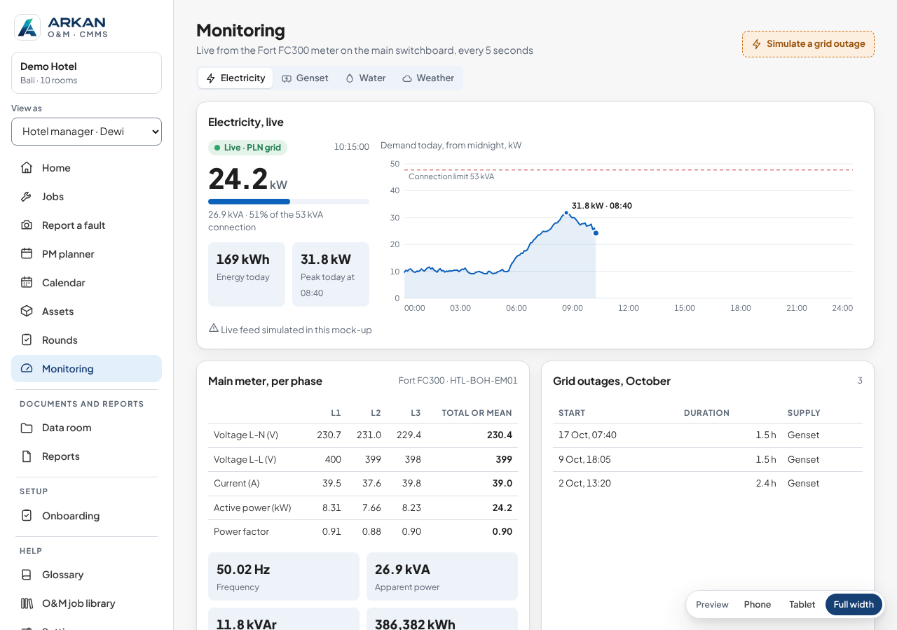

# What already exists, and what we reuse

Search of 30 October 2026: the Arkan repositories first, then open-source platforms, dashboards and firmware.
Purpose: build as little as possible from scratch, for the ingest script, the monitoring platform's dashboard and the logger.

## 1. Requirements the choice must meet

From the owner's answers (PLAN.md §3):
- **R1** Same logins as the other Arkan dashboards: Caddy `basicauth` with `/opt/edge/secrets/hub-users.caddy`.
- **R2** Data in a **dedicated folder, one subfolder per site**.
- **R3** Its own repository (`arkan-monitoring`), separate from `arkan-cmms`.
- **R4** Runs on `hermes-vps` beside the Hub, the CMMS, Hermes and other services: light, loopback port, no `sudo` by sessions.
- **R5** Alerts by **WhatsApp through Hermes**.
- **R6** Multi-site and multi-device later; Arkan look; English and Indonesian.
- **R7** The `arkan-cmms` Monitoring page can read the real data.

## 2. Arkan repositories

| Repository | What we reuse | Where |
|---|---|---|
| **arkan-cmms** | **The Monitoring page, already built** (screenshot below): live kW against the connection limit, demand today 00:00 to 24:00 with the peak, energy today, the per-phase table of the Fort meter (V L-N, V L-L, A, kW, PF, Hz, kVA, kVAr, kWh), grid outages, genset tab, weather tab with the forecast (MET Norway, BMKG), temperature and humidity charts with dew point, glossary EN + ID. **The VPS deploy set** for hermes-vps | `cmms-demo/src/features.js` (views), `cmms-app/server/server.py` (weather API), `cmms-app/deploy/` (Dockerfile, compose on loopback, `sites/cmms.caddy` with the shared login, `update-vps.sh`), `arkan-ui/` (UI kit) |
| **arkan-hub** | Trusted-proxy `X-Auth-User`, `/health`, audit log, tag-based update with rollback, nightly backup, smoke tests, the VPS install guide (layout of `/opt/edge`, `/srv`) | `hub/access.py`, `deploy/update.sh`, `deploy/backup.sh`, `docs/smoke-tests.md`, `deploy/VPS-INSTALL-GUIDE.md` |
| **arkan-solar-desk** | **The Hermes integration pattern**: settings block `hermes`, sending off by default, every send logged | `server/settings.py`, `docs/hermes.md` |
| arkan-skills-V1 | Which KPIs to show and how to compute them (energy efficiency, power quality, PF correction, monitoring) | `arkan-engineering/skills/senior-electrical-elv-engineer/references/calc-energy-efficiency.md`, `calc-power-quality-pfc.md`, `solar-pv-energy-storage/references/calc-monitoring.md` |

Rendered from `arkan-cmms` at 1280 px on 30 October 2026. A private copy is also on claude.ai: https://claude.ai/artifact/P8iE82nr8zx2iycsPxp1QS (Monitoring in the side bar).

**What none of them has:** an endpoint that receives readings, a store for time series, a device registry, alerts, or logger firmware.

## 3. Open-source platforms and dashboards

| Option | What it is | Fit | Against |
|---|---|---|---|
| **Emoncms** (OpenEnergyMonitor) | Energy logging and dashboards: inputs by HTTP or MQTT, processing chains, feeds, a dashboard builder, ready "apps" (My Electric). PHP 8, MariaDB, Redis, Mosquitto; Docker all-in-one image. AGPL-3.0. Active | The closest energy-specific product. An ESP32 can post straight to its input API. Could be running in a day | Its own user accounts (fails R1 without a second login), its own look (R6), feeds stored in its own format, not a folder per site (R2), four more services on the VPS (R4), no WhatsApp/Hermes link (R5), and the CMMS would need an adapter (R7) |
| **Open Energy Dashboard (OED)** | Campus energy dashboard: meters, **groups of meters (buildings, campuses)**, comparison, maps, cost. Node.js, PostgreSQL, Plotly; Docker. MPL-2.0 | Good model for **phase 2** (several sites, group totals, site-by-site comparison) | Built for interval data loaded from CSV or pulled from specific meter types, not live readings. PostgreSQL, its own login, its own look (R1, R2, R6) |
| **ThingsBoard CE** | Full IoT platform: devices, multi-tenant, rule engine, alarms, dashboards. Java; Apache-2.0 | Covers everything, including alarms | Heavy: 4 to 8 GB RAM advised (R4), its own login and tenant model (R1), not a folder per site (R2), a large system to learn and secure |
| **Grafana + InfluxDB / VictoriaMetrics** | Generic time-series dashboards | Grafana can take the login from the proxy header (auth proxy), so R1 is possible. Fast charts | A database instead of folders (R2), not the Arkan look (R6), alerts need a webhook bridge to Hermes, two more services (R4) |
| Home Assistant (Energy dashboard) | Home automation with an energy view | Excellent for one building | Single-home by design, not multi-site |
| IAMMETER, vendor clouds | Vendor meters + cloud or Docker server | | Tied to the vendor's hardware |

## 4. Firmware and libraries for the logger

| Option | Fit | Against |
|---|---|---|
| **ESPHome** (`modbus_controller`, AHT/HTU/SHT sensors, DS3231, OTA, web page) | **Fastest way to read the meter**: a YAML file, no code. Ideal to verify the FCN300 registers on the bench in an hour | No store-and-forward to the SD card: readings are lost while WiFi is down. Its native transport is Home Assistant or MQTT, not our HTTPS ingest |
| Tasmota | Modbus energy drivers, SD card on ESP32 | Same gaps as ESPHome, less flexible |
| **Arduino + proven libraries** (PlatformIO) | Full control of the SD queue, the payload and OTA | More code, but standard libraries carry most of it: `eModbus` (Modbus RTU master), `RTClib` (DS3231), the sensor's Adafruit library, `SdFat`, `ArduinoJson`, `esp_https_ota`, a WiFi setup portal |

## 5. Hermes for WhatsApp alerts (confirmed in the Hermes Agent repository)

Hermes Agent has a **webhook platform with a direct delivery mode**: `deliver: whatsapp` with `deliver_only: true` sends the rendered text **as it is, without running the agent** (no LLM cost, sub-second). A POST to `http://<vps>:8644/webhooks/<route>`, signed with HMAC-SHA256 (`X-Webhook-Signature-V2` + `X-Webhook-Timestamp`), answers 200 when delivered and 502 when WhatsApp refused it, so the platform can retry.
Source: `website/docs/user-guide/messaging/webhooks.md` in `NousResearch/hermes-agent`, section "Direct Delivery Mode".

To check on the VPS, with the owner: which Hermes version runs, whether its webhook platform is on, and that port 8644 is not open to the internet.

## 6. Recommendation

**Reuse the Arkan pieces, take ideas from OED, use ESPHome only as a bench tool.**

1. **Platform (`arkan-monitoring`):**
   - copy the deploy set and UI kit from `arkan-cmms`, and the login, health, update and backup pattern from `arkan-hub`;
   - move the **CMMS Monitoring views** over, fed by the real API;
   - write the ingest, the per-site folders, the device registry and the alerts (the only new parts).
   - It meets R1 to R7 with nothing new on the VPS but one container.
2. **Phase 2 ideas from OED:** groups of meters, site comparison, cost per kWh, a map of sites.
3. **Alerts:** a Hermes webhook route in direct delivery mode to the Arkan WhatsApp group (the solar-desk rule: sending off until the owner turns it on).
4. **Logger:** Arduino + the libraries above for production (it needs the SD queue). **ESPHome on the same board for the first meter test**, to confirm the registers before the production firmware is finished.

**If speed matters more than R1, R2 and the Arkan look,** Emoncms is the off-the-shelf alternative: an ESP32 posting to it could show Adab's data within days. The cost is a second login and a data store that is not a folder per site, and moving to the Arkan platform later would mean migrating the data.

## 7. Decision of 30 October 2026: Open Energy Dashboard

The owner chose **Open Energy Dashboard (OED) as the reference for the platform**, and set the Arkan design (CMMS, Hub) aside until a later integration. §6 above is kept as the earlier recommendation. The plan now deploys OED as the dashboard, fed by our ingest service (PLAN.md §4.2, §5.3).

### Can OED show temperature and humidity? Yes, with limits

Checked in the OED source code (`OpenEnergyDashboard/OED`, branch `development`, commit `74a1c63` of 28 October 2026), because its website is not reachable from the cloud session:

| Point | What the code says | Where |
|---|---|---|
| Unit types | Every unit is `quantity` (summed, like kWh), `flow` (a rate, like kW) or **`raw`** (neither summed nor rated: averaged) | `src/server/models/Unit.js`, `unitRepresentType` |
| Temperature | **Celsius and Fahrenheit are standard OED units, type `raw`**, with a built-in Celsius to Fahrenheit conversion. They are created hidden (`displayable: none`); the admin makes them visible | `src/server/util/insertData.js` |
| Humidity | **No built-in unit.** The admin adds one (for example "% RH", type `raw`) on the Units page; OED allows any unit | `src/client/app/components/unit/` |
| Line graph | Works for raw units (there are server tests for raw line readings). OED averages points when the range is long; "Redraw" brings back full resolution | `src/server/test/web/readingsLineMeterRaw.js` |
| 3D and radar graphs | **Not in OED v1.0.0** (the pinned release: line, bar, compare, map only); on OED's development branch they work for raw units | `types/redux/graph.ts` (v1.0.0), `GraphicRateMenuComponent.tsx` (development) |
| **Bar graph** | **Not for raw units**: "Cannot create bar graph on raw units such as temperature" | `BarChartComponent.tsx`, `translations/data.ts` |
| **Compare graph** | **Not for raw units**: "Cannot create comparison graph on raw units such as temperature" | `CompareBarComponent.tsx` |
| Data in | CSV upload by API: `POST /api/csv/readings` with `meterName` (OED v1.0.0; `meterIdentifier` only on OED's development branch), `email` and `password` of an OED user with the CSV role, `cumulative`, `headerRow`, `refreshReadings` and more | `src/server/routes/csv.js`, `services/csvPipeline/` |

**In practice for Adab:**
- Room temperature and humidity are two OED meters with raw units, shown as **line graphs over time** (day, week, month, with zoom) and, after an OED upgrade, in 3D (hour by day).
- No daily bar chart and no "this week vs last week" comparison for them. If wanted, the ingest service can also write a daily min/max file. OED cannot show it as a bar either, so it would go on our status page.
- Energy (kWh) gets everything: line (as kW), bar (per day, week), compare, map (3D after an OED upgrade).

### What OED does not do (kept in our ingest service)
- Receive live posts from the logger: OED takes CSV uploads, so the service pushes every 5 minutes.
- Alerts: none in OED; the service sends them through Hermes to the WhatsApp group.
- A live "now" view: OED graphs readings once uploaded; the status page shows the latest values.
- Timezones: OED stores times without a zone; the service sends WITA local time.

## Sources

- Emoncms: https://github.com/emoncms/emoncms
- Open Energy Dashboard: https://github.com/OpenEnergyDashboard/OED (source read at commit 74a1c63), https://openenergydashboard.github.io/features.html
- ThingsBoard CE requirements (third-party guides): https://wz-it.com/en/knowledge/iot/install-thingsboard/, https://zbotic.in/thingsboard-iot-dashboard-self-hosted-setup-guide/
- ESPHome Modbus controller: https://esphome.io/components/sensor/modbus_controller/; three-phase example on an ESP32-S3: https://gist.github.com/jabbas/55ed902656939e1c44010916668dd6db
- Hermes Agent: https://github.com/NousResearch/hermes-agent (webhooks doc in the repository)
- IAMMETER self-hosted: https://www.iammeter.com/blog/self-hosted-integration
- Not reachable from the cloud session (network allow-list): fortindo.id, openenergydashboard.github.io, hermes-agent.nousresearch.com
