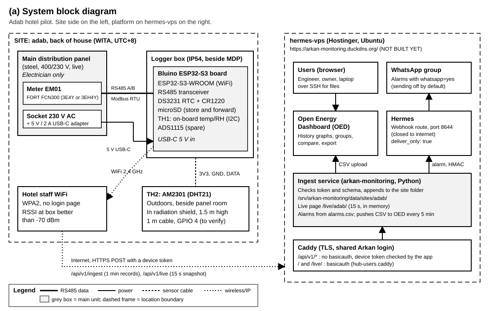
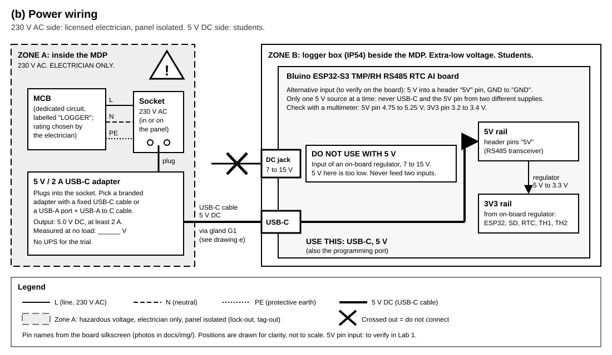
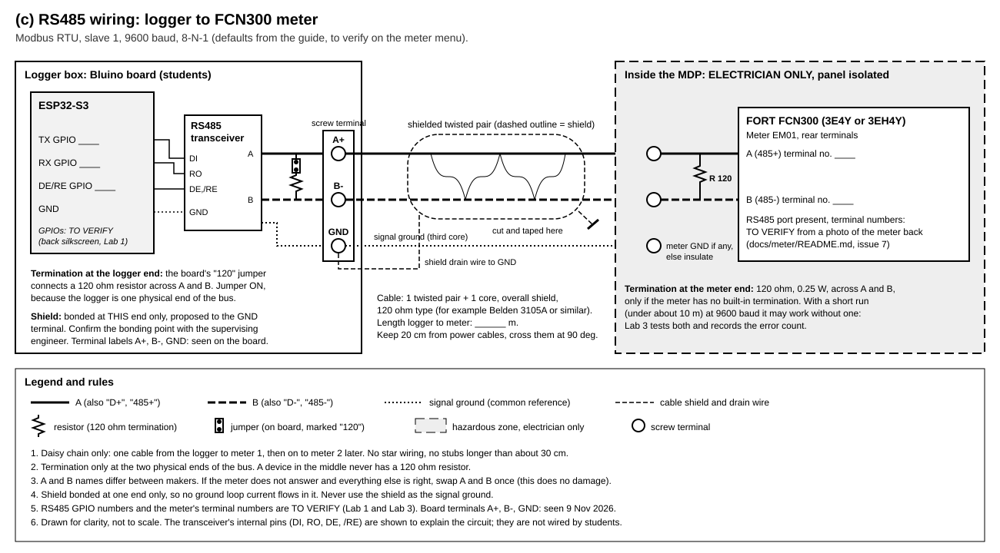
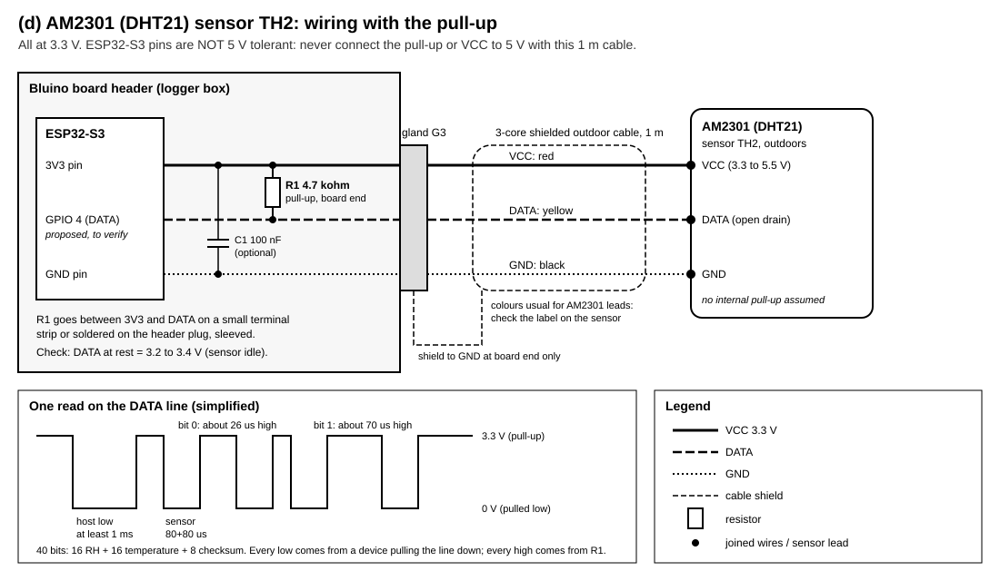
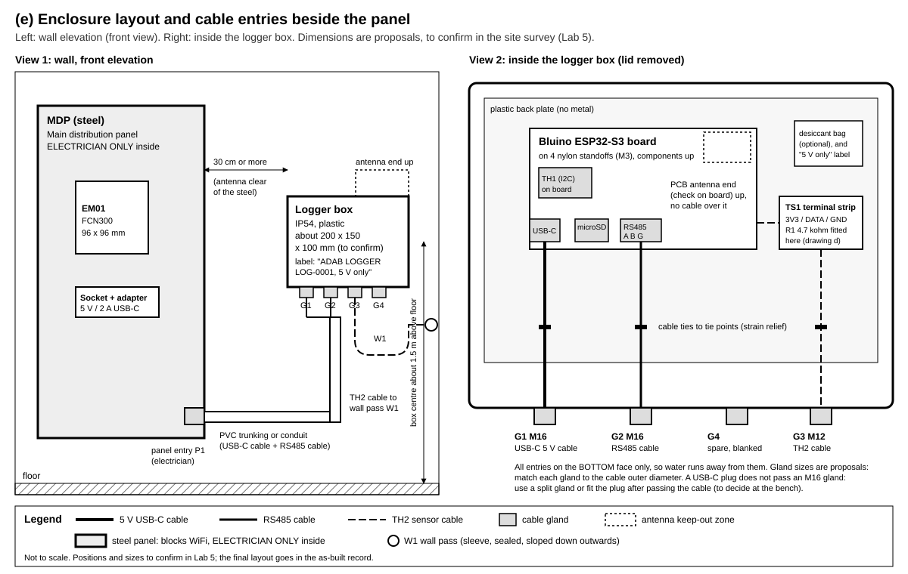
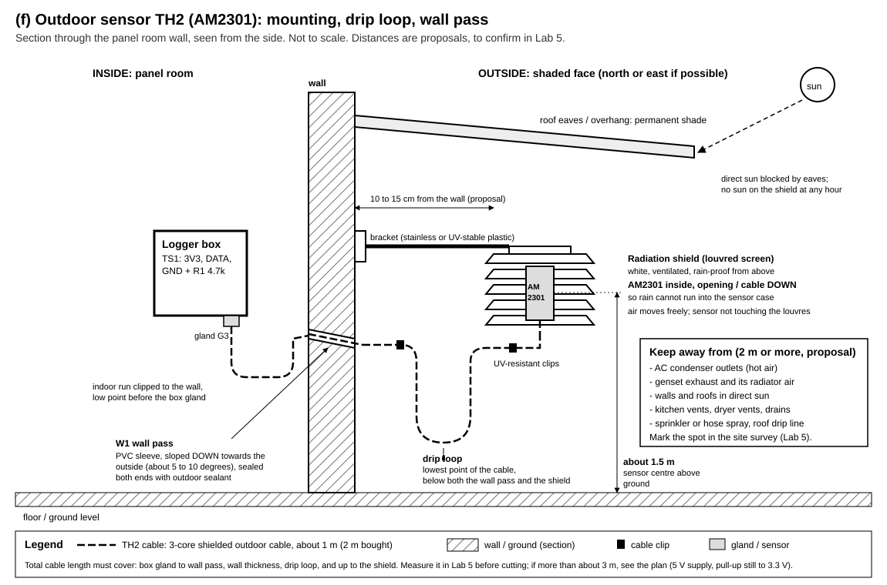

# Installing the Adab energy and environment logger: a practical for engineering students

Lab manual, version 0.1, 5 November 2026. Based on `docs/PLAN.md` v0.9.

This manual takes a group of students, under the supervision of an engineer, from a bare logger board on the bench to a commissioned logger at the Adab hotel. Each lab teaches the theory behind the step, then has you do it, measure it and write it down.

> **Status of what you are installing.** The logger firmware and the monitoring platform are **not built yet** (sessions S2, S3 and S5 of the plan). The labs that depend on them (Lab 4 upload, Lab 7 data and alarm checks) describe the steps as the plan defines them; they are marked **NOT BUILT YET** and are run once those parts exist. Labs 1, 2, 3 and 5 can be run now with the test sketches in [`labs/`](labs/).

> **Facts still to verify.** The pin map, the meter register map and its scaling are **not verified**. They are marked **to verify** wherever they appear. Part of your job in these labs is to verify them and record the result. Never treat a "to verify" value as a fact until your record sheet, signed by the supervisor, says it is.

---

## Contents

1. [About this practical](#1-about-this-practical): objectives, prerequisites, roles, safety
2. [Tools and bill of materials](#2-tools-and-bill-of-materials)
3. [Schematics](#3-schematics)
4. [Theory](#4-theory)
5. [Lab 1: bench bring-up](#lab-1-bench-bring-up)
6. [Lab 2: the AM2301 outdoor sensor](#lab-2-the-am2301-outdoor-sensor)
7. [Lab 3: RS485 and Modbus](#lab-3-rs485-and-modbus)
8. [Lab 4: network and upload](#lab-4-network-and-upload)
9. [Lab 5: site survey](#lab-5-site-survey)
10. [Lab 6: installation](#lab-6-installation)
11. [Lab 7: commissioning](#lab-7-commissioning)
12. [Troubleshooting](#12-troubleshooting)
13. [As-built record template](#13-as-built-record-template)
14. [Student report template](#14-student-report-template)

---

## 1. About this practical

### 1.1 What you will build

A small box beside the main distribution panel (MDP) at the back of the Adab hotel. Inside it, an ESP32-S3 board reads:

- the hotel's **3-phase power meter** (FORT FCN300) over an RS485 cable, using the Modbus RTU protocol;
- the **electrical room's temperature and humidity**, from a sensor on the board (`TH1`);
- the **outdoor temperature and humidity**, from an AM2301 sensor on a 1 m cable outside the panel room (`TH2`).

It keeps every record on a microSD card, with the time from a battery-backed clock, and sends the records over the hotel's staff WiFi to the monitoring platform at `https://arkan-monitoring.duckdns.org/`. The platform stores one folder per site, shows history in Open Energy Dashboard (OED), shows live values on `/live/adab/`, and sends chosen alarms to a WhatsApp group through Hermes. See drawing (a).

### 1.2 Learning objectives

By the end of the practical you can:

1. Explain why a 3.3 V microcontroller must never see 5 V on an input pin, and design a pull-up that respects it.
2. Explain how I2C addresses devices on a shared bus, and identify the devices on a board with a bus scan.
3. Explain the single-wire timing protocol of the DHT family, and size a pull-up resistor for a given cable.
4. Explain differential signalling, characteristic impedance and termination on an RS485 bus, and wire one correctly.
5. Read and decode a Modbus RTU frame: address, function code, registers, word order, scaling, CRC.
6. Calculate 3-phase active, apparent and reactive power from voltage, current and power factor, and use it to check a meter.
7. Calculate the dew point from temperature and humidity, and explain why it matters in an electrical room.
8. Carry out a site survey, an installation and a commissioning test with written records an engineer can sign.

### 1.3 Prerequisites

- Basic circuit theory: Ohm's law, voltage dividers, RC time constant.
- Safe use of a digital multimeter (DC voltage, resistance, continuity).
- Arduino IDE (2.x) or PlatformIO: install the ESP32 board support ("esp32 by Espressif") before Lab 1.
- Python 3 on the laptop, for Lab 3: `pip install minimalmodbus pyserial`.
- AC circuit basics: RMS, phase angle, power factor (revised in section 4.6).
- Site induction at the hotel before Labs 5 to 7 (given by the hotel's engineering staff).

### 1.4 Roles

| Role | Who | Does | Never does |
|---|---|---|---|
| **Supervising engineer** | Arkan engineer | Briefs each lab, checks the work, signs the record sheets, holds the authority to stop work | |
| **Licensed electrician** | Contracted, holds the local licence | **All work inside the MDP**: isolation, lock-out and tag-out, the socket circuit, the RS485 cable at the meter terminals, any termination resistor at the meter, panel entries. Opens the panel for photos | |
| **Students** (pairs: an operator and a recorder, swap every lab) | You | Bench work, the low-voltage side (5 V, 3.3 V, RS485 at the logger end, sensors), surveys, measurements, records, commissioning checks from outside the panel | **Work inside the MDP, open it, or touch anything in it**, live or not |
| **Owner** | Arkan | WiFi credentials, device tokens, platform settings, WhatsApp switch, approvals | |
| **Hotel engineering staff** | Hotel | Site access, permits, shutdown windows | |

### 1.5 Safety rules

Read them, sign the record of Lab 1, and follow them every day.

1. **You never work inside the MDP.** It holds 400/230 V and high fault currents. Everything inside it (meter wiring, current transformers (CTs), the socket circuit, the RS485 cable ends at the meter) is done by the licensed electrician, **with the panel isolated**, locked and tagged out. You may read the meter's LCD through the closed door window or when the electrician opens the panel, standing back, hands off.
2. **Never open the secondary circuit of a CT.** If you see CT wires disconnected or loose, stop and call the electrician. An open CT secondary can produce lethal voltages.
3. **Your side is extra-low voltage only:** 5 V DC from the adapter, 3.3 V logic, RS485, sensors. Before touching the logger, check that the only supply is the 5 V USB-C cable.
4. **The board's DC jack takes 7 to 15 V. Never connect 5 V to it, and never use it together with USB-C.** Use USB-C (or the 5V header pin, to verify in Lab 1). See drawing (b).
5. **ESP32-S3 pins are not 5 V tolerant.** Nothing above 3.3 V on any GPIO. Pull-ups go to 3.3 V.
6. **Power off before rewiring.** Unplug USB-C before changing any wire on the board.
7. **ESD:** touch a grounded point before handling the board; hold it by the edges.
8. **Work at height:** the outdoor sensor sits about 1.5 m high: a step stool at most, no ladders without the supervisor. Drilling the wall pass: safety glasses, check for hidden cables and pipes first (cable detector), with the hotel's permission.
9. **Stop rule:** anyone can stop the work at any time if something looks unsafe. Nobody is blamed for stopping.
10. **No changes to the meter's settings.** The scripts only read. Nobody writes to the meter's configuration registers (CT ratio, address, baud) without the supervisor and the owner.

### 1.6 Conventions in this manual

- **"to verify"** = an assumption from the plan or a guide that this practical must check. Record what you find.
- Times: the logger and the platform store **UTC**. People see **WITA** (Asia/Makassar, UTC+8, no daylight saving). Write both in records when it matters: `2026-11-05 06:30 UTC (14:30 WITA)`.
- Sensor names: `TH1` = on-board sensor (electrical room air), `TH2` = AM2301 (outdoors). Meter: `EM01`. Logger: `LOG-0001`.
- Drawings are referred to by their letter, (a) to (f), listed in section 3.

---

## 2. Tools and bill of materials

### 2.1 Tools (per group)

| Tool | Used in |
|---|---|
| Laptop with Arduino IDE 2.x (or PlatformIO), Python 3, a serial terminal | All labs |
| USB-C data cable (not a charge-only cable) | 1 to 4 |
| Digital multimeter (DC V, ohms, continuity), CAT III rated for site work | 1 to 3, 6, 7 |
| USB-RS485 adapter (CH340 or FTDI type, with A, B and GND terminals) | 3, 7 |
| Breadboard, jumper wires (female-to-male for the header) | 1 to 3 |
| Reference thermometer and hygrometer (calibrated, about plus or minus 0.3 C and 2 % RH or better) | 2, 7 |
| Phone with a WiFi analyser app, or the board running `lab4_rssi_survey`; USB power bank | 4, 5 |
| Tape measure, camera (phone), compass app | 5 |
| Screwdrivers (small flat 2.5 mm for terminals), wire strippers, ferrule crimper and ferrules, side cutters | 6 |
| Drill and step drill for glands, cable detector, masonry bit for the wall pass | 6 |
| Label printer or pre-printed cable labels, cable ties, adhesive tie mounts | 6 |
| Precision screwdriver, ESD wrist strap | 1 |

### 2.2 Bill of materials (from the plan, section 9, with proposals marked)

| # | Item | Qty | Notes |
|---|---|---|---|
| 1 | Bluino ESP32-S3 TMP/RH RS485 RTC AI board | 1 | DS3231 RTC, CR1220 cell, microSD, on-board temp/RH (`TH1`), ADS1115, RS485 with 120 ohm jumper |
| 2 | 5 V / 2 A USB-C adapter | 1 | Branded. Plugs into the socket at the panel (fitted by the electrician) |
| 3 | USB-C cable, length to suit the route | 1 | Data-capable is handy for site debugging |
| 4 | IP54 plastic enclosure, about 200 x 150 x 100 mm (proposal) | 1 | Size to confirm with the parts in hand |
| 5 | Cable glands, M16 x 2 and M12 x 1, blanking plug x 1 (proposal) | 4 | Match each to the cable diameter |
| 6 | Nylon standoffs M3 and screws | 4 | Board mounting |
| 7 | Shielded twisted-pair cable for RS485, 1 pair + 1 core (for example a 120 ohm instrumentation type) | length logger to meter + 2 m | Measured in Lab 5 |
| 8 | Ferrules for 0.25 to 0.5 mm2 | 20 | |
| 9 | microSD card, industrial grade, 8 to 32 GB, FAT32 | 1 | |
| 10 | AM2301 (DHT21) sensor (owner's) | 1 | `TH2` |
| 11 | 4.7 kohm resistor, 0.25 W | 2 | One spare |
| 12 | 3-core shielded outdoor-rated cable | about 2 m | For `TH2` |
| 13 | Small terminal strip (3 way) for `TH2` | 1 | `TS1` in drawing (e) |
| 14 | Radiation shield (louvred screen) and bracket | 1 | For `TH2` |
| 15 | PVC sleeve for the wall pass, outdoor sealant | 1 | |
| 16 | PVC trunking or conduit, UV-resistant cable clips | to suit | |
| 17 | 120 ohm resistor, 0.25 W (meter end, only if needed) | 1 | Fitted by the electrician |
| 18 | Spare CR1220 cell | 1 | |
| 19 | Labels, cable ties, desiccant bag (optional) | | |

---

## 3. Schematics

All drawings are black on white, with line styles and labels (not colour) carrying the meaning. Each has its own legend.

| Drawing | File | Used in |
|---|---|---|
| (a) System block diagram | [`schematics/a-system-block-diagram.svg`](schematics/a-system-block-diagram.svg) | 4.0, Lab 4, Lab 7 |
| (b) Power wiring | [`schematics/b-power-wiring.svg`](schematics/b-power-wiring.svg) | Lab 1, Lab 6 |
| (c) RS485 wiring, logger to meter | [`schematics/c-rs485-wiring.svg`](schematics/c-rs485-wiring.svg) | 4.4, Lab 3, Lab 6 |
| (d) AM2301 wiring with the pull-up | [`schematics/d-am2301-wiring.svg`](schematics/d-am2301-wiring.svg) | 4.3, Lab 2, Lab 6 |
| (e) Enclosure layout and cable entries | [`schematics/e-enclosure-layout.svg`](schematics/e-enclosure-layout.svg) | Lab 5, Lab 6 |
| (f) Outdoor sensor mounting | [`schematics/f-outdoor-sensor-mounting.svg`](schematics/f-outdoor-sensor-mounting.svg) | Lab 5, Lab 6 |

### (a) System block diagram


### (b) Power wiring


### (c) RS485 wiring


### (d) AM2301 wiring


### (e) Enclosure layout


### (f) Outdoor sensor mounting


### 3.1 Provisional pin map (all to verify in Lab 1)

From `docs/PLAN.md` section 2, read from photos of the board (`docs/img/board-top.jpg`, `docs/img/board-bottom.jpg`). The back silkscreen is mirrored and blurry in the photo.

| Function | GPIO (provisional) | Status |
|---|---|---|
| I2C SDA / SCL | 8 / 9 | to verify in Lab 1 |
| SD SCK / MISO / MOSI | 12 / 13 / 11 | to verify in Lab 1 (the "SPI INTERFACE" header reads GND 3V3 12 13 11 21) |
| SD CS | 10 or 21 | to verify in Lab 1 |
| RS485 TX / RX / DE-RE | top 3 rows of the back table | to verify in Lab 1, by reading the back silkscreen and by the Lab 3 echo test |
| AM2301 data (`TH2`) | 4 (proposed: free on the header, not a strapping pin) | to verify in Lab 1 and Lab 2 |

---

## 4. Theory

Read the section before the lab that uses it. Each section ends with what you will check in the lab.

### 4.0 The whole system in one paragraph

The logger is a **Modbus master**: every 15 s it asks the meter (the **slave**) for its registers; it reads both temperature and humidity sensors every 15 to 60 s (the plan gives both figures: to settle in the firmware); it stamps the record with the RTC time in UTC, writes it to the SD card first, then sends it over HTTPS to the platform. Records are averaged to 1 minute and uploaded every minute; a small snapshot goes to the live page every 15 s. If the network is down, the SD card queue keeps the records and sends the backlog later (store and forward). Drawing (a).

### 4.1 ESP32-S3 and 3.3 V logic

The ESP32-S3 runs at **3.3 V**. Its input pins read a voltage as "low" below about 0.25 x 3.3 = 0.8 V and as "high" above about 0.75 x 3.3 = 2.5 V (check the datasheet for exact figures). Each pin has protection diodes to the 3.3 V rail. If you apply 5 V to a pin, current flows through that diode into the 3.3 V rail: at best the reading is wrong and the rail rises, at worst the pin or the chip is destroyed. **The pins are not 5 V tolerant.**

Consequences on this board:

- **Power:** 5 V comes in on USB-C. A regulator on the board makes 3.3 V for the ESP32, the SD card, the RTC and the sensors. The DC jack feeds a different regulator that needs **7 to 15 V**: 5 V there is too low, and feeding two inputs at once can back-feed one supply into the other. Drawing (b).
- **Strapping pins:** some GPIOs (on the ESP32-S3: GPIO 0, 3, 45, 46) are read at reset to choose the boot mode. A sensor pulling one of them at power-up can stop the board from booting. That is why `TH2` is proposed on GPIO 4, not a strapping pin.
- **Current per pin:** keep it to a few mA. A 4.7 kohm pull-up to 3.3 V sinks only 3.3 / 4700 = 0.7 mA when the line is pulled low.

**In the lab:** you measure the 5 V and 3.3 V rails, and confirm that nothing you connect brings more than 3.3 V to a pin.

### 4.2 I2C

I2C (Inter-Integrated Circuit) is a two-wire bus: **SDA** (data) and **SCL** (clock), shared by many devices. Each device has a 7-bit **address**. The master (the ESP32) starts a transfer, sends the address, and only the device with that address answers with an **ACK** (it pulls SDA low for one clock).

- Both lines are **open drain**: devices only pull them low; **pull-up resistors** (usually 2.2 to 10 kohm, on the board) pull them high. Two devices can never fight, because nobody drives the line high.
- A **bus scan** tries every address from 1 to 126 and lists those that ACK. It is the fastest way to prove the SDA/SCL pins and find out which chips are on the board.
- Addresses you expect on this board (to verify): DS3231 RTC at **0x68** (often with an EEPROM at 0x57), ADS1115 at **0x48** to 0x4B, and the temp/RH module `TH1`: **0x38** if it is an AHT10/AHT20 (the silkscreen near the module appears to read "AHT10", to verify), 0x40 for HTU21/SHT21, 0x44 for SHT3x.

**In the lab:** you run the scan, list the addresses, and identify each chip.

### 4.3 The DHT single-wire protocol and pull-ups

The AM2301 (also sold as DHT21) uses **one data wire** with its own timing protocol, not I2C:

1. At rest, the pull-up holds the line **high** (3.3 V).
2. The ESP32 pulls the line **low for at least 1 ms** (start signal), then releases it.
3. The sensor answers: **low 80 us, high 80 us**.
4. The sensor sends **40 bits**. Each bit starts with a low of about 50 us, then a **high whose length is the bit**: about 26 us for a 0, about 70 us for a 1.
5. The 40 bits are: 16 bits humidity (x 10), 16 bits temperature (x 10, top bit = negative), 8 bits **checksum** (sum of the first four bytes, low 8 bits). A wrong checksum means a corrupted read: the firmware retries once, then reports an error (alarm A14).

Drawing (d) shows the waveform.

**Why the pull-up?** Both ends only ever pull the line **low** (open drain). The high level comes from the resistor. Many cased AM2301 have no pull-up inside, so you fit one at the board end.

**Sizing it.** The cable and the inputs add capacitance C. When a device releases the line, it rises with the time constant tau = R x C. For 1 m of cable plus the inputs, take C at about 300 pF (an estimate; measure or look up your cable). With R = 4.7 kohm: tau = 4700 x 300e-12 = **1.4 us**. The line reaches 2.5 V (high) after about 1.4 x tau = 2 us, much shorter than the 26 us of the shortest high. So 4.7 kohm is comfortable. A larger R (10 kohm) rises more slowly but uses less current; a smaller R (1 kohm) rises fast but makes the sensor sink 3.3 mA. The plan allows 4.7 to 10 kohm; this practical uses **4.7 kohm to 3.3 V**.

**Never pull up to 5 V.** The ESP32 would see 5 V on its pin every time the line is high. With 1 m of cable, power the sensor from **3V3** as well (the AM2301 works from 3.3 to 5.5 V; check the datasheet of yours).

**Timing and WiFi.** The microseconds above are measured by the ESP32 in software. WiFi interrupts can disturb them and cause checksum errors. Read at most once every 2 s (the logger reads every 15 s). If errors are frequent with WiFi on, the plan's fallback is a DHT driver that uses the ESP32's RMT peripheral.

**In the lab:** you fit the pull-up, measure the idle voltage on DATA (3.2 to 3.4 V), and count read errors.

### 4.4 RS485: differential signalling and termination

RS485 sends each bit as the **difference** between two wires, **A** and **B**, not as a voltage against ground:

- A transmitter drives A and B in opposite directions. The receiver looks at V(A) minus V(B): above +200 mV is one logic state, below -200 mV is the other.
- Noise picked up by the cable appears **almost equally on both wires** (common mode) and cancels out in the difference. Twisting the pair makes the pick-up even more equal. That is why RS485 runs up to 1200 m in electrically noisy places like a panel room.
- The receiver accepts a common-mode voltage of about -7 to +12 V. To keep the two ends' grounds within that range, run a **signal ground** wire (the third core) between them.
- **Half duplex:** one pair carries both directions, so only one device talks at a time. The transceiver has a **DE** (driver enable) pin: the ESP32 sets it high to transmit and low to listen. On some boards DE is switched automatically; on this one it is a GPIO, to verify.

**Characteristic impedance and reflections.** A twisted pair has a characteristic impedance Z0, typically **120 ohm**. A signal travelling along the cable that meets an open end reflects back and can corrupt the next bits. A **120 ohm resistor across A and B at each physical end** of the bus absorbs the signal: this is **termination**. Rules:

- Terminate the **two ends only** (here: the logger, with the board's "120" jumper, and the meter end). Never a device in the middle.
- Wire as a **daisy chain**, never a star; keep stubs under about 30 cm.

**Does it matter at 9600 baud over a few metres?** One bit lasts 1 / 9600 = **104 us**. The signal travels at about 0.66 x the speed of light, about 5 ns per metre: a 10 m cable has a round trip of about 0.1 us, a thousandth of a bit. Reflections die out long before the receiver samples the bit. A common rule: termination matters when the round trip is more than about a quarter of the rise time or bit time. So **at 9600 baud over 10 m, termination is good practice but not critical**; at 115200 baud over 500 m it would be essential. Lab 3 tests with and without.

**Biasing (fail-safe).** When nobody talks, the line floats and noise can look like a start bit. Many transceivers have built-in fail-safe; some boards add bias resistors (A to 3.3 V or 5 V, B to ground). Note what your board has (to verify from the board or its maker).

**Shield.** The cable's shield drains interference to ground. Bond it at **one end only** (proposed: the logger end, to the G terminal; confirm with the supervisor). Bonding both ends lets a current flow in the shield when the two grounds differ (a ground loop), which injects noise instead of removing it. **The shield is not the signal ground.**

**A and B names.** Makers do not agree on which wire is A. If everything else is right and nothing answers, swap A and B once: it does no harm.

**In the lab:** you wire the pair as in drawing (c), test an echo between the board and the laptop's adapter, and count errors with and without termination.

### 4.5 Modbus RTU: frames, registers, word order, scaling, CT ratio

Modbus RTU is a **master/slave** protocol on top of RS485. The logger (master) asks; the meter (slave, address 1 by default) answers. Settings must match on both sides: **9600 baud, 8 data bits, no parity, 1 stop bit (8-N-1)**, slave **1**: these are the guide's defaults, **to verify** on the meter's menu.

**The frame.** Bytes are sent back to back; a silence of at least 3.5 characters (about 4 ms at 9600 baud) marks the end of a frame.

| Field | Size | Example request: read 17 registers from 0x0000 |
|---|---|---|
| Slave address | 1 byte | `01` |
| Function code | 1 byte | `03` (read holding registers) |
| Start register | 2 bytes, high byte first | `00 00` |
| Number of registers | 2 bytes | `00 11` (17) |
| CRC-16 | 2 bytes, **low byte first** | `85 C6` |

So the logger sends `01 03 00 00 00 11 85 C6`. The meter answers `01 03 22` (34 data bytes follow), then 17 registers of 2 bytes each, then its CRC. A **CRC** (cyclic redundancy check) is computed over the whole frame; a wrong CRC means the frame is dropped. If the meter does not support the request, it answers with an **exception**: the function code with its top bit set (`83`) and an error code (`02` = illegal data address).

**Function codes 03 and 04.** FC03 reads **holding registers** (in principle read/write, for settings), FC04 reads **input registers** (read only, for measurements). Meters differ: some answer both for the same addresses, some only one. The guide lists both (issue 6 in `docs/meter/README.md`): **you try both** in Lab 3.

**Addresses.** The guide gives 0-based offsets (0x0000) and "PLC addresses" (40001 for FC03, 30001 for FC04). The frame always carries the 0-based offset: 40001 means offset 0 of the holding registers. An off-by-one is the most common Modbus mistake.

**Registers are 16 bits.** A value bigger than 65535, or a 32-bit float, takes **two consecutive registers**. Which comes first is the **word order**:

- "hi-lo" (big-endian, ABCD): register n is the high word. Value = high x 65536 + low.
- "lo-hi" (word-swapped, CDAB): register n is the low word.

Example from the guide (to verify): energy at 0x0018 (high) and 0x0019 (low), kWh = (high x 65536 + low) / 100. If 0x0018 = 2 and 0x0019 = 53429, kWh = (2 x 65536 + 53429) / 100 = **1845.01 kWh**. Read with the wrong word order, the same words give 53429 x 65536 + 2 = 3,501,522,946, which is nonsense: that is how you spot it.

**Scaling.** Registers carry integers. The meter's documentation gives a multiplier: voltage x 0.1 (2310 = 231.0 V), frequency x 0.01 (5000 = 50.00 Hz), PF x 0.001 (985 = 0.985). The guide is **unsure** for current (x 0.001 or x 0.01) and gives no factor for power (issue 3). You find the scale by comparing the raw value with the LCD: scale = LCD value / raw value, then round to a power of ten.

**Signed values.** A register read as "s16" treats values above 32767 as negative (65535 = -1). Power can be negative if energy flows back (or a CT is reversed). Try both u16 and s16.

**CT ratio and primary or secondary values.** The meter measures current through **current transformers (CTs)**: a 100/5 A CT turns 100 A in the cable into 5 A in the meter. The CT ratio is set in the meter (registers 0x0030 CT1 primary, 0x0031 CT2 secondary, guide, to verify). Some meters send **primary** values (the real current in the cable), others **secondary** (the current in the meter). With a 100/5 CT, a secondary reading of 2.06 A means 2.06 x 100 / 5 = **41.2 A** in the cable. If your register value is about CT2/CT1 of the LCD (1/20 here), the meter sends secondary values (issue 5). **You only read the CT registers; you never write them.**

**Where the corrections go.** The logger reads a **register table in its config**: address, function code, type (u16, s16, u32, s32, float), word order, scale. A correction found in Lab 3 is a config change, not a firmware change.

**In the lab:** you dump the registers with FC03 and FC04, match each LCD value to a register, type, word order and scale, and fill in the verification table.

### 4.6 Three-phase power

The hotel is fed by a **3-phase 4-wire** supply: three lines L1, L2, L3 and a neutral N. In Indonesia (PLN) the nominal voltages are **230 V line to neutral (V_LN)** and **400 V line to line (V_LL)**, to confirm on site. For a balanced system V_LL = sqrt(3) x V_LN (230 x 1.732 = 398 V).

For each phase, with current I, and phase angle phi between voltage and current:

- **Active power** P = V_LN x I x cos(phi), in kW: the power that does work and is billed in kWh.
- **Apparent power** S = V_LN x I, in kVA: what the cables and the supply must carry.
- **Reactive power** Q = V_LN x I x sin(phi), in kVAr: power that flows back and forth (motors, transformers, AC compressors).
- **Power factor** PF = P / S = cos(phi) for sinusoidal waveforms. S^2 = P^2 + Q^2 (the power triangle).

The three-phase total is the sum of the phases. For a **balanced** load:

- **P = sqrt(3) x V_LL x I x PF**
- **S = sqrt(3) x V_LL x I**
- **Q = sqrt(S^2 - P^2) = sqrt(3) x V_LL x I x sin(phi)**

Worked example: V_LL = 400 V, I = 41.2 A on each phase, PF = 0.93.

- S = 1.732 x 400 x 41.2 = 28,544 VA = **28.5 kVA**
- P = 28.5 x 0.93 = **26.5 kW**
- Q = sqrt(28.54^2 - 26.55^2) = **10.5 kVAr**

The same with V_LN: 3 x 230.9 x 41.2 x 0.93 = 26.5 kW. The two forms agree.

**Unbalanced loads** (a hotel always is a little): use the per-phase sum, P = P1 + P2 + P3. The balanced formula with the mean current is then only an estimate; the difference tells you how unbalanced the load is (alarm A10 looks at current imbalance).

**Energy:** kWh = the integral of kW over time. A 26.5 kW load for 15 minutes uses 26.5 x 0.25 = 6.6 kWh. The meter keeps a **cumulative counter**; the platform computes consumption as the difference between two readings, so a gap in the data never corrupts a total.

**Why the PF matters:** PLN bills excess kVArh when the PF is below 0.85 (alarm A09, from `alarms.csv`).

**In the lab:** you calculate P, S and Q from the meter's V, I and PF registers, and compare with the meter's own kW, kVA and kVAr registers and its LCD.

### 4.7 Dew point

Air at temperature T and relative humidity RH holds water vapour. Cool it, and at the **dew point** Td the vapour starts to condense. The **Magnus formula** (good between about -45 and +60 C):

- gamma = ln(RH / 100) + (17.62 x T) / (243.12 + T)
- **Td = 243.12 x gamma / (17.62 - gamma)**

Worked example: outdoors T = 29.8 C, RH = 66.5 %: gamma = ln(0.665) + 17.62 x 29.8 / 272.92 = -0.408 + 1.924 = 1.516, Td = 243.12 x 1.516 / 16.104 = **22.9 C**.

**Why it matters here:** if the electrical room is air-conditioned to 24 C and humid outdoor air at a dew point of 22.9 C gets in, any surface below 22.9 C (cold switchgear, AC ducts) collects water. Water and live busbars do not mix. Alarm **A23** compares the outdoor dew point (from `TH2`) with the room temperature (`TH1`), and **A24** watches for a room much warmer than outdoors (failed ventilation). Both depend on good sensor offsets, which you set in Lab 2.

---

## Lab 1: bench bring-up

**Goal.** Power the board safely, flash a test sketch, and **confirm the pin map**: I2C, RTC, SD card, and find the RS485 and free GPIO pins.

**Theory.** 4.1, 4.2. Drawings (b) and section 3.1.

**Equipment.** Board, USB-C data cable, laptop with Arduino IDE, multimeter, microSD card (FAT32), CR1220 cell, ESD strap, magnifier or phone camera with macro.

**Sketch.** [`labs/lab1_bringup/lab1_bringup.ino`](labs/lab1_bringup/lab1_bringup.ino) (not yet tested on the hardware). Library: RTClib (Adafruit).

**Steps.**

1. **Inspect.** Check the board for damage, solder bridges, and that the CR1220 cell is in its holder with + up. Photograph both sides in sharp focus. On the back, read the pin table (mirrored: flip the photo) and write the RS485 TX, RX and DE pins in the record sheet. Mark them "read from silkscreen, to confirm in Lab 3".
2. **Before any power:** with the multimeter on ohms, measure between 5V and GND, and between 3V3 and GND on the header. Expect no short (more than a few hundred ohms, rising as the capacitors charge). A near 0 ohm reading: stop, call the supervisor.
3. **Power by USB-C only.** Plug the USB-C cable into the laptop. Check that the power LED lights. Measure on the header: **5V pin to GND** (expect 4.75 to 5.25 V) and **3V3 pin to GND** (expect 3.2 to 3.4 V). **Do not connect anything to the DC jack.**
4. **Board settings in the Arduino IDE:** board "ESP32S3 Dev Module", "USB CDC On Boot: Enabled", the right port. If upload fails, hold **BOOT**, press **RESET**, release BOOT, then upload.
5. **Flash** `lab1_bringup.ino`, open the Serial Monitor at 115200 baud.
6. **I2C scan.** Read the list of addresses. Identify each one (section 4.2). If nothing is found, try SDA and SCL swapped (edit the pins) and record which works.
7. **RTC.** Read the time. Set it to **UTC** with `T2026-11-05 06:30:00` (use the real UTC time from a phone or `https://time.is/UTC`). Read it again after 10 minutes and note the drift. Unplug USB for 2 minutes, plug in, read again: the time must have kept running (the CR1220 cell). Record `lostPower`.
8. **SD card.** Insert the card. The sketch tries CS = 10 first; type `c` to try 21. Record which CS works. Read the file back. Remove the card, read it on the laptop: the lines must be there.
9. **Free GPIO for `TH2`.** With nothing connected to GPIO 4, check on the header that GPIO 4 is free (not tied to another part: continuity to nearby pins and to GND/3V3 should be open). Record.
10. **Clean up:** unplug USB, store the board in its ESD bag.

**Expected result.**

- Rails within limits, no shorts.
- I2C scan shows at least the RTC (0x68) and the temp/RH module (0x38, 0x40 or 0x44); ADS1115 at 0x48 to 0x4B.
- RTC keeps time through a power cycle, drift under about 2 s per day (DS3231 spec is about plus or minus 2 ppm, about 0.2 s per day, at 0 to 40 C).
- SD write and read-back work with one CS pin.

**Record sheet: Lab 1**

| Item | Expected | Measured / found | OK? |
|---|---|---|---|
| Resistance 5V to GND, unpowered | no short | | |
| Resistance 3V3 to GND, unpowered | no short | | |
| 5V pin voltage on USB-C | 4.75 to 5.25 V | | |
| 3V3 pin voltage | 3.2 to 3.4 V | | |
| I2C SDA / SCL GPIO | 8 / 9 (to verify) | | |
| I2C addresses found | 0x68, 0x38 or 0x40 or 0x44, 0x48 | | |
| `TH1` chip type (from address and silkscreen) | AHT10? (to verify) | | |
| RTC set to UTC at (time) | | | |
| RTC drift after 10 min / after 24 h | under 1 s / under 2 s | | |
| RTC after 2 min unplugged | time kept, lostPower = no | | |
| SD SCK / MISO / MOSI | 12 / 13 / 11 (to verify) | | |
| SD CS that works | 10 or 21 | | |
| RS485 TX / RX / DE from back silkscreen | (unknown) | | |
| GPIO 4 free on the header | yes (to verify) | | |
| Safety rules read and signed (names) | | | |
| Supervisor signature, date | | | |

**Questions.**

1. Why must the 5 V adapter never go to the DC jack? What does the regulator behind the jack need, and what would happen with 5 V?
2. The I2C lines are open drain. What would happen if two devices drove the line with push-pull outputs at the same time?
3. Why set the RTC to UTC rather than WITA? What goes wrong with daylight saving in other countries, and why does it not matter in Makassar?
4. The DS3231 is rated about plus or minus 2 ppm. How many seconds per month is that?
5. Why is GPIO 0 a bad choice for the AM2301?

---

## Lab 2: the AM2301 outdoor sensor

**Goal.** Wire the AM2301 (`TH2`) with its pull-up, read it, compare it with `TH1` and a reference instrument, and set the offsets.

**Theory.** 4.3, 4.7. Drawing (d).

**Equipment.** Board, AM2301, 4.7 kohm resistor, breadboard or 3-way terminal strip, 1 m of the outdoor cable (the real one if possible), multimeter, reference thermometer and hygrometer, a plastic box or bag (to test in still air).

**Sketch.** [`labs/lab2_am2301/lab2_am2301.ino`](labs/lab2_am2301/lab2_am2301.ino) (not yet tested on the hardware). Libraries: Adafruit "DHT sensor library", "Adafruit Unified Sensor", "Adafruit AHTX0".

**Steps.**

1. **USB unplugged.** Read the AM2301's label: check the wire colours (usually red VCC, black GND, yellow DATA). Record them.
2. **Wire it as in drawing (d):** VCC to **3V3**, GND to **GND**, DATA to **GPIO 4**, and the **4.7 kohm resistor from DATA to 3V3** at the board end. Use the real 1 m cable between the board and the sensor.
3. **Check before power:** resistance DATA to 3V3 = 4.7 kohm (plus or minus 5 %). Continuity on each core end to end. No short between cores.
4. **Power on (USB-C).** Measure DATA to GND with the sensor idle: expect **3.2 to 3.4 V**. Measure VCC at the sensor end: 3.2 to 3.4 V. **If you see 5 V anywhere on DATA, unplug at once.**
5. **Flash** `lab2_am2301.ino`. Watch the lines every 5 s. Leave it 10 minutes: the sensors must settle (the AM2301 is slow, about 2 s per reading and minutes to follow a temperature step).
6. **Comparison.** Put the AM2301, the board and the reference instrument together in still air, out of the sun, away from your hands and breath (a closed cardboard box with holes works). After 15 minutes, take 5 readings 1 minute apart of TH1, TH2 and the reference. Compute the mean of each and the **offset = reference - sensor** for temperature and humidity.
7. **Set the offsets** in the sketch (`TH1_T_OFFSET` and so on), reflash, and check that the corrected readings now match the reference within the sensor's accuracy. These offsets go to `site.json` on the platform later (`docs/PLAN.md` section 2).
8. **Error count.** Run 1 hour with WiFi off. Record errors / reads. (With the real firmware, repeat with WiFi on: if errors exceed about 1 %, report it; the plan's fallback is an RMT-based driver.)
9. **Pull-up experiment** (supervisor present): replace 4.7 kohm with 10 kohm, then remove the pull-up altogether. Record what happens to the error count each time. Put the 4.7 kohm back.
10. **Dew point.** Compute the dew point by hand for one reading with the formula of 4.7, and compare with the sketch's value.

**Expected result.**

- DATA idle at 3.2 to 3.4 V; never above.
- TH2 within about plus or minus 0.5 C and 3 % RH of the reference after the offset (maker's figures); TH1 reads warmer than the room by about 1 to 3 C before its offset (board self-heating, plan section 2).
- Error rate under 1 % with the pull-up; many errors or no reading without it.

**Record sheet: Lab 2**

| Item | Expected | Measured | OK? |
|---|---|---|---|
| Wire colours VCC / DATA / GND | red / yellow / black (to verify) | | |
| R DATA to 3V3, unpowered | 4.47 to 4.94 kohm | | |
| DATA idle voltage | 3.2 to 3.4 V | | |
| VCC at sensor end | 3.2 to 3.4 V | | |

| Reading (1 min apart) | Ref T (C) | TH1 T | TH2 T | Ref RH (%) | TH1 RH | TH2 RH |
|---|---|---|---|---|---|---|
| 1 | | | | | | |
| 2 | | | | | | |
| 3 | | | | | | |
| 4 | | | | | | |
| 5 | | | | | | |
| **Mean** | | | | | | |
| **Offset = ref - sensor** | | | | | | |

| Test | Errors / reads | Notes |
|---|---|---|
| 4.7 kohm, 1 h, WiFi off | | |
| 10 kohm, 10 min | | |
| No pull-up, 10 min | | |
| Dew point by hand vs sketch | | |

**Questions.**

1. Calculate the rise time constant with 10 kohm and 300 pF. Is the shortest "high" (26 us) still safe? What cable length would make it marginal?
2. Why is the pull-up at the board end, not the sensor end, in this design? Would either work?
3. The plan allows a 5 V supply for cables longer than about 3 m, but keeps the pull-up at 3.3 V. Explain why the ESP32 pin is still safe.
4. Why is TH1 warmer than the room? How would you reduce that effect?
5. With your offsets, what is the dew point outdoors right now? If the electrical room were cooled to 24 C, would alarm A23 (gap under 2 C) trigger?

---

## Lab 3: RS485 and Modbus

**Goal.** Prove the RS485 pins and wiring with a loopback, then dump the meter's registers with a laptop, match them against the LCD, fill in the verification table of `docs/meter/README.md`, and check the power calculation.

**Theory.** 4.4, 4.5, 4.6. Drawing (c).

**Equipment.** Board, USB-RS485 adapter, 2 m of the RS485 cable, laptop with Python and `minimalmodbus`, multimeter, 120 ohm resistor. For part B and C: the meter at the hotel (**no spare meter yet**, owner, 30 October 2026), the electrician, a camera.

**Sketch and script.** [`labs/lab3_modbus_dump/lab3_modbus_dump.ino`](labs/lab3_modbus_dump/lab3_modbus_dump.ino) and [`labs/modbus_dump.py`](labs/modbus_dump.py) (neither tested on the hardware yet). The plan also foresees `tools/modbus_dump.py` in session S2; until then use this one.

### Part A: loopback on the bench (board to laptop)

1. Fill in `PIN_RS485_TX`, `PIN_RS485_RX`, `PIN_RS485_DE` in the sketch from your Lab 1 record. Flash it.
2. USB unplugged. Wire the board's RS485 terminal to the USB-RS485 adapter: **A to A, B to B, G to GND**, with 1 to 2 m of the real cable. Board's "120" jumper ON.
3. Plug both into the laptop. Measure, with nobody talking, V(A) - V(B) at the board terminal: record it (a positive idle voltage of about +200 mV or more means fail-safe bias is present).
4. In the Serial Monitor type `e` (echo mode). In a second serial terminal on the adapter's port (9600 8-N-1), type a few characters: they must come back, and the Serial Monitor shows them in hex. Try 100 characters.
5. If nothing comes back: swap A and B once; check DE; check TX/RX are not swapped (edit the sketch). Record what fixed it.
6. **Termination test:** jumper OFF, repeat; jumper ON plus a 120 ohm resistor at the adapter end, repeat. Record errors (wrong characters) in each case.

### Part B: register dump with the laptop at the hotel

Do this on the first short visit, before the install (plan, session S4).

1. **Electrician:** confirms that the meter has RS485 terminals (photo of the meter's back, issue 7), notes the terminal numbers, and with the panel isolated connects a short cable from the meter's A, B (and GND if present) to a terminal block **outside** the live area, or brings the cable out through a gland. The panel is closed and re-energised by the electrician.
2. **Electrician or supervisor, from the LCD menu (read only):** note and photograph the Modbus address, baud rate, parity, CT ratio and PT ratio settings. Photograph the meter's label: **3E4Y or 3EH4Y**.
3. **Students:** connect the USB-RS485 adapter to the terminal block outside the panel. Run:
   `python modbus_dump.py --port COM5 --csv dump-adab.csv` (your port name).
4. The script reads 0x0000 to 0x003F with FC03, then FC04. If both time out: check the ID and baud from step 2 (`--slave`, `--baud`), swap A and B once.
5. **At the same moment**, photograph each LCD page: V per phase, V line to line, A per phase, kW, kVA, kVAr, PF, Hz, kWh. Write the time on the sheet.
6. Run again with `--repeat 10 --interval 30` and watch which words count up slowly: those are the energy counters (issue 4: dump 0x0018 to 0x001F).
7. Read 0x0030 and 0x0031 (CT1, CT2) and compare with the CT ratio on the LCD menu (issue 5).

### Part C: match, fill in, check

1. For each LCD value, find the register whose value, with a scale of 10^n, matches it. Try u16, s16, and pairs as u32, s32, float, both word orders. Fill in the **verification table** below and copy it into `docs/meter/README.md` or `fcn300-3e4y-verified.md` (through a pull request reviewed by the supervisor).
2. Decide for each value: FC03 or FC04, type, word order, scale, primary or secondary.
3. **Power check:** with your verified V_LN, I and PF per phase, compute P per phase and the total, S and Q (section 4.6). Compare with the meter's P, S, Q registers and the LCD. The difference should be within the meter's accuracy plus rounding (a few tenths of a percent at a steady load).
4. Optional, back on the bench: run the board's own dump (`d` in `lab3_modbus_dump.ino`) on the meter, once the electrician has installed the cable, and compare with the laptop's dump.

**Expected result.**

- Part A: echo works; the pin map for RS485 is confirmed; no errors with or without termination at this length and speed.
- Part B and C: every LCD value matched to a register; the table filled in; the power check agrees within about 1 %.

**Record sheet: Lab 3 Part A**

| Item | Value |
|---|---|
| RS485 TX / RX / DE GPIO (confirmed) | |
| A/B swapped to work? | |
| Idle V(A) - V(B) | |
| Errors in 100 characters: jumper ON / OFF / both ends terminated | |

**Record sheet: Lab 3 Part B and C, the verification table**

Meter label: FCN300-______ . Slave ID ____ . Baud ____ . Parity ____ . CT ____ / ____ . PT ____ / ____ . Dump time (UTC / WITA): ______

| Quantity | LCD value | Guide address | Found at address | FC | Raw word(s) | Type | Word order | Scale | Primary or secondary | Match? |
|---|---|---|---|---|---|---|---|---|---|---|
| V L1-N | | 0x0000 | | | | | | x 0.1? | | |
| V L2-N | | 0x0001 | | | | | | x 0.1? | | |
| V L3-N | | 0x0002 | | | | | | x 0.1? | | |
| V L1-L2 | | 0x0003 | | | | | | x 0.1? | | |
| V L2-L3 | | 0x0004 | | | | | | x 0.1? | | |
| V L3-L1 | | 0x0005 | | | | | | x 0.1? | | |
| I L1 | | 0x0006 | | | | | | x 0.001 or x 0.01? | | |
| I L2 | | 0x0007 | | | | | | ? | | |
| I L3 | | 0x0008 | | | | | | ? | | |
| Frequency | | 0x0009 | | | | | | x 0.01? | | |
| P L1 | | 0x000A | | | | | | ? | | |
| P L2 | | 0x000B | | | | | | ? | | |
| P L3 | | 0x000C | | | | | | ? | | |
| P total | | 0x000D | | | | | | ? | | |
| Q total | | 0x000E | | | | | | ? | | |
| S total | | 0x000F | | | | | | ? | | |
| PF | | 0x0010 | | | | | | x 0.001? | | |
| kWh import | | 0x0018 + 0x0019 | | | | | | / 100? | | |
| kVArh | | 0x001A | | | | | | ? | | |
| CT1 / CT2 | | 0x0030 / 0x0031 | | | | | | | | |

**Power check**

| Phase | V_LN (V) | I (A) | PF | P = V x I x PF (kW) | Meter P (kW) | Difference (%) |
|---|---|---|---|---|---|---|
| L1 | | | | | | |
| L2 | | | | | | |
| L3 | | | | | | |
| Total | | | | | | |
| S = sum of V x I (kVA) | | | | | Meter S: | |
| Q = sqrt(S^2 - P^2) (kVAr) | | | | | Meter Q: | |
| sqrt(3) x V_LL x I_mean x PF (kW) | | | | | (estimate) | |

**Questions.**

1. Decode this request byte by byte: `01 03 00 18 00 02 44 0C`. What does the meter send back if 0x0018 holds 2 and 0x0019 holds 53429? What is the energy in kWh?
2. At 9600 baud 8-N-1, how long does one byte take? How long does the request above plus a 17-register answer take on the wire?
3. Your current register reads 206 and the LCD shows 41.2 A, with a 100/5 CT. Which scale and which (primary or secondary) is it?
4. Why did the echo test work with and without termination? At what cable length and baud rate would you expect it to fail without?
5. Why is the meter's sum of per-phase power more trustworthy than sqrt(3) x V_LL x I x PF for this hotel?
6. The scripts only read. Name two meter registers you must never write by mistake, and what would happen.

---

## Lab 4: network and upload

**Goal.** Measure the WiFi signal where the box will go, put the logger on the staff WiFi through its setup page, and check that records reach the platform and the live page.

**Theory.** 4.0. Drawing (a).

**Equipment.** Board (or the finished logger), USB power bank, laptop, phone with a WiFi analyser app, the staff WiFi name and password (from the owner), the device token (from the owner, through `tools/` in `arkan-monitoring`), browser login to the platform.

**Sketch.** [`labs/lab4_rssi_survey/lab4_rssi_survey.ino`](labs/lab4_rssi_survey/lab4_rssi_survey.ino) (not yet tested on the hardware).

> **NOT BUILT YET:** the logger's WiFi setup page and uploader (session S2), the platform, the ingest API and the live page (sessions S3 and S5). Part A can be done now. Parts B to D describe the plan's design; run them when those parts exist, and update this lab with what you find.

### Part A: RSSI survey (can be done now)

1. **What RSSI is:** received signal strength in dBm, a logarithmic scale. -50 dBm is strong, -70 dBm is the plan's minimum for the box, -80 dBm is unreliable (alarm A17 fires below -80 dBm mean). Every 3 dB is half the power.
2. Flash `lab4_rssi_survey.ino` with `SSID_FILTER` set to part of the staff network name. Power the board from the power bank.
3. At each candidate spot (inside the closed IP54 box if you have it, at the height it will be mounted), wait for 10 scans and record the **mean**. Do the same with the phone app. Spots: beside the MDP at 30 cm, at 1 m, inside the panel room door, and any spot the supervisor proposes.
4. Hold the board **against the steel panel** and record again: see how much the steel costs you.
5. Note the WiFi **channel** and whether the network is 2.4 GHz (the ESP32-S3 has no 5 GHz radio).

### Part B: WiFi setup page (NOT BUILT YET, from plan section 5.1)

1. Power the logger. With no WiFi stored, it starts an **access point** (name and password to be given by the firmware docs).
2. Join it from a phone. The setup page opens. Enter the **staff network name and WPA2 password**. The logger stores them in **NVS** (its non-volatile memory) and restarts as a WiFi client.
3. Check in the logger's status (setup page or serial log): connected, IP address, RSSI, NTP time synchronised.
4. Never write the WiFi password in your report or a photo. Record only "set by (name) on (date)".

### Part C: posting to the platform (NOT BUILT YET, from plan sections 5.2 to 5.4)

1. The owner creates the device and its **token** with the `arkan-monitoring` tools (`add_site`, device `LOG-0001` on site `adab`) and gives it to the supervisor. The token is entered in the logger's config. It is a secret: not in photos or reports.
2. The logger POSTs records to `/api/v1/ingest` every minute (HTTPS, `Authorization: Bearer <device token>`), as JSON (plan section 5.2): one record per minute with `ts` (UTC), `seq`, the `env` list (`TH1`, `TH2`), the `meters` list (`EM01`) and `sys` (RSSI, uptime, backlog, boot reason).
3. The supervisor (or the owner) checks on the VPS that the day file grows: `/srv/arkan-monitoring/data/sites/adab/LOG-0001/raw/YYYY/MM/YYYY-MM-DD.csv`.
4. **Store and forward test:** switch off the WiFi for the logger (the supervisor removes the credentials or takes the logger out of range) for 10 minutes. Check that `sys.backlog` grows, then that, once back, the missing minutes arrive and there is **no gap** in the day file (each `seq` once).

### Part D: live page and OED (NOT BUILT YET)

1. Open `https://arkan-monitoring.duckdns.org/live/adab/` with the Arkan login. Expect tiles for kW, kVA, PF, Hz, V and I per phase, `TH1` and `TH2`, updated every 15 s, with the status line "Live, updated N s ago" (`docs/LIVE.md`).
2. Compare one tile with the meter's LCD at the same moment.
3. In OED (`https://arkan-monitoring.duckdns.org/`), find the meters `adab-EM01-energy`, `adab-TH1-temp`, `adab-TH2-temp` and so on. Readings appear after the 5-minute push, not live. OED shows **WITA** local time; the files hold UTC.

**Expected result.** RSSI better than -70 dBm at the box position (Part A). Later: logger online, day file growing, no gap after the store and forward test, live page updating.

**Record sheet: Lab 4**

| Spot | Height | Board mean RSSI (dBm) | Phone RSSI (dBm) | Channel | OK (> -70)? |
|---|---|---|---|---|---|
| Beside MDP, 30 cm | | | | | |
| Beside MDP, 1 m | | | | | |
| Panel room door | | | | | |
| Against the steel panel | | | | | |
| Other: | | | | | |

| Check (when built) | Result | Time (UTC) |
|---|---|---|
| WiFi set through the setup page (by, date) | | |
| NTP synchronised, RTC corrected | | |
| First record in the day file | | |
| Backlog during 10 min outage (max) | | |
| Gap after recovery? (expected none) | | |
| Live page value vs LCD (kW) | | |
| OED shows the site's meters | | |

**Questions.**

1. The mean RSSI is -72 dBm. By how much (as a ratio) must the received power increase to reach -66 dBm? What could you change on site?
2. Why does the logger write to the SD card **before** uploading?
3. Why does the payload carry `seq`? What would happen on resend without it?
4. The live snapshot is not stored or resent. Why is that acceptable, and what keeps the history complete?
5. Why does the platform store UTC but OED show WITA?

---

## Lab 5: site survey

**Goal.** Collect everything needed to plan the install: positions, distances, cable routes, WiFi, the meter's details, the outdoor sensor's spot, and the hazards. No tools are used on the installation.

**Theory.** Drawings (e) and (f). Section 1.5.

**Equipment.** Tape measure, camera, compass app, WiFi survey kit (Lab 4 Part A), reference thermometer and hygrometer, this checklist, the hotel's permit. The electrician, for the panel.

**Steps.**

1. **Induction and permit.** Sign in with the hotel's engineering staff. Agree which rooms you may enter and when the electrician can open the panel.
2. **The MDP.** From outside, photograph the panel, its label, and the space on the wall around it. Note the panel material (steel), size, door side, and where cables enter it.
3. **The meter, with the electrician** (panel opened by the electrician, you stand back): photograph the meter's **label** (3E4Y or 3EH4Y), its **back** (RS485 A/B terminals present? issue 7), the CT ratio on the CTs' labels, and the LCD settings pages (address, baud, CT ratio). Ask the electrician about a free spot for the **socket** and a breaker for it, and a free **cable entry** in the panel.
4. **The box position** (drawing (e)): a wall spot beside the panel, at least 30 cm from the steel (proposal), box centre about 1.5 m high, reachable without a ladder, not in a walkway, not under a pipe or a vent. Measure the **RSSI** there (Lab 4 Part A): it must be better than -70 dBm. Mark it on a sketch with dimensions.
5. **Cable routes.** Measure the routes for: the USB-C cable from the socket to the box; the RS485 cable from the meter terminals to the box (add 1 m at each end for terminations); the `TH2` cable from the box to the outdoor spot through the wall. Keep the RS485 route 20 cm from power cables where possible; note where it must cross them.
6. **The outdoor spot for `TH2`** (drawing (f)): on a face that is **in shade all day** (north or east if possible, under the eaves), about 1.5 m above ground, 10 to 15 cm off the wall (proposal), **away from AC condenser outlets, the genset exhaust, kitchen vents and walls in the sun** (2 m or more, proposal). Check the shade in the morning and the afternoon, or ask the staff. Measure the outdoor temperature and humidity with the reference instrument.
7. **The wall pass.** Wall material and thickness; a spot for a sleeve sloping down to the outside; check for hidden cables and pipes (cable detector) and ask the hotel.
8. **The room.** Measure the room's temperature and humidity. Is it air-conditioned or ventilated? (This decides whether alarm A23 should go to WhatsApp.)
9. **Supply facts for the alarms** (`docs/alarms/README.md`): the PLN supply voltage (from the LCD), and the hotel's **contracted kVA** (from a PLN bill, ask the hotel), for A05, A06, A08.
10. **Hazards.** List what you saw: water near the panel, poor lighting, trip hazards, asbestos labels, blocked access.
11. Write the survey report (template below) and the **bill of quantities**: cable lengths, glands, trunking.

**Expected result.** A report the supervisor can sign that answers: where the box goes, its RSSI, every cable length, the meter's model and RS485 terminals, the `TH2` spot, the wall pass, and the hazards.

**Record sheet: Lab 5**

| Item | Finding | Photo no. |
|---|---|---|
| MDP location, material, size | | |
| Meter label: FCN300-3E4Y or 3EH4Y | | |
| RS485 terminals on the meter (numbers) | | |
| Meter LCD settings: ID, baud, parity | | |
| CT ratio (CT label and meter setting) | | |
| Socket and breaker: existing or new (electrician) | | |
| Free cable entry in the panel | | |
| Box position (sketch ref.), height, distance from panel | | |
| RSSI at box position, mean (dBm) | | |
| USB-C cable length (m) | | |
| RS485 cable length (m) | | |
| `TH2` cable length, box to sensor (m) | | |
| `TH2` spot: face (N/E/S/W), shade AM and PM, height | | |
| Distance to nearest AC condenser / genset / vent (m) | | |
| Wall material and thickness (mm) | | |
| Room T / RH (reference), air-conditioned? | | |
| Outdoor T / RH (reference) | | |
| Supply V L-N (LCD) | | |
| Contracted kVA (PLN bill) | | |
| Hazards | | |
| Supervisor signature, date | | |

**Questions.**

1. Why is the box beside the panel and not inside it? Give two reasons (one about safety, one about radio).
2. Why must the `TH2` spot be in shade all day, even with a radiation shield?
3. What could make the outdoor sensor read high in the evening, after a sunny day? How do you avoid it?
4. Why do you need the contracted kVA, and what happens to alarm A08 without it?

---

## Lab 6: installation

**Goal.** Build the box on the bench, then mount it on site, run the cables, mount the outdoor sensor, and label everything, so that the electrician can make the final connections in the panel.

**Theory.** Drawings (b), (c), (d), (e), (f). Section 1.5.

**Equipment.** The full bill of materials (2.2), the tools (2.1), the survey report (Lab 5), the electrician for the panel work.

### Part A: box assembly on the bench

1. Drill the glands in the **bottom face only** (drawing (e)): G1 USB-C cable, G2 RS485, G3 `TH2`, G4 spare with a blanking plug. Size each gland to the cable's outer diameter. Decide how the USB-C cable passes: a split gland, or a cable whose plug is fitted after passing (decide with the supervisor; record it).
2. Fit a **plastic** back plate (no metal near the antenna). Mount the board on four nylon standoffs, components up, with the **PCB antenna end towards the top** and no cable over it (check where the antenna is on the module first).
3. Fit terminal strip TS1 for `TH2` with the **4.7 kohm pull-up** between 3V3 and DATA (drawing (d)). Short leads from TS1 to the header, sleeved, in ferrules.
4. Insert the microSD card (formatted FAT32, labelled with the logger ID).
5. Labels: on the lid, "ADAB LOGGER LOG-0001, 5 V USB-C ONLY, DO NOT USE DC JACK", and the supervisor's contact.
6. **Bench test the assembly:** power by USB-C through G1, run the Lab 2 sketch: `TH1` and `TH2` read. Close the lid; check the gland seals are tight.

### Part B: on site, the electrician's work (students watch from a safe distance)

1. The electrician isolates the panel, locks and tags it out, and proves it dead.
2. The electrician fits the **socket** on its circuit and labels the breaker "LOGGER".
3. The electrician brings the **RS485 cable** in through a panel entry (P1), connects **A, B (and GND if present)** at the meter terminals (drawing (c)), cuts back and insulates the **shield at the meter end**, fits the **120 ohm** resistor at the meter if Lab 3 showed it is needed, and fixes the cable inside the panel away from the busbars.
4. The electrician closes the panel, removes the locks and re-energises it. Record the time and the electrician's name.

### Part C: on site, the students' work

1. **Mount the box** at the surveyed position (drawing (e)), level, glands down.
2. **Run the RS485 cable** from P1 to G2 in trunking or conduit, 20 cm from power cables where possible, crossing them at 90 degrees. At the box: strip, ferrule, connect **A to A, B to B, ground core to G**; connect the **shield drain to G** (the logger end is the only bonded end; confirm with the supervisor). Board's "120" jumper ON.
3. **Run the USB-C cable** from the adapter (in the socket, plugged in by the electrician or with the panel door procedure agreed) to G1. Strain relief with a tie inside the box. **USB-C only, not the DC jack.**
4. **Outdoor sensor** (drawing (f)):
   - drill the wall pass (with permission, after the cable detector check), fit the sleeve **sloping down to the outside**;
   - fix the bracket and the radiation shield, 10 to 15 cm off the wall, sensor centre about 1.5 m above ground, **in shade**;
   - put the AM2301 inside the shield, **opening and cable down**, not touching the louvres;
   - run the cable from the shield **down into a drip loop** (its lowest point below both the shield and the wall pass), up to the sleeve, through it, and down to G3. UV-resistant clips outside;
   - seal both ends of the sleeve with outdoor sealant; tighten G3;
   - connect at TS1: red to 3V3, yellow to DATA, black to GND (the colours you recorded in Lab 2); shield to GND at the board end only.
5. **Label every cable at both ends** (scheme: `<from>-<to>-<type>`): `LOG0001-EM01-RS485`, `LOG0001-SKT-5V`, `LOG0001-TH2`. Label the socket "LOGGER 5 V ADAPTER, DO NOT UNPLUG".
6. **Before power:** continuity of A, B and ground end to end (the electrician confirms the meter end is connected); no short between A and B (about 60 ohm with both 120 ohm terminations in place, 120 ohm with one: a useful check of the termination); DATA to 3V3 = 4.7 kohm.
7. **Photographs** of everything, with the lid open and closed, for the as-built record.

**Expected result.** Box mounted and sealed, cables in trunking and labelled, sensor in its shield in shade with a drip loop, all continuity checks passed, photos taken.

**Record sheet: Lab 6**

| Check | Expected | Result | By |
|---|---|---|---|
| Glands on bottom face only, tight | yes | | |
| Board on nylon standoffs, antenna up and clear | yes | | |
| Pull-up 4.7 kohm on TS1 (measured) | 4.47 to 4.94 kohm | | |
| Panel isolated and locked out for the electrician's work (time, name) | | | electrician |
| RS485 connected at meter, terminal numbers | | | electrician |
| Shield cut back at meter end | yes | | electrician |
| Termination at meter end fitted? | as Lab 3 decided | | electrician |
| Panel re-energised (time, name) | | | electrician |
| R between A and B at the box, power off | about 60 ohm (both ends) or 120 ohm (one end) | | |
| Continuity A, B, ground end to end | yes | | |
| Shield bonded at logger end only | yes | | |
| Power only through USB-C | yes | | |
| `TH2` in shield, opening down, in shade, height (m) | about 1.5 m | | |
| Drip loop below shield and wall pass | yes | | |
| Wall pass sloped down outwards, sealed both ends | yes | | |
| All cables labelled at both ends | yes | | |
| Photos taken (numbers) | | | |

**Questions.**

1. Why are all the glands on the bottom face?
2. Why does the shield get bonded at one end only, and why is that end the logger end in this design (or why not)?
3. What does a reading of 60 ohm between A and B tell you? And 120 ohm? And an open circuit?
4. Why must the drip loop be lower than both the wall pass and the shield?
5. Why does the electrician, not a student, connect the RS485 cable at the meter, even though RS485 is low voltage?

---

## Lab 7: commissioning

**Goal.** Prove that the installed logger works: meter values within **1 %** of the LCD, sensors within their accuracy of a reference, data complete over **24 h**, and the alarms in `docs/alarms/alarms.csv` behave as written.

**Theory.** All of section 4. Drawing (a). `docs/alarms/README.md`, `docs/LIVE.md`.

**Equipment.** Laptop, reference thermometer and hygrometer, camera, the platform login, the alarm register, the record sheets of Labs 1 to 6.

> **NOT BUILT YET:** the firmware, the platform, the live page and the alarms. This lab is written from the plan; run it once sessions S2 to S6 are done, and correct it with what you find.

### Part A: checklist before power

| # | Check | OK? |
|---|---|---|
| 1 | Lab 6 record complete and signed | |
| 2 | Only USB-C supplies the board; DC jack empty | |
| 3 | Pull-up and `TH2` wiring as drawing (d) | |
| 4 | RS485 as drawing (c); jumper ON; meter end done by the electrician | |
| 5 | microSD inserted | |
| 6 | Box closed, glands tight | |
| 7 | Panel closed by the electrician; no student near live parts | |

### Part B: power-up and first data

1. Plug in (the electrician or the agreed procedure). The logger boots, joins the WiFi (Lab 4), synchronises its clock (NTP), and starts reading.
2. On the live page `/live/adab/`: status "Live", values appear within 30 s.
3. In the logger's status: firmware version, RSSI, SD state OK, backlog 0, boot reason "poweron".

### Part C: meter values within 1 %

1. At one moment, photograph the LCD pages and note the live page (or the logger's serial log). Repeat 3 times, 5 minutes apart, at a steady load if possible.
2. For each value: **error % = (logger - LCD) / LCD x 100**. Pass if |error| <= 1 % (allow one digit of the LCD's last decimal for small values).
3. The energy counter: logger kWh and LCD kWh must be the **same** to the LCD's resolution.

| Quantity | LCD | Logger | Error % | Pass (<= 1 %)? |
|---|---|---|---|---|
| V L1-N / L2-N / L3-N | | | | |
| V L1-L2 / L2-L3 / L3-L1 | | | | |
| I L1 / L2 / L3 | | | | |
| P total (kW) | | | | |
| S total (kVA) | | | | |
| Q total (kVAr) | | | | |
| PF | | | | |
| Frequency (Hz) | | | | |
| Energy (kWh) | | | same? | |

### Part D: sensors

Take 3 readings 1 minute apart with the reference instrument beside `TH1` (inside the room near the box) and beside the `TH2` shield (outside). After the offsets of Lab 2: `TH2` within about plus or minus 0.5 C and 3 % RH; `TH1` within about plus or minus 0.5 C after its offset. Record the final offsets for `site.json`.

### Part E: 24 h data check

After 24 hours (from 00:00 WITA to 00:00 WITA, which is 16:00 to 16:00 UTC):

1. Count the 1-minute records in the day files: expect **1440** (more than 99 % = at least 1426 for the 7-day validation of phase P7).
2. Look for gaps (missing minutes) and duplicates (same `seq` twice): none expected.
3. Plot kW and both temperatures over the day in OED: does the shape make sense (hotel load higher in the evening, outdoor temperature peaking early afternoon)?
4. Check that `e` (kWh) only ever increases (alarm A19 otherwise).
5. Check the number of sensor read errors and Modbus timeouts in the heartbeat.

### Part F: alarm tests from `alarms.csv`

Rules for the tests:

- **Never create a real fault on the supply.** Meter alarms (A04 to A10) are tested by temporarily changing the threshold in the **per-site copy** `/srv/arkan-monitoring/data/sites/adab/alarms.csv` (the platform reloads it within a minute), done by the supervisor or the owner, then put back. Record the original line and restore it.
- **WhatsApp sending stays off** (`alerts.send`) unless the owner turns it on for the test. With it off, check `events.jsonl` and the live page instead.
- Note the start and clear time of each test in WITA.

| ID | Alarm | Test method (safe) | Expected | Result |
|---|---|---|---|---|
| A01 | Logger offline | Unplug USB-C for 20 min | Alarm after 15 min; clears on the first record; A02 on return | |
| A02 | Power interruption detected | Same as A01 | Event on return, with outage start and end | |
| A03 | Meter not answering | Unscrew B at the logger's terminal for 2 min (logger end, low voltage) | Alarm after 3 timeouts; clears when reconnected | |
| A04 | Phase lost | Per-site threshold raised above the real V (supervisor), then restored | Alarm within 30 s to 1 min (live check) | |
| A05, A06 | Under / overvoltage | Per-site threshold changed, then restored | Alarm after 5 min | |
| A07 | Frequency out of range | Per-site range narrowed, then restored | Alarm after 1 min | |
| A08 | High demand | Needs `contracted_kva`; per-site threshold lowered, then restored | Alarm after 5 min | |
| A09 | Low power factor | Per-site threshold raised above the real PF, then restored | Alarm after 15 min, logged only | |
| A10 | Current imbalance | Per-site threshold lowered, then restored (ignored below 5 A mean) | Alarm after 15 min, logged only | |
| A11, A12 | Electrical room hot / very hot | Per-site threshold lowered below room temperature, then restored | Alarm after 10 / 5 min | |
| A13 | Electrical room humid | Per-site threshold lowered, then restored | Alarm after 60 min, logged only | |
| A14 | Temp/RH sensor fault | Remove the `TH2` DATA wire at TS1 for 15 min | Alarm after 10 min names `TH2`; clears on valid readings | |
| A15 | SD card error | On the bench unit only: remove the card with power off, power on | Event logged; data still sent | |
| A16 | Backlog growing | Supervisor revokes the token for 70 min (or blocks the upload), then restores | Alarm when unsent records are older than 60 min | |
| A17 | Weak WiFi | Not provoked; check the RSSI value used | Info only | |
| A18 | Clock not set | On the bench unit only: set the RTC 5 min wrong with no network, then connect | Alarm, cleared after NTP correction | |
| A19 | Energy counter went backwards | Not provoked on site (would need a meter reset). Test on the platform with a simulated logger | Event logged | |
| A20 | Push to OED failing | Owner stops the push for 35 min on the platform | Alarm after 30 min | |
| A21 | Sensors disagree | Disabled at adab (`enabled = no`): check it does **not** fire | No alarm | |
| A22 | Outdoor very hot | Per-site threshold lowered below outdoor temperature, then restored | Alarm after 30 min, info only | |
| A23 | Condensation risk | Per-site gap threshold raised, then restored | Alarm after 30 min, logged only | |
| A24 | Room much warmer than outdoors | Per-site threshold lowered below the real difference, then restored | Alarm after 30 min; **WhatsApp yes** (if sending is on) | |
| A25 | Outdoor sensor wet or stuck | Not provoked (needs 24 h at 99 % RH) | Check the rule in the register | |

**Expected result.** All meter values within 1 %, sensors within their accuracy after offsets, 1440 records in 24 h with no gap or duplicate, each alarm raised and cleared as the register says. Then hand over to the 7-day validation (phase P7).

**Questions.**

1. The LCD shows 41.2 A and the logger 41.6 A. Pass or fail? What would you check first?
2. Why test the meter alarms by changing thresholds rather than by creating the real condition?
3. Why does each alarm have a clear value different from its threshold (for example A11: alarm above 35 C, clear below 33 C)?
4. Over 24 h you count 1437 records. Is that a pass for the 7-day criterion? Where would you look for the 3 missing minutes?

---

## 12. Troubleshooting

| Symptom | Likely cause | Check / fix |
|---|---|---|
| No power LED on USB-C | Charge-only cable, bad adapter, short on the board | Try a known data cable; measure 5 V at the adapter; check for shorts (Lab 1 step 2) |
| Board gets hot, smells | 5 V on the DC jack or on a GPIO, reversed supply | **Unplug at once.** Check drawing (b); call the supervisor |
| Upload fails ("no serial data", "port busy") | Not in download mode, wrong port, Serial Monitor open | Hold BOOT, press RESET, release BOOT; close the monitor; pick the right port |
| Serial Monitor empty | "USB CDC On Boot" disabled, wrong baud | Enable it; 115200 baud |
| Board does not boot with `TH2` connected | DATA on a strapping pin, or pulled low at reset | Use GPIO 4 (to verify); check the sensor wiring |
| I2C scan finds nothing | Wrong SDA/SCL pins, swapped, missing pull-ups | Swap 8 and 9; check the board's I2C header; measure SDA/SCL idle at 3.3 V |
| RTC loses time after unplugging | Flat or missing CR1220, cell upside down | Measure the cell (about 3 V); replace; + side up |
| RTC time 8 h out | Set in WITA instead of UTC | Set it again in UTC |
| SD.begin fails | Wrong CS pin, card not FAT32, card too big (exFAT) | Try the other CS (`c`); format FAT32; use 8 to 32 GB |
| `TH2` always "ERR" | No pull-up, wrong pin, swapped wires, 5 V/3.3 V mixed | DATA idle 3.2 to 3.4 V? pull-up 4.7 kohm? colours per the label |
| `TH2` errors only with WiFi on | Timing disturbed by WiFi interrupts | Read less often (15 s); RMT-based driver (plan) |
| `TH2` stuck at 99 to 100 % RH | Wet sensor, opening not down, no shield | Check the mounting (drawing (f)); normal for hours after rain, not for a day (A25) |
| `TH2` reads high in the afternoon | Sun on the shield or the wall, hot air from an AC unit | Move to a shaded spot (Lab 5) |
| `TH1` reads 1 to 3 C high | Board self-heating | Expected; set the offset (Lab 2) |
| Modbus timeout, nothing answers | A/B swapped, wrong ID/baud/parity, DE pin wrong, no RS485 port on the meter | Swap A/B once; check the meter menu; echo test (Lab 3 Part A); photo of the meter back |
| Modbus answers sometimes, CRC errors | No signal ground, noise from power cables, missing bias, both shields bonded | Connect the ground core; reroute away from power; check the shield is bonded at one end only |
| Exception 02 (illegal data address) | Register not mapped for that function code | Try the other FC; check the block (read smaller blocks) |
| Values 10x or 1000x wrong | Wrong scale | Compare with the LCD (Lab 3 Part C); fix the scale in the register table |
| Currents 1/20 or 1/100 of the LCD | Meter sends secondary values | Multiply by CT1/CT2 (Lab 3); config change |
| Huge or random 32-bit values | Wrong word order or wrong pair | Use the other word order; check which word counts up |
| Negative power | Signed register, or a CT reversed | Read as s16/s32; if one phase is negative at normal load, tell the electrician |
| WiFi will not connect | Wrong password, 5 GHz-only network, captive portal, RSSI too low | Check the network is 2.4 GHz WPA2 with no login page; RSSI > -70 dBm |
| Records missing on the platform, logger online | Token wrong or revoked, clock wrong, platform down | Check the logger's last HTTP answer; A16 backlog; A18 clock |
| Live page "No data" but OED updates | Live snapshot not reaching `/api/v1/live` | Live is best effort; check the logger log; history is not affected |
| Gaps after a power cut | No UPS for the trial (expected) | Gap shows as "logger offline" (A01); data resumes with correct time |

---

## 13. As-built record template

Copy this section into `docs/install/as-built-adab.md` (or the site folder) and fill it in at the end of Lab 7. Real WiFi passwords and tokens are **never** written here.

```
AS-BUILT RECORD: energy and environment logger
Site code: adab                 Location: MDP, back of house
Logger: LOG-0001                Firmware version: ______     Board: Bluino ESP32-S3 TMP/RH RS485 RTC AI
Install date: ______ (WITA)     Commissioned: ______ (WITA)
Supervising engineer: ______    Electrician (licence no.): ______    Students: ______

1. POWER
   Socket circuit / breaker label: ______      Adapter make/model: ______ (5 V / __ A)
   Supply into the board: USB-C (DC jack unused)       Measured 5V pin: ____ V, 3V3: ____ V

2. METER EM01
   Model on label: FCN300-______    Serial no.: ______
   Modbus: slave ID __  baud ____  parity __  stop bits __
   CT ratio: ____ / ____ A   PT ratio: ____ / ____
   RS485 terminals on the meter: A = __, B = __, GND = __
   Register map: verified on ______ by ______; file: docs/meter/______
   Values sent as primary / secondary (circle)

3. RS485
   Cable type: ______   length: ____ m   route: ______
   Termination: logger jumper ON / OFF; meter end resistor YES / NO
   Shield bonded at: ______ (one end only)   Signal ground connected: YES / NO
   R between A and B (power off): ____ ohm

4. SENSORS
   TH1: chip ______ at I2C 0x__, location: electrical room (on board)
        offset T ____ C, RH ____ %
   TH2: AM2301 on GPIO __, pull-up ____ kohm to 3.3 V, supply 3V3
        location: ______ face, height ____ m, ____ cm from wall, in radiation shield
        cable length ____ m, drip loop YES, wall pass sealed YES
        offset T ____ C, RH ____ %

5. PIN MAP (verified)
   I2C SDA __ SCL __ | SD SCK __ MISO __ MOSI __ CS __ | RS485 TX __ RX __ DE __ | TH2 DATA __

6. NETWORK
   WiFi SSID: (staff network, name kept in the site profile)   Channel: __   2.4 GHz
   RSSI at the box (mean): ____ dBm
   Platform: https://arkan-monitoring.duckdns.org/   live: /live/adab/
   Device token issued on: ______ by ______ (token itself not recorded here)

7. ENCLOSURE
   Box make/size: ______   IP rating: __   Height of centre: ____ m   Distance from MDP: ____ cm
   Glands: G1 ____  G2 ____  G3 ____  G4 ____
   Labels fitted: lid / cables / socket

8. COMMISSIONING RESULTS (Lab 7)
   Meter values within 1 %: YES / NO (worst: ______ at ____ %)
   24 h records: ____ / 1440    Gaps: ____   Duplicates: ____
   Alarms tested: ______   Not tested and why: ______
   alerts.send (WhatsApp) state at hand-over: ON / OFF

9. PHOTOS (file names)
   Panel closed: __  Meter label: __  Meter back: __  LCD settings: __
   Box open: __  Box closed: __  Cable routes: __  TH2 mounting: __  Wall pass inside/outside: __

10. OPEN POINTS AT HAND-OVER
   ______

Signatures: Supervising engineer ______  Electrician ______  Owner ______
```

---

## 14. Student report template

One report per pair per lab (Labs 1 to 4), and one group report for Labs 5 to 7. Keep it short: 2 to 4 pages plus the record sheets.

```
LAB REPORT
Lab no. and title: ______
Date, place: ______           Group / pair: ______ (operator: ______, recorder: ______)
Supervising engineer: ______

1. Aim (2 or 3 lines, in your own words)

2. Theory (half a page at most)
   The principle behind the lab, with the one or two equations you used.

3. Method
   What you did, in order, and any change from the manual (and why).
   Safety: hazards met and how they were controlled.

4. Results
   The completed record sheet (attach), photos with numbers.
   Calculations shown in full for at least one case (for example a power check or a dew point).

5. Discussion
   Do the results meet the expected result? If not, why not?
   Sources of error and their size (instrument accuracy, timing, load changing).
   Which "to verify" facts did you verify, and what is the verified value?

6. Answers to the lab questions

7. Conclusion (3 to 5 lines)
   What works, what is verified, what is still open.

8. Recommendations
   Changes to the manual, the plan, the firmware config, or the install.

Signed: students ______   Checked: supervising engineer ______  date ______
```

**Assessment guide for the supervisor (suggested weights):** safety and conduct 20 %, quality of records 25 %, correctness of calculations 20 %, discussion and error analysis 20 %, answers to questions 15 %. A safety breach stops the lab regardless of marks.
