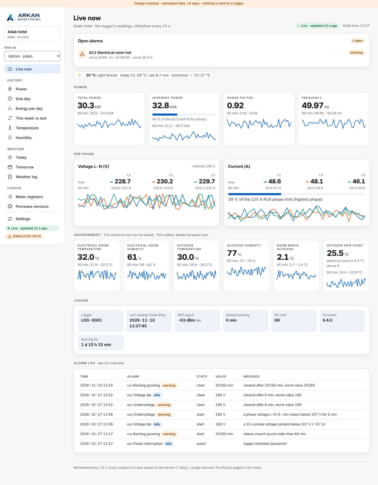
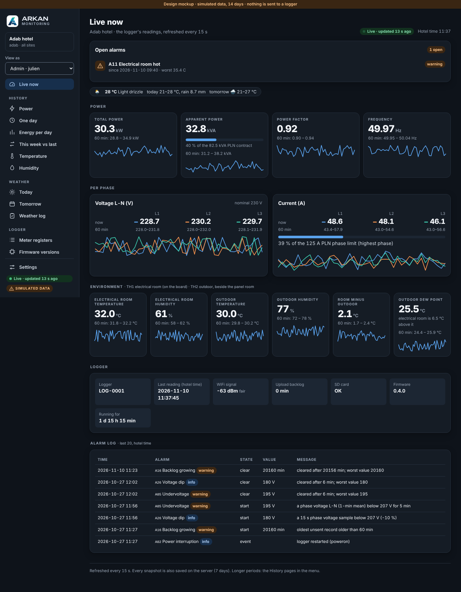
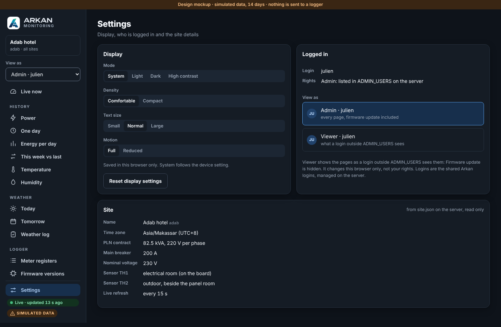
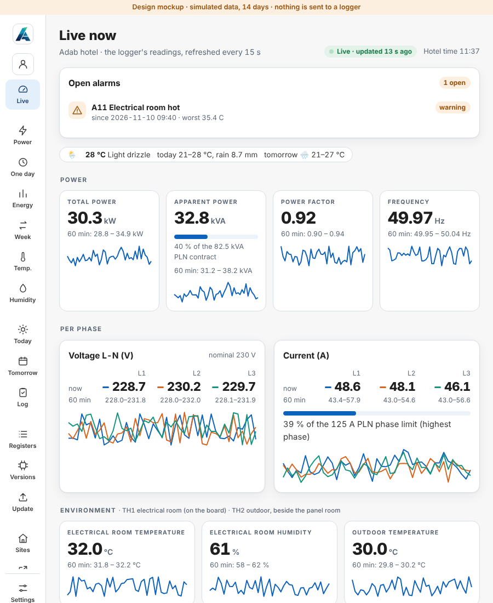

# Dashboard mockup in the Arkan design (for review)

The pages of `arkan-monitoring.duckdns.org` (`/live/`, `/live/adab/` and its sub pages, `/live/adab/register`) redrawn with the
Arkan UI kit, the design of the CMMS. **Same content, new look.** Open **[`index.html`](index.html)** in a browser: one file, no network,
simulated data (14 days), nothing is sent to a logger.

| | |
|---|---|
|  |  |
|  |  |

## What changed against the pages in service

- **Side bar of the CMMS**: logo, site, **View as**, the pages in groups (History, Weather, Logger, Platform), **Settings** at the bottom
  with the live state. Icon rail from 700 px, bottom tabs and a "More" sheet on a phone.
- **View as** shows who is logged in (the Caddy login) and the rights: `Admin · <login>` when the login is in `ADMIN_USERS`,
  `Viewer · <login>` otherwise. An admin can switch to Viewer to see the pages as the other logins do (Firmware update hidden).
  It changes the browser only, never the rights on the server.
- **Settings**: the kit's display settings (mode: system, light, dark, high contrast; density; text size; motion; reset), saved in the
  browser as in the CMMS and shared with it on the same address. Also who is logged in, and the site details from `site.json` (read only).
- **Meter registers** and **All sites** are pages of the same shell (today they are separate pages).
- Charts, tables, values, texts and the 15 s refresh are those of `server/app/live.html` and `registers.html`.

## To decide at the review

1. View as: is Admin / Viewer the right list, or are named roles wanted (as "Hotel manager" in the CMMS)? Roles need a list on the server.
2. The link to Open Energy Dashboard stays in the menu; today `/` sends back to `/live/`.
3. English only, as today (the CMMS also has Indonesian).

## Files

`page.html` (the page: styles and script, placeholders for the rest), `arkan-ui.css` and `arkan-ui.js` (copy of the kit, see
`VENDORED.md`), `brand-mark.html` and `brand-text.html` (logo), `capture.py` (saves the answers of a local service as `fixtures.json`),
`build.py` (puts everything in `index.html`).

Rebuild: start the service and the simulator as in [`../README.md`](../README.md) with `ADMIN_USERS=julien`, then

```bash
python3 docs/mockup/arkan/capture.py
python3 docs/mockup/arkan/build.py
```

`capture.py` makes up what the simulator does not send (register table report, firmware history, day-ahead forecast, one open alarm).
After approval, `page.html` without the `FX` block becomes `server/app/live.html`.
