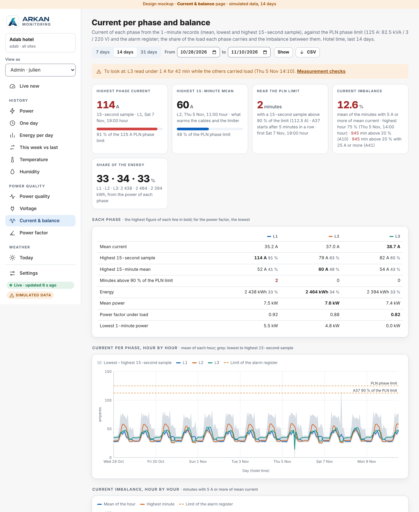
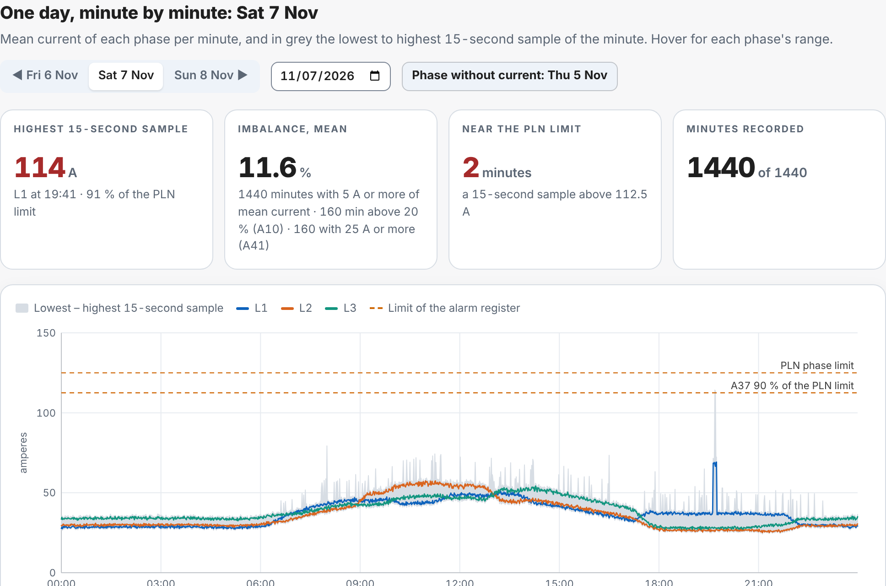
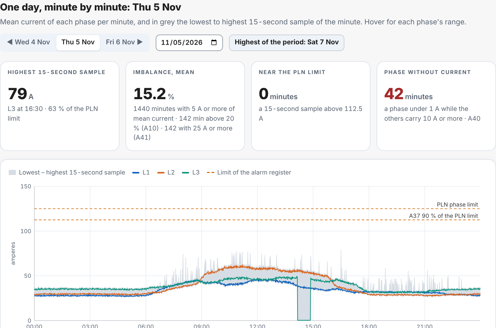
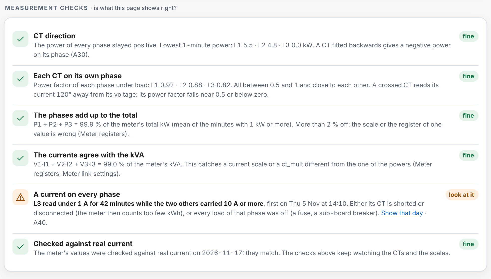

# Current per phase and phase balance

**Status, 17 November 2026: built in release `v0.10.0`** (`server/app/quality.py`, `server/app/alarms.py`, the page in
`server/app/live.html`; install: [`UPDATING.md`](../../UPDATING.md) section C). The proposal of the same day was reviewed: the
**estimated neutral current** and the **balancing card** (amperes to move between phases) were taken out; the rest is built, with
alarms A40 (a phase without current) and A41 (the current imbalance under load, counted apart from A10). The meter's values were
checked against real current on site and match (owner, 17 November 2026). The decisions are [at the end](#decisions-of-the-review).

This folder keeps the design: the mockup, the rules and the review of what was missing. Open **[`index.html`](index.html)** in a browser
(one file, no server, no network): the site page as released (`server/app/live.html`) with the saved answers of the Arkan mockup
([`../arkan/`](../arkan/README.md)) and 14 days of simulated phase currents. The page works: change the period, click a day, hover the
charts. The page's clock is fixed at **Tue 10 Nov 2026 13:00** hotel time.

The request:
- a page for **the current of each phase** and **the balance between the phases**;
- a review of **what was missing to check the current and the balance**.

**No firmware change and no new column.** Every figure comes from what the logger already writes in each 1-minute record:
`EM01_i1..i3`, `p1..p3`, `v1..v3`, `p`, `s`, with their lowest and highest 15-second sample.

**Simulated data.** The 14 days of the Arkan mockup: the total power, power factor and voltages of each hour are those of the other pages;
only their split between the phases is simulated, as a hotel would split them: the kitchen on L1 (breakfast, lunch, dinner, busier on
Friday and Saturday evenings), the laundry on L2 (weekdays 9:00 to 16:00), the rooms' air conditioning a little more on L3 (afternoon and
night), the pool pump and the lift on all three. Two events: on **Sat 7 Nov at 19:41** the kitchen's ovens and dishwasher together take
L1 to **114 A** (two 15-second samples above 90 % of the PLN limit, not five minutes in a row, so A37 does not start); on **Thu 5 Nov from
14:10 to 14:51** L3 reads under 1 A while L1 and L2 carry their load (its CT shorted during work in the panel: A40 starts).

## The page (`#current`, menu Power quality → Current & balance)

| Top: tiles, each phase | Charts: per phase, imbalance, by hour of the day |
|---|---|
|  |  |

| One day, minute by minute (the highest of the period) | One day: L3 without current |
|---|---|
|  |  |

| Measurement checks | Day by day |
|---|---|
|  |  |

| Live now: the current card gets one line | Power quality: the imbalance tile links here | Dark | Phone |
|---|---|---|---|
|  |  |  |  |

The whole page: [`img/desk-current.png`](img/desk-current.png).

### The template, top to bottom

| Block | What it shows | Why |
|---|---|---|
| Head | Title, the period (7, 14, 31 days or two dates, as every history page) and the **CSV** of the original records | Same as the other power quality pages |
| Banner (only when a check fails) | What is wrong, in one line: "To look at: L3 read under 1 A for 42 min while the others carried load (Thu 5 Nov 14:10)" | A wrong measurement makes every figure below wrong: it comes first |
| **Highest phase current** | The highest 15-second sample of any phase, which phase, when, and a bar against the **PLN phase limit** (125 A = 82.5 kVA / 3 / 220 V) | The limiter trips on one phase even when the total kVA is under contract |
| **Highest 15-minute mean** | The highest mean of 15 one-minute means in a row, per phase, against the same limit | What warms the cables and the limiter; the 15-second samples catch motor starts |
| **Near the PLN limit** | Minutes with a 15-second sample above 90 % of the limit (112.5 A), and the first one | A37 needs 5 minutes in a row: the near misses were seen nowhere |
| **Current imbalance** | Mean of the minutes with 5 A or more of mean current, the highest hour, the minutes above 20 % (A10), and apart, the minutes above 20 % with 25 A or more of mean current (A41) | The figures A10 and A41 check, over time: 20 % of 30 A at night is harmless, under load it matters |
| **Share of the energy** | kWh of each phase and its share | Which phase carries the load |
| **Each phase** | One table, L1, L2, L3 side by side: mean current, highest 15-second sample and 15-minute mean (with % of the limit), minutes above 90 %, kWh and share, mean kW, power factor under load, lowest 1-minute power | The three phases compared on one screen |
| **Current per phase, hour by hour** | Each phase's hourly mean, in grey the lowest to highest 15-second sample, the A37 and PLN lines | The trend and the peaks |
| **Current imbalance, hour by hour** | Mean of the hour and highest minute, the A10 line | When the phases drift apart |
| **By hour of the day** | Mean current of each phase for each hour of the day, over the period | Which phase carries the load, and when: the order changes over the day |
| **Day by day** | Highest current and its phase, mean of each phase, energy shares, imbalance (mean, highest hour), minutes above 20 % (A10) and of them with 25 A or more (A41), minutes near the limit; "phase without current" mark; click a day for its minutes | Find the days to look at |
| **Current alarms** | The lines of the alarm log of the period for A10, A41, A37, A29, A30 and A40 | As the Power quality page does for its alarms |
| **One day, minute by minute** | ◀ ▶, a calendar, **Highest of the period**, **Phase without current**; tiles (highest sample, imbalance, minutes near the limit, minutes without current or recorded); each phase per minute with its 15-second range and the limits | The detail behind a peak or a fault |
| **Measurement checks** | Six checks, each fine / look at it / wrong / to do (next section) | Is what this page shows right? |

On a phone the tables drop their less useful columns. In the simulated 14 days the page reads: highest 114 A on L1 (91 % of the PLN
limit), highest 15-minute mean 60 A on L2, 2 minutes near the limit, imbalance 12.6 %, energy 33 · 34 · 33 %; by hour of the day L2 leads
from 9:00 to 15:00 (the laundry), L3 at night (the rooms). The simulated hotel never draws less than about 27 A per phase, so A10 and
A41 count the same minutes here; at night at the hotel (about 10 A per phase) A41 leaves those minutes out.

## How the figures are worked out

| Figure | How |
|---|---|
| Current of a phase in an hour | Mean of the 1-minute means (`EM01_i1`); lowest and highest: the lowest `_min` and highest `_max` 15-second sample of the hour |
| 15-minute mean | Mean of 15 one-minute means in a row (restarts after a gap), carried over from one day file to the next; the highest one ending in each hour |
| PLN phase limit | `contracted_kva` × 1000 / 3 / `contract_v_ln` from `site.json` (125 A at Adab), as A37 and Live now |
| Near the limit | A minute with a 15-second sample above A37's threshold (90 % of the limit), counted per phase |
| Current imbalance | The largest deviation of a phase from the mean of the three, in % of the mean, for minutes with a mean of 5 A or more: **the rule of A10**. **A41** counts the same apart, for minutes with a mean of **25 A or more** (`site.json` `i_imbalance_loaded_a`). Thresholds from the alarm register in use |
| Energy of a phase | Its 1-minute power `p1` summed (kWh = kW × 1/60). The meter has no counter per phase; the sum is checked against the total (checks) |
| Power factor of a phase | P / (V × I) of each minute with 0.3 kW or more on that phase; the meter gives only the total power factor |

## Measurement checks

At the bottom of the page, and as a banner at the top when one fails. All from the records already kept.

| Check | Test | What it catches |
|---|---|---|
| CT direction | Each phase's lowest 1-minute power stays above A30's threshold (−0.5 kW) | A CT fitted backwards (A30 already alarms; the page shows the margin) |
| Each CT on its own phase | Each phase's power factor between 0.5 and 1, and the three within 0.2 of each other | A CT on another phase than its voltage wire: its power factor falls near 0.5 or below zero. A30 does not see it while the power stays positive |
| The phases add up to the total | P1 + P2 + P3 within 2 % of the meter's total kW | A wrong scale or register for one value |
| The currents agree with the kVA | V1·I1 + V2·I2 + V3·I3 within 5 % of the meter's kVA; "wrong" at about 50 times | A current scale or `ct_mult` that differs from the powers' (the 250/5 CT ratio is 50) |
| A current on every phase | No minute with a phase under 1 A while the two others carry 10 A or more | A CT shorted or disconnected (the meter then counts too few kWh), or a whole phase off (a fuse, a sub-board breaker). Alarm A40 |
| Checked against real current | A date in `site.json` (`meter_checked`), set with `manage.py site-set adab meter_checked=<date>`: at Adab the values were checked and match (17 November 2026) | Until it is set, the amperes are not trusted ([`../../meter/README.md`](../../meter/README.md) section 4) |

## What was missing to check the current and the balance

**What existed before** (release `v0.9.0`):

| What | Where |
|---|---|
| Current of each phase now, its 60-minute range and sparkline, a bar against the PLN phase limit | Live now |
| Each phase's current, power and voltage every minute, with the lowest and highest 15-second sample | the records (`DATA-FORMAT.md`), the CSV |
| A10 current imbalance (20 %, 15 min, not below 5 A), A37 phase current near the PLN limit (90 %, 5 min, WhatsApp), A29 near the breaker rating (`rated_a`), A30 negative power on a phase | the alarm register |
| One tile "Current imbalance" (the highest hourly mean) | Power quality |
| A28 voltage unbalance (2 %), hour by hour | Voltage |

**The gaps, and what was done** (`v0.10.0`):

| # | Missing | Done |
|---|---|---|
| G1 | Any history of the current per phase (only the last 60 minutes, on Live now) | Hour by hour, day by day, one day minute by minute |
| G2 | The highest 15-second sample and 15-minute mean per phase against the PLN limit; the minutes near it (A37 sees only 5-minute runs) | Tiles, the table Each phase, counts per day |
| G3 | The current imbalance over time (one tile) | Hour by hour, by hour of the day, day by day, the A10 lines |
| G4 | **`p1`, `p2`, `p3` were recorded but shown nowhere** | Mean kW, kWh and share per phase |
| G5 | Which phase carries the load at which time of day | By hour of the day |
| G6 | The power factor of each phase | P / (V × I) per phase |
| G7 | Any check that the CTs and scales are right | The six checks and the banner |
| G8 | The imbalance now | One line on the current card of Live now, with a link to the page |
| G9 | **A phase without current**: a shorted or open CT loses kWh silently (the voltage is there, the power stays positive: no other alarm fires) | **Alarm A40**: a phase under 1 A while the two others carry 10 A or more, for 5 min, warning, WhatsApp `yes` |
| G10 | A10 at light load: 20 % of 30 A at night is harmless | **Two counts**: A10 as before (from 5 A), and **alarm A41**, the same imbalance counted apart only with 25 A or more of mean current; both on the page |
| G11 | **The amperes were not verified**: the register map was a proposal | **Checked on site against real current: they match** (17 November 2026); the check "Checked against real current" and `meter_checked`; checks 3 and 4 catch a wrong `ct_mult` from the office |
| G12 | A new alarm of a release needed the register in use on the VPS edited by hand (`init` never overwrites it) | **The lines of the default register missing from the register in use are used as they are**: A40 and A41 work at once, an edited line always wins |

Reviewed and **not done** (decisions below): an estimated neutral current; the amperes to move between phases; a measured neutral,
current harmonics and the board's phase map at the site visit; the negative-sequence voltage unbalance of EN 50160 for A28 (the
Voltage page and A28 keep the largest deviation of a phase voltage from the mean, which reads higher than EN 50160's figure: a stricter
check).

## How it is built (release `v0.10.0`)

No change to the logger, the firmware, the records or OED.

| Part | What |
|---|---|
| `server/app/quality.py` | The same pass over each day file as the power quality pages (same cache, each file summarised once) adds per hour: `i1..i3` with `_min`, `_max`, `_d15`; `p1..p3`, `e1..e3`, `p1_min..p3_min`, `pf1..pf3`, `i1_hi..i3_hi`; `iu`, `iu_max`, `iu_n`, `iu_hi`; `i_zero`, `i_zero_ph`, `i_zero_at`; `psum`, `sratio`. `current_hourly()` joins the 15-minute means across the change of day file; `current_minutes()` gives one day |
| API | `GET /api/v1/quality/<site>/current?days=N` (or `?from=&to=`): the hours, the limits (A10, A41, A37, A29, A30, A40 from the alarm register in use), `pln_a`, `rated_a`, `i_floor_a`, `i_imb_loaded_a`, `i_loaded_a`, the current lines of the alarm log of the period. `GET /api/v1/quality/<site>/current/day/<date>`: the minutes. Same login and `USER_SITES` rules as the rest |
| `server/app/alarms.py`, `docs/alarms/alarms.csv` | Rules `i_phase_zero` (A40) and `i_imbalance_loaded` (A41, from `site.json` `i_imbalance_loaded_a`, 25 A by default); A10 unchanged. `register()` adds the lines of the default register missing from the register in use. A38 and A39 stay kept for the meter readings proposal (its decision R5) |
| `server/app/live.html` | The page, the line on Live now's current card, the link from the Power quality tile |
| `manage.py` | `site-set <site> key=value` (`meter_checked`, `i_imbalance_loaded_a`, the contract values); `alarm-register [--add]`: lists the lines used from the default register, `--add` copies them into the register in use to edit them |
| Tests | `server/tests/test_ingest.py`: A40 (start after 5 minutes, clear, nothing told at light load), A10 from 5 A and A41 from 25 A with its site override, the register in use completed from the default one, the page's API (each field, the 15-minute mean across two day files, the day, errors), `site-set`, `alarm-register` |

## Decisions of the review

| # | Question | Proposed | Decided (17 November 2026) |
|---|---|---|---|
| C1 | Where in the menu, and the name | Power quality, between Voltage and Power factor: **Current & balance** | As proposed |
| C2 | The busy hours of the balancing card | The top quarter of the hours | **The balancing card is taken out** |
| C3 | Show an estimated neutral current | Yes, labelled "estimated" | **No: taken out** (tile, charts, Live now) |
| C4 | A40 phase without current: severity and WhatsApp | Warning, WhatsApp yes | **Yes**, WhatsApp `yes` (sent once WhatsApp exists, S6) |
| C5 | A41 neutral current high | Off until the neutral is measured | **Not added** (no neutral) |
| C6 | A10 at light load | Keep 5 A, show amperes | **Two separate counts**: A10 as it was (above 20 %, from 5 A), and A41 (above 20 % with 25 A or more of mean current) |
| C7 | At the site visit: neutral registers, the meter's label for harmonics, the board's phase map | Yes | **No** |
| C8 | Voltage unbalance as EN 50160 defines it, for A28 | Yes | **No need** |
| C9 | `meter_checked` in `site.json` | Yes | As proposed; the meter's values were checked against real current and match (17 November 2026) |
| C12 | New alarms of a release without overwriting the register in use | (asked in the review) | **Yes**: the missing lines are taken from the default register |
| C10 | The line on Live now | Yes | As proposed, with the imbalance only |
| C11 | Later: the phase map, a month view | Not in the first release | Not in this release |

## Files

| File | What |
|---|---|
| `index.html` | the mockup (built, one file) |
| `mock-server.js` | answers the page's `/api/v1/quality/<site>/current` requests inside the mockup, with the fields and rules of `server/app/quality.py`, from simulated minutes of the three phases made out of the saved hours. Also put into the Arkan and readings mockups, so their menu entry works |
| `build.py` | builds `index.html` from `server/app/live.html`, `mock-server.js`, the UI kit and `../arkan/fixtures.json` (each insertion point must be found once, or it stops) |
| `capture.js` | the screenshots in `img/` (Playwright); stops if the page writes an error |

Rebuild after a change of the page:

```bash
python3 docs/mockup/current/build.py
node docs/mockup/current/capture.js
```
