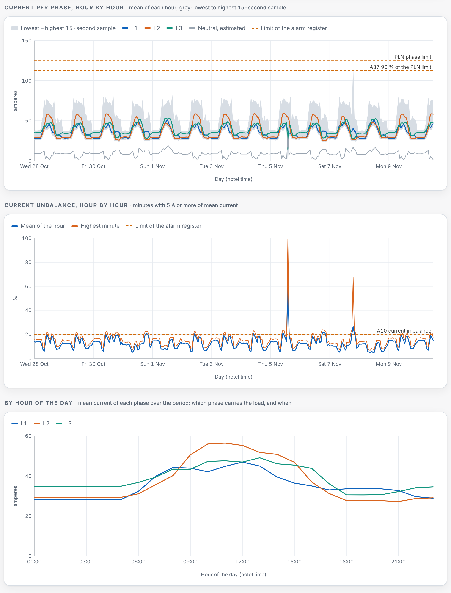
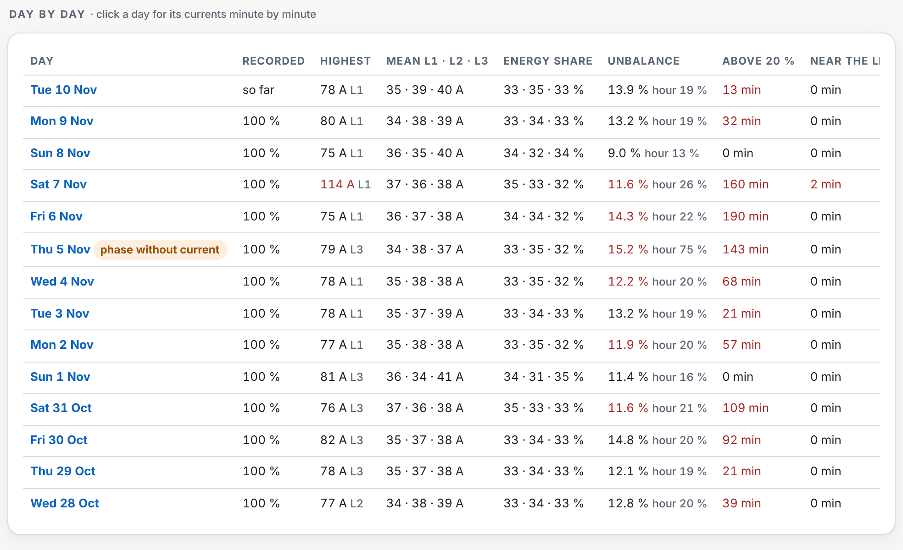
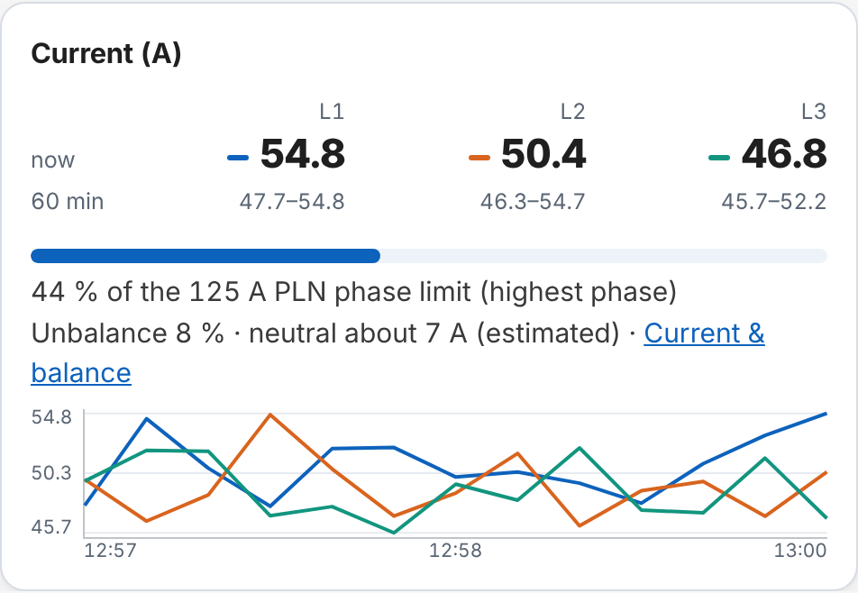
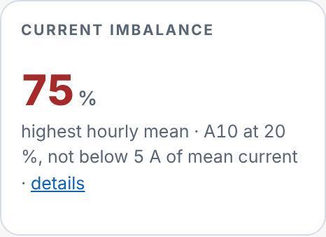
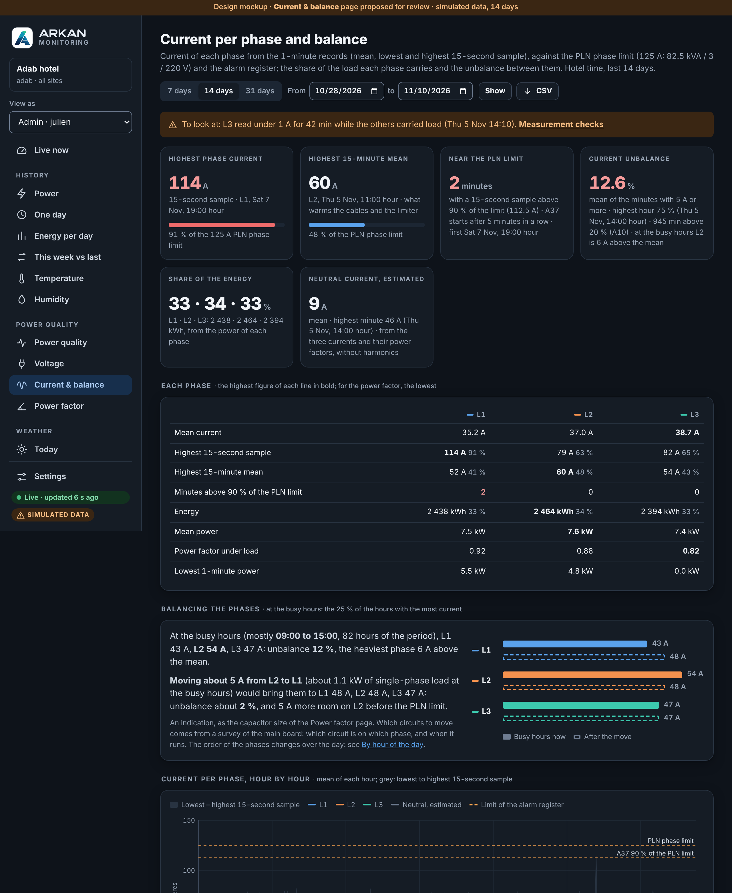
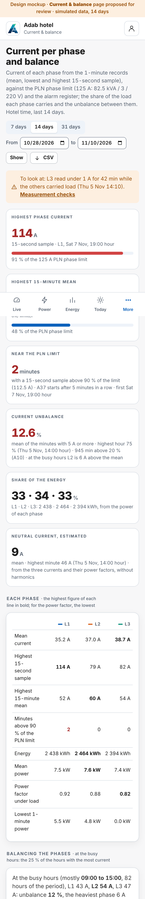

# Current per phase and phase balance: proposal

**Status, 17 November 2026: proposal for review.** Nothing in `server/` or `firmware/` is changed. Open **[`index.html`](index.html)** in a
browser (one file, no server, no network): it is the site page as released (`server/app/live.html`) with the saved answers of the Arkan
mockup ([`../arkan/`](../arkan/README.md)) and the proposed page **Current & balance** in the menu group **Power quality**. The page works:
change the period, click a day, hover the charts. The page's clock is fixed at **Tue 10 Nov 2026 13:00** hotel time.

The request:
- a page for **the current of each phase** and **the balance between the phases**;
- a review of **what is missing to check the current and the balance**.

**No firmware change and no new column are needed for the page.** Every figure comes from what the logger already writes in each
1-minute record: `EM01_i1..i3`, `p1..p3`, `v1..v3`, `p`, `s`, with their lowest and highest 15-second sample. The gaps that need the meter
or the site are listed in [What is missing](#what-is-missing-to-check-the-current-and-the-balance).

**Simulated data.** The 14 days of the Arkan mockup: the total power, power factor and voltages of each hour are those of the other pages;
only their split between the phases is simulated, as a hotel would split them: the kitchen on L1 (breakfast, lunch, dinner, busier on
Friday and Saturday evenings), the laundry on L2 (weekdays 9:00 to 16:00), the rooms' air conditioning a little more on L3 (afternoon and
night), the pool pump and the lift on all three. Two events: on **Sat 7 Nov at 19:41** the kitchen's ovens and dishwasher together take
L1 to **114 A** (two 15-second samples above 90 % of the PLN limit, not five minutes in a row, so A37 does not start); on **Thu 5 Nov from
14:10 to 14:51** L3 reads under 1 A while L1 and L2 carry their load (its CT shorted during work in the panel).

## The page (`#current`, menu Power quality → Current & balance)

| Top: tiles, each phase, balancing | Charts: per phase, unbalance, by hour of the day |
|---|---|
|  |  |

| One day, minute by minute (the highest of the period) | One day: L3 without current |
|---|---|
|  |  |

| Measurement checks | Day by day |
|---|---|
|  |  |

| Live now: the current card gets one line | Power quality: the imbalance tile links here | Dark | Phone |
|---|---|---|---|
|  |  |  |  |

The whole page: [`img/desk-current.png`](img/desk-current.png).

### The template, top to bottom

| Block | What it shows | Why |
|---|---|---|
| Head | Title, the period (7, 14, 31 days or two dates, as every history page) and the **CSV** of the original records | Same as the other power quality pages |
| Banner (only when a check fails) | What is wrong, in one line: "To look at: L3 read under 1 A for 42 min while the others carried load (Thu 5 Nov 14:10)" | A wrong measurement makes every figure below wrong: it comes first |
| **Highest phase current** | The highest 15-second sample of any phase, which phase, when, and a bar against the **PLN phase limit** (125 A = 82.5 kVA / 3 / 220 V) | The limiter trips on one phase even when the total kVA is under contract |
| **Highest 15-minute mean** | The highest mean of 15 one-minute means in a row, per phase, against the same limit | What warms the cables and the limiter; the 15-second samples catch motor starts |
| **Near the PLN limit** | Minutes with a 15-second sample above 90 % of the limit (112.5 A), and the first one | A37 needs 5 minutes in a row: the near misses are seen nowhere today |
| **Current unbalance** | Mean of the minutes with 5 A or more, the highest hour, the minutes above 20 % (A10), and in amperes: how far the heaviest phase is above the mean at the busy hours | The figure A10 checks, over time; the amperes say whether it matters |
| **Share of the energy** | kWh of each phase and its share | Which phase carries the load |
| **Neutral current, estimated** | Mean and highest minute | Unbalance and mixed power factors put current in the neutral |
| **Each phase** | One table, L1, L2, L3 side by side: mean current, highest 15-second sample and 15-minute mean (with % of the limit), minutes above 90 %, kWh and share, mean kW, power factor under load, lowest 1-minute power | The three phases compared on one screen |
| **Balancing the phases** | At the busy hours (the quarter of the hours with the most current), the mean of each phase and the unbalance; **how many amperes to move from which phase to which**, about how many kW, and the unbalance after; two bars per phase (now, after) | The answer to "what do we do about it" |
| **Current per phase, hour by hour** | Each phase's hourly mean, in grey the lowest to highest 15-second sample, the estimated neutral, the A37 and PLN lines | The trend and the peaks |
| **Current unbalance, hour by hour** | Mean of the hour and highest minute, the A10 line | When the phases drift apart |
| **By hour of the day** | Mean current of each phase for each hour of the day, over the period | The order of the phases changes over the day: one move must suit the whole day |
| **Day by day** | Highest current and its phase, mean of each phase, energy shares, unbalance (mean, highest hour), minutes above 20 %, minutes near the limit, neutral; "phase without current" mark; click a day for its minutes | Find the days to look at |
| **Current alarms** | The lines of the alarm log of the period for A10, A37, A29, A30 and the proposed A40 | As the Power quality page does for its alarms |
| **One day, minute by minute** | ◀ ▶, a calendar, **Highest of the period**, **Phase without current**; tiles (highest sample, unbalance, neutral, minutes); each phase per minute with its 15-second range, the neutral, the limits | The detail behind a peak or a fault |
| **Measurement checks** | Six checks, each fine / look at it / wrong / to do (next section) | Is what this page shows right? |

On a phone the tables drop their less useful columns and the balancing bars go under the text. In the simulated 14 days the page reads:
highest 114 A on L1 (91 % of the PLN limit), highest 15-minute mean 60 A on L2, 2 minutes near the limit, unbalance 12.6 % (945 minutes
above 20 %, mostly Friday and Saturday dinners and the L3 fault), energy 33 · 34 · 33 %, neutral about 9 A; at the busy hours (09:00 to
15:00) L1 43 A, L2 54 A, L3 47 A: **move about 5 A (1.1 kW) from L2 to L1**, unbalance 12 % → 2 %.

## How the figures are worked out

| Figure | How |
|---|---|
| Current of a phase in an hour | Mean of the 1-minute means (`EM01_i1`); lowest and highest: the lowest `_min` and highest `_max` 15-second sample of the hour |
| 15-minute mean | Mean of 15 one-minute means in a row (restarts after a gap); the highest one ending in each hour |
| PLN phase limit | `contracted_kva` × 1000 / 3 / `contract_v_ln` from `site.json` (125 A at Adab), as A37 and Live now |
| Near the limit | A minute with a 15-second sample above A37's threshold (90 % of the limit), counted per phase |
| Current unbalance | The largest deviation of a phase from the mean of the three, in % of the mean, for minutes with a mean of 5 A or more: **the rule of A10**, threshold from the alarm register in use |
| Energy of a phase | Its 1-minute power `p1` summed (kWh = kW × 1/60). The meter has no counter per phase; the sum is checked against the total (checks) |
| Power factor of a phase | P / (V × I) of each minute with 0.3 kW or more on that phase; the meter gives only the total power factor |
| **Neutral, estimated** | The three currents added as vectors: the voltages 120° apart, each current behind its voltage by the angle of its power factor (lagging taken, as in a hotel; a leading phase over-compensated by a capacitor bank would read wrong). **Fundamental only**: the third harmonic of LED drivers and computers adds up in the neutral, so the real neutral current is higher |
| Busy hours | The hours whose heaviest phase is in the top quarter of the period |
| The move | Half the difference between the heaviest and the lightest phase at the busy hours, in amperes, moved from one to the other; kW = A × 230 V × the power factor of the heaviest phase. The unbalance left is the middle phase's deviation. **An indication**, as the capacitor size of the Power factor page: which circuits to move comes from a survey of the main board |

## Measurement checks

At the bottom of the page, and as a banner at the top when one fails. All from the records already kept.

| Check | Test | What it catches |
|---|---|---|
| CT direction | Each phase's lowest 1-minute power stays above A30's threshold (−0.5 kW) | A CT fitted backwards (A30 already alarms; the page shows the margin) |
| Each CT on its own phase | Each phase's power factor between 0.5 and 1, and the three within 0.2 of each other | A CT on another phase than its voltage wire: its power factor falls near 0.5 or below zero. A30 does not see it when the power stays positive |
| The phases add up to the total | P1 + P2 + P3 within 2 % of the meter's total kW | A wrong scale or register for one value |
| The currents agree with the kVA | V1·I1 + V2·I2 + V3·I3 within 5 % of the meter's kVA; "wrong" at about 50 times | A current scale or `ct_mult` that differs from the powers' (the 250/5 CT ratio is 50) |
| A current on every phase | No minute with a phase under 1 A while the two others carry 10 A or more | A CT shorted or disconnected (the meter then counts too few kWh), or a whole phase off (a fuse, a sub-board breaker). Proposed alarm A40 |
| Checked against the meter and a clamp meter | A date in `site.json` (`meter_checked`, proposed), set after the on-site register check | Until it is set, the amperes are not trusted ([`../../meter/README.md`](../../meter/README.md) section 4) |

## What is missing to check the current and the balance

**What exists today** (release `v0.9.0`):

| What | Where |
|---|---|
| Current of each phase now, its 60-minute range and sparkline, a bar against the PLN phase limit | Live now |
| Each phase's current, power and voltage every minute, with the lowest and highest 15-second sample | the records (`DATA-FORMAT.md`), the CSV |
| A10 current imbalance (20 %, 15 min, not below 5 A), A37 phase current near the PLN limit (90 %, 5 min, WhatsApp), A29 near the breaker rating (`rated_a`), A30 negative power on a phase | the alarm register |
| One tile "Current imbalance" (the highest hourly mean) | Power quality |
| A28 voltage unbalance (2 %), hour by hour | Voltage |

**The gaps**, and what this proposal does about each:

| # | Missing | Why it matters | Proposed | Needs |
|---|---|---|---|---|
| **On the page, from the records already kept** |||||
| G1 | Any history of the current per phase (only the last 60 minutes, on Live now) | Peaks, trends and days to look at | Hour by hour, day by day, one day minute by minute | This page |
| G2 | The highest 15-second sample and 15-minute mean per phase against the PLN limit; the minutes near it | The limiter trips on one phase; A37 sees only 5-minute runs, the near misses are lost | Tiles, the table Each phase, counts per day | This page |
| G3 | The current unbalance over time (one tile today) | When and how much the phases drift apart | Hour by hour, by hour of the day, day by day, the A10 lines | This page |
| G4 | **`p1`, `p2`, `p3` are recorded but shown nowhere** | The load and the energy of each phase | Mean kW, kWh and share per phase | This page |
| G5 | Which phase carries the load at which time of day | One move must suit the whole day, not one hour | By hour of the day | This page |
| G6 | What to do about the unbalance | A figure without an action | The move: amperes, kW, unbalance after | This page; G15 to name the circuits |
| G7 | **The neutral current**: not read, not estimated | An unbalanced load and mixed power factors load the neutral; it has no breaker | The estimate (fundamental only), labelled as such | This page; G12 for a measured value |
| G8 | The power factor of each phase | A crossed CT; where the reactive load is | P / (V × I) per phase | This page |
| G9 | Any check that the CTs and scales are right | Every ampere and kWh depends on it | The six checks and the banner | This page |
| G10 | The unbalance and neutral now | Seen at a glance during a site visit or a fault | One line on the current card of Live now, with a link to the page | `live.html` |
| **Alarms** |||||
| G11 | **A phase without current** | A shorted or open CT loses kWh silently (no other alarm fires: the voltage is there, the power stays positive); a phase off cuts guests' power | **A40**: a phase under 1 A while the two others carry 10 A or more, for 5 min, warning | A rule in `alarms.py`, a line in `alarms.csv` |
| G12 | A neutral current alarm | A neutral too small for its current overheats without tripping | **A41**: off until the neutral is measured (G13) and its cable size known (G16) | G13, G16 |
| **From the meter: at the first site visit** |||||
| G13 | **The amperes are not verified**: the register map is a proposal and `ct_mult` stays 1 until the site test ([`../../meter/README.md`](../../meter/README.md)) | Every figure of this page; the PLN limit bar and A37 too | The check "Checked against the meter and a clamp meter", a date in `site.json`; checks 3 and 4 catch a wrong `ct_mult` from the office | The register check of the first visit |
| G14 | **A measured neutral current** | The estimate leaves out harmonics | The guide leaves **0x0011 to 0x0017** unexplained (between the power factor and the energy): look there, and up to 0x003F, in the dump already planned. If the meter has the neutral, a line `in` in the register table (page **Meter registers**, no firmware change) | The dump at the visit |
| G15 | Current harmonics (THD) per phase | The third harmonic adds up in the neutral and heats it | Only the **FCN300-3EH4Y** has harmonics: read the label at the visit; harmonics are not read for now (decision of 31 October) | The label; a decision |
| **From the site** |||||
| G16 | The **phase map of the main board**: which circuit is on which phase, its breaker, what it feeds; the size of the neutral cable | To name the circuits to move; A41's threshold | A list from the electrician's survey; later `site.json` `circuits` so the balancing card names them | The survey |
| **In what exists** |||||
| G17 | **Voltage unbalance (A28, Voltage page) is not the EN 50160 figure its note quotes.** It takes the largest deviation of a phase-to-neutral voltage from the mean; EN 50160's 2 % is the **negative-sequence** ratio (10-minute means, 95 % of a week). The phase-to-neutral voltages also carry the zero sequence, so the two can be far apart: in a numerical check on simulated voltages, 0.19 % for EN 50160 against 2.56 % for the page | A28 may alarm on a supply that meets EN 50160, or say "EN 50160" for a figure that is not | Compute the negative-sequence unbalance exactly from the **line voltages `v12`, `v23`, `v31` already in the records**: β = (V12⁴ + V23⁴ + V31⁴) / (V12² + V23² + V31²)², u2 = √((1 − √(3 − 6β)) / (1 + √(3 − 6β))). Show both on the Voltage page and use u2 for A28, or rename A28's figure | Decision C8 |

## How it would be built

One release of the platform; no change to the logger, the firmware, the records or OED.

| Part | What |
|---|---|
| `server/app/quality.py` | The same pass over each day file as the power quality pages (same cache, each file summarised once) adds per hour: `i1..i3` with `_min`, `_max`, `_d15`; `p1..p3`, `e1..e3`, `p1_min..p3_min`, `pf1..pf3`, `i1_hi..i3_hi`; `in`, `in_max`; `iu`, `iu_max`, `iu_n`, `iu_hi`; `i_zero`, `i_zero_ph`, `i_zero_at`; `psum`, `sratio` (about 40 fields, 150 kB for 14 days before gzip). The 15-minute mean carries over from one day file to the next, as the energy counter does |
| API | `GET /api/v1/quality/<site>/current?days=N` (or `?from=&to=`): the hours, the limits (A10, A37, A29, A30, A40, A41 from the alarm register in use), `pln_a`, `rated_a`, `nominal_v`, the current lines of the alarm log of the period. `GET /api/v1/quality/<site>/current/day/<date>`: the minutes. Same login and `USER_SITES` rules as the rest |
| `server/app/alarms.py`, `docs/alarms/alarms.csv` | Rule `i_phase_zero` (A40) and rule `i_neutral` (A41, from a measured `in` when the register table has it, else the estimate). **A38 and A39 are kept for the meter readings proposal** (its decision R5) |
| `server/app/live.html` | The page ([`current.js`](current.js), [`current.css`](current.css)), the line on Live now's current card, the link from the Power quality tile |
| `site.json`, `manage.py` | `meter_checked` (date of the on-site register check). There is no command today to change one field of `site.json` after `add-site`: a new one, `manage.py site-set adab meter_checked=2026-11-xx` |
| Tests | The neutral estimate against known phasors, the unbalance (as A10), the 15-minute mean across a day file boundary and a gap, the checks, A40 replayed on a record with a shorted CT; HTTP tests of both requests and of `USER_SITES` |
| Docs | `LIVE.md` (the page), `alarms/README.md` (A40, A41), `UPDATING.md` (the release section) |

## Decisions for the review

| # | Question | Proposed |
|---|---|---|
| C1 | Where in the menu, and the name | Power quality, between Voltage and Power factor: **Current & balance** |
| C2 | The **busy hours** of the balancing card: the top quarter of the hours by the heaviest phase, or fixed hours (for example 10:00 to 15:00 and 18:00 to 22:00)? | The top quarter: it follows the site |
| C3 | Show the **estimated neutral** before a measured one exists? | Yes, always labelled "estimated, without harmonics" |
| C4 | **A40 phase without current**: 1 A while the two others carry 10 A, for 5 minutes; severity and WhatsApp? | Warning, **WhatsApp yes**: in a hotel a whole phase without current is never normal, and kWh are being lost |
| C5 | **A41 neutral current high** | In the register, **off** until the neutral is measured (G14) and the neutral cable's rating is known (G16); then 80 % of that rating for 15 min |
| C6 | **A10**: 20 % at 30 A at night is harmless; 20 % at 100 A matters. Keep A10 as it is, or count it only above 25 A of mean current (20 % of the PLN limit)? | Keep A10 as it is; the page shows the deviation in amperes beside the % so the reader judges it |
| C7 | **At the first site visit**, add to the register check: the dump of 0x0011 to 0x0017 for a neutral current or per-phase values (G14), the meter's label 3E4Y or 3EH4Y (G15), a photo of the main board's circuit list and the neutral cable's size (G16) | Yes: [`../../meter/README.md`](../../meter/README.md) section 4 and the as-built sheet |
| C8 | **Voltage unbalance as EN 50160 defines it** (G17), from the line voltages already recorded | Yes, in the same release: both figures on the Voltage page, A28 on the negative-sequence figure |
| C9 | `meter_checked` in `site.json`, shown on this page (and later on Meter registers) | Yes |
| C10 | The line on **Live now** (unbalance and neutral now, link to the page) | Yes |
| C11 | Later: the **phase map** in `site.json` so the balancing card names the circuits to move; a **month view** of the share of each phase | Not in the first release |

## Files

| File | What |
|---|---|
| `index.html` | the mockup (built, one file) |
| `current.js`, `current.css` | **the proposed page**, as it would go into `server/app/live.html` |
| `mock-server.js` | the mockup's server: simulated minutes of the three phases from the saved hours, and the answers to the two proposed requests, with the rules above |
| `build.py` | builds `index.html` from `server/app/live.html`, the files above, the UI kit and `../arkan/fixtures.json` (each insertion point must be found once, or it stops) |
| `capture.js` | the screenshots in `img/` (Playwright); stops if the page writes an error |

Rebuild after a change:

```bash
python3 docs/mockup/current/build.py
node docs/mockup/current/capture.js
```
