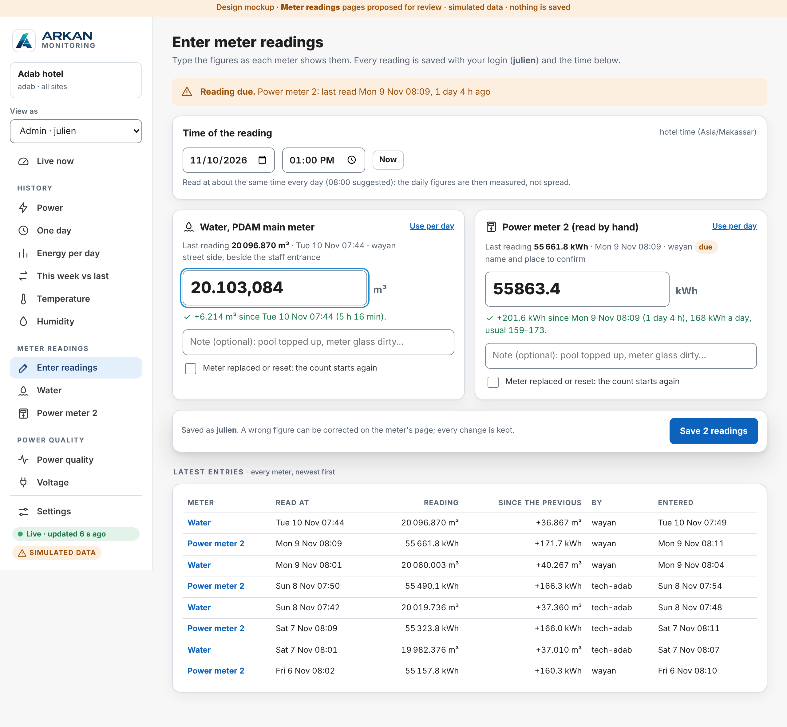
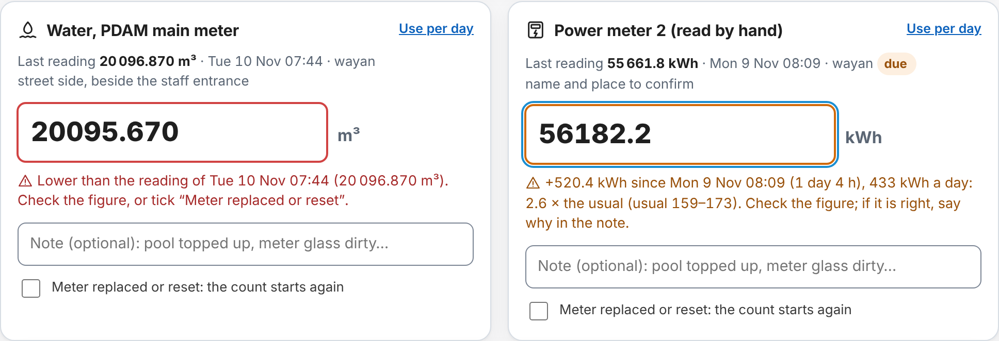
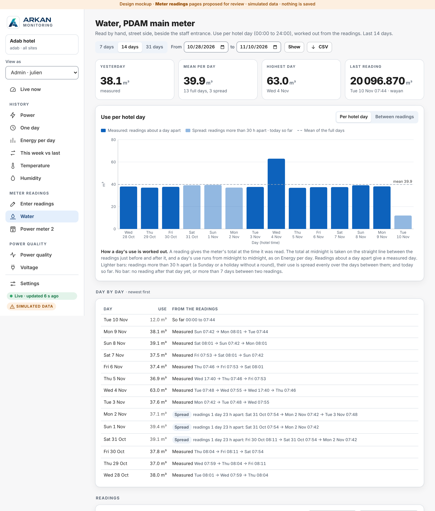
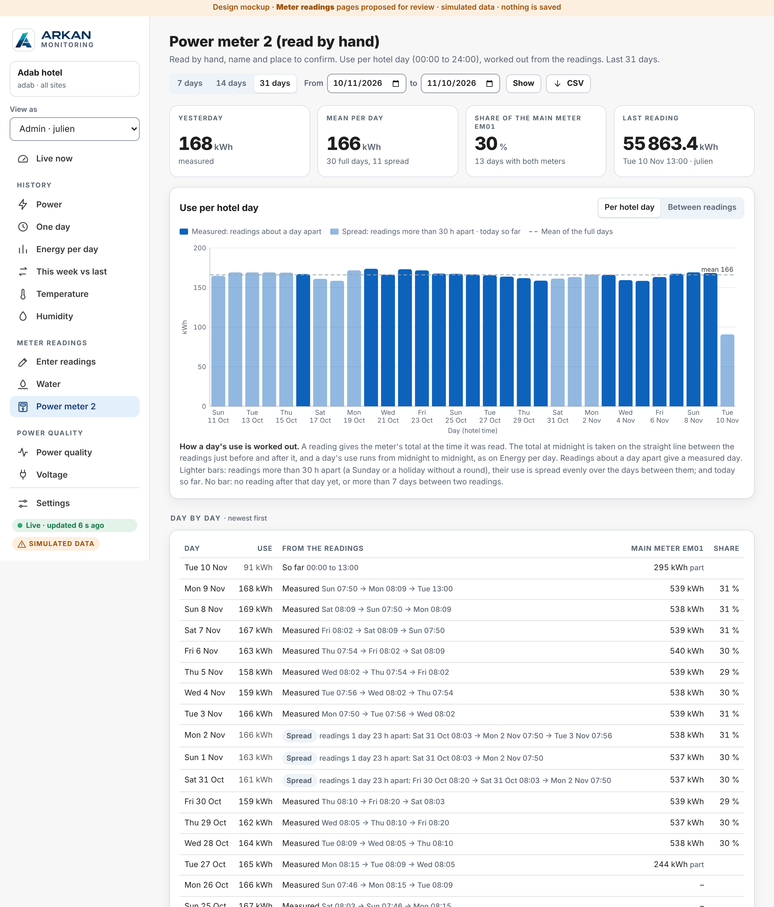
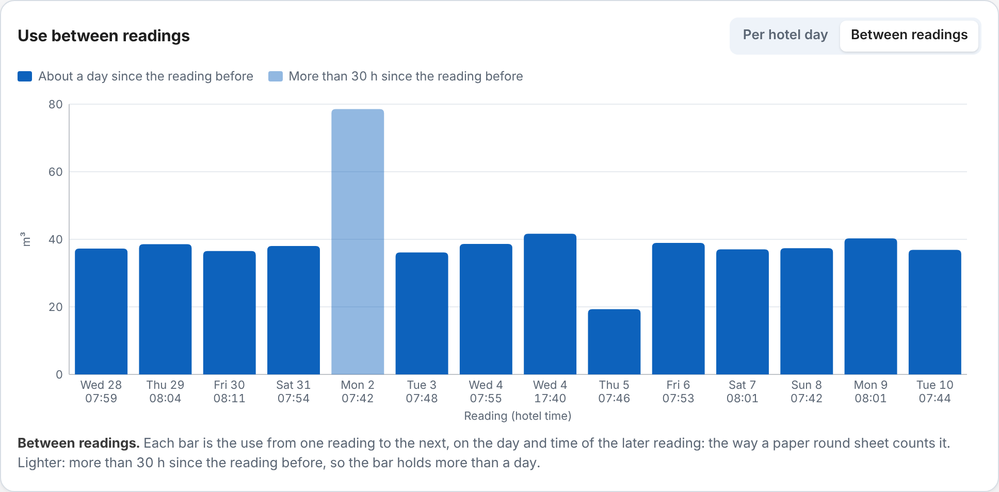
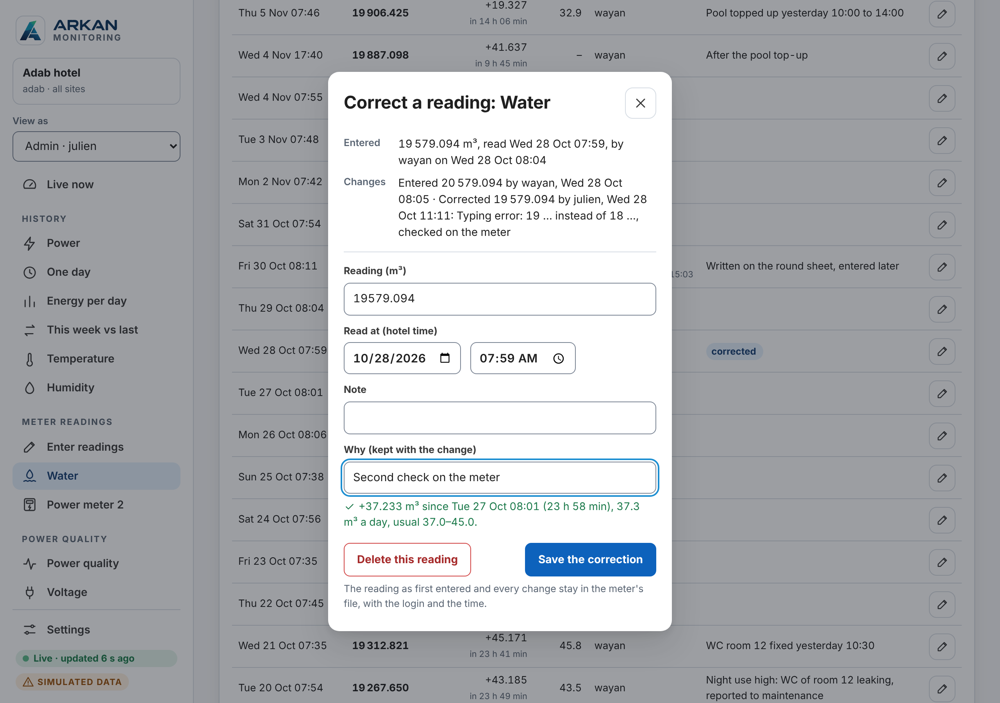
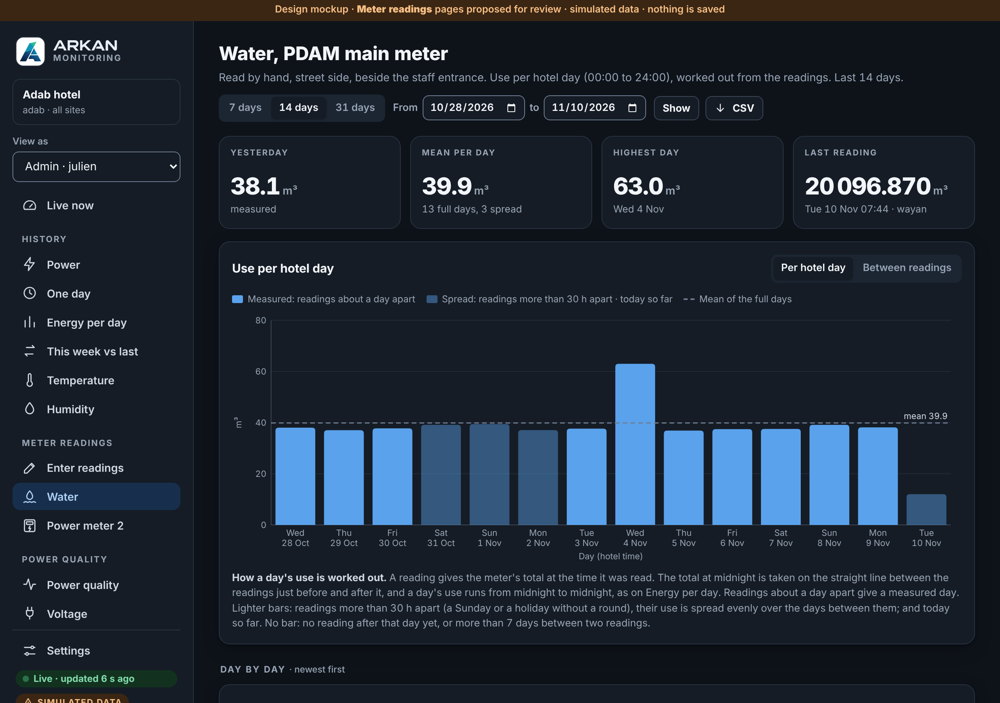
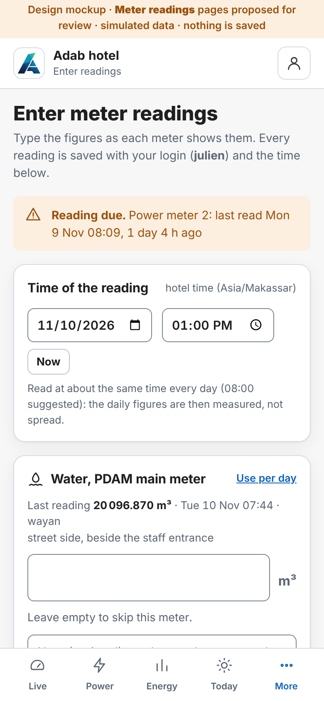
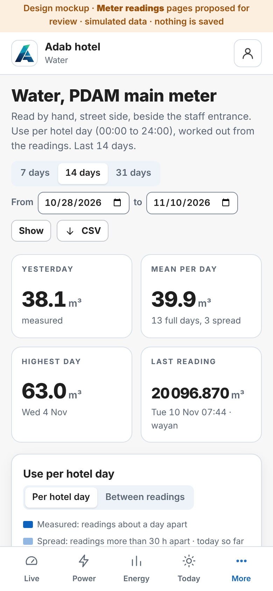

# Meter readings entered by hand: water meter and power meter 2 (PROPOSAL, for review)

**Status: mockup for review and approval, 11 November 2026. Nothing is built.** `server/` and the logger are not changed:
this folder holds the proposed pages, shown inside a copy of the site page with simulated readings.

Open **[`index.html`](index.html)** in a browser (one file, no server, no network). It is the Adab site page of the Arkan
mockup ([`../arkan/`](../arkan/README.md)) with a new menu group, **Meter readings**: **Enter readings**, **Water**, **Power meter 2**.
The page works: type a reading, save it, correct it, delete it, change the period. Everything stays in the browser page and is
gone when it is closed. The page's clock is fixed at **Tue 10 Nov 2026 13:00** hotel time (the time of the Arkan mockup's data).

The request: on the Adab site, record by hand
- the **water** consumption from a meter reading (the meter's total in m³, and the date and time it was read), and show the use of each day;
- an **additional power meter** (its total in kWh, and the date and time it was read), and show the use of each day.

## The pages

| Menu | Address | What it is |
|---|---|---|
| Enter readings | `#readings` | The round: one time (date and time, hotel time, **Now** by default), one field per meter. Each figure is checked as it is typed (below). **Save** saves all the meters filled in, with the login. A banner says which meter is due. The latest 8 entries of every meter are below. |
| Water | `#water` | Use per hotel day in m³ over the period (7, 14, 31 days or two dates, as the history pages), the mean of the full days, the readings and a CSV |
| Power meter 2 | `#pm2` | The same in kWh, plus the share of the main meter `EM01` (the logger's meter) day by day |

| Enter readings: typed, checked | The checks: red stops the save, amber asks to check |
|---|---|
|  |  |

| Water: use per hotel day | Power meter 2, against the main meter |
|---|---|
|  |  |

| Between readings (the paper round sheet's way) | Correcting a reading (the first figure stays in the history) |
|---|---|
|  |  |

| Dark | Phone: Enter readings | Phone: Water |
|---|---|---|
|  |  |  |

Also: [after saving](img/desk-enter-saved.png) (the new reading highlighted, the "due" banner gone), [a meter due](img/desk-pm2-due.png)
(yesterday has no figure until today's reading).

**On the meter's page**
- Tiles: **Yesterday** (or the total of the period when two dates are chosen), **Mean per day** of the full days, **Highest day**
  (power meter 2: **Share of the main meter**), **Last reading** with who read it and "due" when it is late.
- The chart: one bar per hotel day. Dark bar: measured. Light bar: spread, or today so far. No bar: no figure (below). Dashed line: the mean of the full days.
  Hover a bar for the readings it comes from. **Between readings** shows one bar per reading instead.
- **Day by day**: each day's use and the readings behind it. Power meter 2 adds the main meter's kWh of the same day and the share.
- **Readings**: time read, figure, use since the previous reading and over how long, use per day, who entered it (and when, if typed more
  than 2 hours later), the note, and the marks **corrected**, **new count** (meter replaced), **high** (more than 1.5 × the usual).
  The pencil opens the correction sheet.

The simulated data (45 days from 26 September) has a round every morning about 08:00, no round on some Sundays and on 12 to 14 October
(spread days), a leaking WC on 19 to 21 October (+11 m³ a day), the pool topped up on 4 November (63 m³ that day, a second
reading that afternoon), a reading written on paper and typed in the afternoon (30 October), a typing error corrected by an admin
(28 October), and power meter 2 not read yet today (due). Power meter 2 is simulated as about 30 % of the main meter.

## How a day's use is worked out

A reading gives the meter's **total at the time it was read**. People read at different times, sometimes skip a day, sometimes read twice.
To give the use of each **hotel day (00:00 to 24:00 WITA, as Energy per day)**:

1. Between two readings, the use is taken as even: the total at **midnight** is on the straight line between the reading just before
   and the one just after.
2. A day's use = the total at the next midnight − the total at its midnight.
3. **Measured** (dark bar): the readings around the day are at most **30 h** apart. With a round every morning, about two thirds of a day
   come from one interval and one third from the next: the figure is close to the real day.
4. **Spread** (light bar): readings more than 30 h apart (Saturday morning to Monday morning): their use is shared evenly over the
   days between them. The total of those days is right; the split between them is not known.
5. **No figure**: no reading after that day yet (yesterday, until today's reading), or more than **7 days** between two readings
   (the readings table still shows the total of that interval).
6. **Today so far**: from 00:00 to the last reading, light bar.

Example (water, simulated): Sat 31 Oct 07:54 → 19 692.179 m³, no reading on Sunday, Mon 2 Nov 07:42 → 19 770.740 m³:
78.561 m³ in 1 day 23 h 48 min, 39.4 m³ a day. Saturday, Sunday and Monday each take their part of it ("spread").

**Between readings** (the switch on the chart) shows the other way, as a paper round sheet does: each bar is the use from one
reading to the next, on the day of the later reading. It needs no calculation, but a Monday after a Sunday without a round shows two days.

## Checks when a reading is typed

| Check | Shown | Save |
|---|---|---|
| Not a number | red | no |
| Time in the future, or a reading already at that minute | red | no |
| **Lower than the reading before** (a typing error, or the meter was replaced or reset) | red: "check the figure, or tick Meter replaced or reset" | no |
| Higher than a **later** reading (a missed reading added afterwards, in between) | red | no |
| More decimals than the meter shows | amber | yes |
| **Use per day more than 1.5 × the usual**, or less than half (usual = the 10th to 90th percentile of the measured days of the last 28 days; only for 12 h or more since the previous reading) | amber: "2.6 × the usual (159–173). Check the figure; if it is right, say why in the note" | yes |
| Fine | green: "+201.6 kWh since Mon 9 Nov 08:09 (1 day 4 h), 168 kWh a day, usual 159–173" | yes |

- The figure may be typed `20096.870`, `20096,870`, `20 096,870` or `20.096,870` (Indonesian): one comma or one point is the decimals.
  Figures are shown with a narrow space between thousands (`20 096.870`) so they cannot be misread.
- **Meter replaced or reset**: the new reading starts a new count; the old meter's last figure can be given, so the use up to the change still counts.
  Without it, the days of that interval get no figure.
- A missed reading can be added later with its own date and time (up to 30 days back); it must fit between the readings around it.

## Who can do what

| | Who |
|---|---|
| See the pages, download the CSV | every login that sees the site (as the other pages, `USER_SITES` applies) |
| **Enter a reading** | every login that sees the site (a technician's login, `tech-adab`, does the round) |
| **Correct or delete a reading** | the person who entered it, or an admin (`ADMIN_USERS`); a reason is required; the first figure and every change are kept, with the login and the time |

In the mockup, **View as: Viewer** hides the pencil on the readings of others.

## How it would be built (after approval)

No change to the logger, the firmware or OED. One release of the platform (`v0.9.0`):

| Part | What |
|---|---|
| `site.json` | a list `manual_meters`, one line per meter: `{"id": "water", "name": "Water", "long": "Water, PDAM main meter", "kind": "water", "unit": "m³", "decimals": 3, "due_h": 26, "where": "..."}`; power meter 2 adds `"compare": "EM01"`. A third meter (gas, solar) needs no code. Set with `manage.py` |
| Data file | `sites/<site>/manual/<meter>.csv`, **append only**: one line per entry, correction or deletion (`seq, at_utc, user, action, id, time_utc, value, note, reset, old, reason`); the current readings are the file read from the top. Times in UTC, as every other file. Kept in the nightly backup with the rest of the data folder; readable by a second dashboard by the rules of [`DATA-ACCESS.md`](../../DATA-ACCESS.md) (a CSV growing at the end) |
| `server/app/manual.py` | reads the file, works out the days (the rules above) and the checks; the same rules as the mockup's `readings.js`, so the page, the CSV and a second dashboard give the same figures |
| API | `GET /api/v1/manual/<site>?days=N` (or `?from=&to=`): meters, readings, use per day and between readings, usual range, last reading, due. `POST /api/v1/manual/<site>/<meter>` `{time, value, note, reset, old}`. `POST /api/v1/manual/<site>/<meter>/<id>` `{time, value, note, reason}` or `{delete: true, reason}`. `GET /api/v1/manual/<site>/<meter>.csv?what=days\|readings&from=&to=`. JSON POSTs, same origin and `X-Requested-With`, as the register page |
| Page | the code of [`readings.js`](readings.js) and [`readings.css`](readings.css) moved into `server/app/live.html` (less the mockup's server part) |
| `manage.py` | `add-manual-meter`, and `import-readings` for the past readings of the paper sheet or an Excel file (CSV: date, time, figure, note) |
| Tests and docs | unit tests of the day rules and the checks (spread, gaps, reset, corrections, time zone); `LIVE.md`, `DATA-ACCESS.md`, `DATA-FORMAT.md`, `UPDATING.md` |

Size: a few hundred bytes a day for two meters. No extra RAM worth counting.

## Decisions for the review

| # | Question | Proposed |
|---|---|---|
| R1 | Daily figure: **per hotel day** (00:00 to 24:00, worked out from the readings) or **reading to reading** (the use since the reading before, on the day of the reading)? | Per hotel day by default (it lines up with Energy per day and the main meter), with the switch to Between readings on the chart; the CSV gives both |
| R2 | **Power meter 2**: what is it (name, place, what it feeds)? Is it **behind the main meter EM01** (then the share makes sense) or a separate supply? Decimals on its display? | Name and place to give; share shown only if it is behind EM01 |
| R3 | **Water meter**: the PDAM main meter? How many decimals on the dial (3 = litres)? | PDAM main meter, 3 decimals |
| R4 | Who may **enter** and who may **correct**? | Enter: every login of the site. Correct or delete: its author or an admin, with a reason |
| R5 | **Reading due** after 26 h: only the banner and the "due" mark, or also a line in the **alarm register** (e.g. A38 reading overdue, info, no WhatsApp)? And a **water leak** alarm (A39, a day above a set m³, WhatsApp)? | Banner now; A38 and A39 proposed in the alarm register, off until the limits are known |
| R6 | The limits **30 h** (spread) and **7 days** (no figure) | As shown |
| R7 | On the phone, put **Readings** in the bottom tabs (instead of Today's weather) for the technician's round? | Yes |
| R8 | A line on **Live now**: yesterday's water and power meter 2, and "reading due"? | Yes, under the weather line |
| R9 | Later: a **photo of the meter** with each reading (a check for a doubtful figure); the **cost per day** (PDAM tariff per m³, PLN tariff per kWh); sending the readings to **OED** (it takes totals at any time) | Not in the first release |
| R10 | Import of the **past readings** (paper sheet or Excel) | Yes, `manage.py import-readings` |

## Files

| File | What |
|---|---|
| `index.html` | the mockup (built, one file) |
| `readings.js`, `readings.css` | the proposed pages; the block `if (MOCK && FX.manual)` plays the server in the mockup |
| `build.py` | makes the 45 days of simulated readings and builds `index.html` from `server/app/live.html`, the UI kit and `../arkan/fixtures.json` (each insertion point must be found once, or it stops) |
| `capture.js` | the screenshots in `img/` (Playwright); stops if the page writes an error |

Rebuild after a change:

```bash
python3 docs/mockup/readings/build.py
node docs/mockup/readings/capture.js
```
