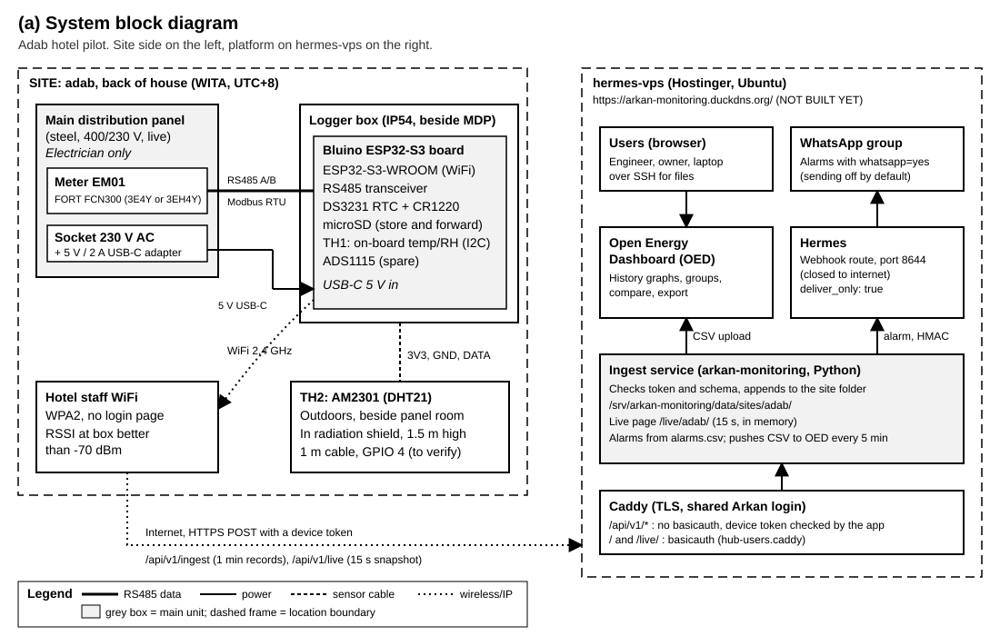
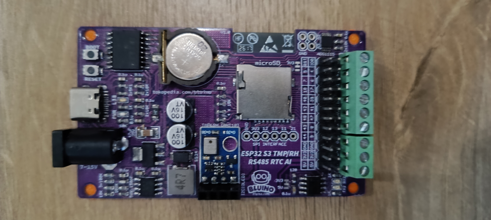
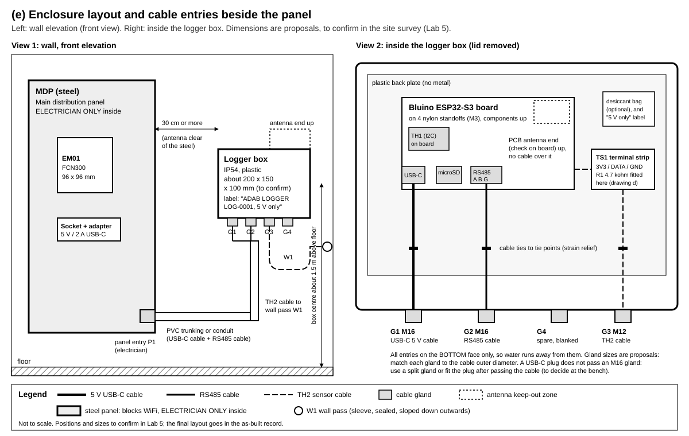
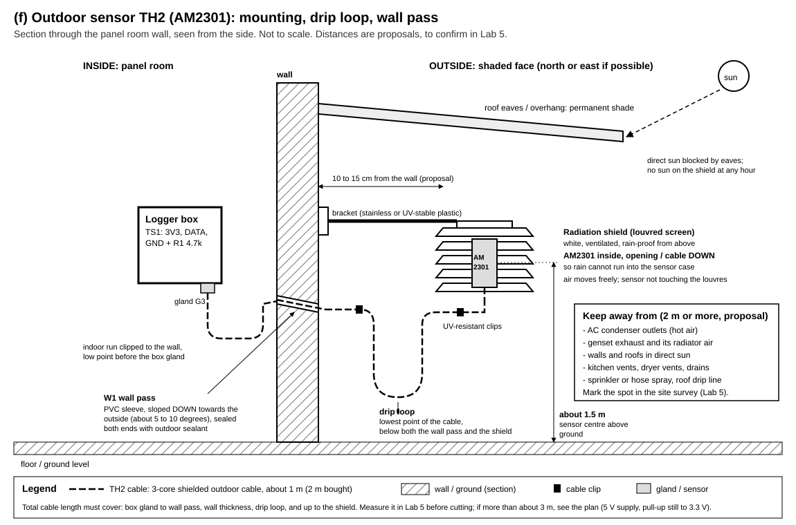

# Tutorial 1: the logger, from the office bench to the Adab hotel

For: technicians and students, working under a supervising engineer, with a licensed electrician for the panel work.
Site: Adab hotel, site code `adab`. Logger: `LOG-0001`. Platform: `https://arkan-monitoring.duckdns.org` on the VPS `hermes-vps`.

> **Status (9 November 2026).** The logger firmware (version **0.4.1**, folder [`firmware/`](../../firmware/)) is written and compiled by CI. The bench board `LOG-0001` has run firmware 0.3.0 (built on the office PC) since 8 November: online, uploading to the platform, the AM2301 confirmed on **GPIO 1**. Version 0.4.1 itself has not yet run on the board (do not use 0.4.0: it restarts every minute, see [`../UPDATING.md`](../UPDATING.md) section 5). The pin map is provisional (the RS485 pins are **not known yet**) and the meter register map is **not verified**. Part A of this tutorial verifies the pins on the bench. The meter register map can only be verified on site: the spare meter at the office has no Modbus port (8 November 2026), so B10 is where it is checked. Expect small surprises on the first bench day and write down everything you find.

This tutorial takes you through the common path from start to end. For the full details it links to the reference documents:
- what the logger does, all its settings and console commands: [`../FIRMWARE.md`](../FIRMWARE.md)
- the full bench test list (T1 to T13) and the record sheet: [`../OFFICE-PREP.md`](../OFFICE-PREP.md)
- the lab manual (theory, wiring drawings, site labs 5 to 7, as-built template): [`../install/README.md`](../install/README.md)
- the data files: [`../DATA-FORMAT.md`](../DATA-FORMAT.md); the alarms: [`../alarms/README.md`](../alarms/README.md); the meter: [`../meter/README.md`](../meter/README.md)

---

## Contents

- [Part 0: before you start](#part-0-before-you-start)
  - [0.1 How to use this tutorial](#01-how-to-use-this-tutorial)
  - [0.2 Who does what](#02-who-does-what)
  - [0.3 Safety rules](#03-safety-rules)
  - [0.4 The map: where things are](#04-the-map-where-things-are)
- [Part A: preparing at the office](#part-a-preparing-at-the-office)
  - [A1 Tools and bill of materials](#a1-tools-and-bill-of-materials)
  - [A2 Installing the software on Windows](#a2-installing-the-software-on-windows)
  - [A3 Getting the code](#a3-getting-the-code)
  - [A4 Building and flashing the firmware](#a4-building-and-flashing-the-firmware)
  - [A5 First boot and the serial monitor](#a5-first-boot-and-the-serial-monitor)
  - [A6 The device token and the setup WiFi password](#a6-the-device-token-and-the-setup-wifi-password)
  - [A7 Configuring the logger (three ways)](#a7-configuring-the-logger-three-ways)
  - [A8 Bench tests (short version)](#a8-bench-tests-short-version)
  - [A9 Assembling the box](#a9-assembling-the-box)
  - [A10 Final checklist before the site](#a10-final-checklist-before-the-site)
- [Part B: on site](#part-b-on-site)
  - [B1 Arrival and site survey](#b1-arrival-and-site-survey)
  - [B2 Mounting the box](#b2-mounting-the-box)
  - [B3 Power](#b3-power)
  - [B4 The RS485 cable to the meter](#b4-the-rs485-cable-to-the-meter)
  - [B5 The outdoor sensor TH2](#b5-the-outdoor-sensor-th2)
  - [B6 Checks before power](#b6-checks-before-power)
  - [B7 First power-up and the meter settings](#b7-first-power-up-and-the-meter-settings)
  - [B8 Putting the logger on the hotel WiFi (setup portal)](#b8-putting-the-logger-on-the-hotel-wifi-setup-portal)
  - [B9 Checking the data on the live page and on the VPS](#b9-checking-the-data-on-the-live-page-and-on-the-vps)
  - [B10 Meter values against the meter's LCD (within 1 %)](#b10-meter-values-against-the-meters-lcd-within-1-)
  - [B11 Sensor calibration and offsets](#b11-sensor-calibration-and-offsets)
  - [B12 The 30-minute check](#b12-the-30-minute-check)
  - [B13 As-built record, photos, closing the box](#b13-as-built-record-photos-closing-the-box)
  - [B14 The 24-hour check (next day)](#b14-the-24-hour-check-next-day)
- [Part C: after the install](#part-c-after-the-install)
  - [C1 What normal looks like](#c1-what-normal-looks-like)
  - [C2 WhatsApp alerts (later)](#c2-whatsapp-alerts-later)
  - [C3 Reading the SD card](#c3-reading-the-sd-card)
  - [C4 Changing settings remotely](#c4-changing-settings-remotely)
  - [C5 Firmware updates](#c5-firmware-updates)
  - [C6 Troubleshooting](#c6-troubleshooting)
- [Appendix](#appendix)
  - [Console command cheat sheet](#console-command-cheat-sheet)
  - [Settings cheat sheet for the site](#settings-cheat-sheet-for-the-site)
  - [VPS commands to ask the operator for](#vps-commands-to-ask-the-operator-for)
  - [Glossary](#glossary)

---

## Part 0: before you start

### 0.1 How to use this tutorial

- **Do the steps in order.** Every step is numbered. After each step you get the **expected result**. If you do not get it, follow the **"If not"** line, or go to the troubleshooting table ([C6](#c6-troubleshooting)). Do not skip ahead with a failed step.
- **"to verify"** means: nobody has checked this fact on the real hardware yet. Check it, write what you find in the record sheet, and tell the supervisor. Never treat a "to verify" value as a fact until the signed record says so.
- **Three kinds of commands** appear in this tutorial:
  - `powershell` blocks: type them in **PowerShell** on your Windows laptop.
  - `bash` blocks: commands on the VPS (`hermes-vps`). **You do not run these yourself**: the owner (or the operator he names) runs them. You ask for them by copying the block into a message.
  - plain blocks: commands for the **logger's serial console** (see [A5](#a5-first-boot-and-the-serial-monitor)). Type them in the serial monitor and press Enter.
- **Secrets** (WiFi passwords, the device token, the setup WiFi password) are shown here as placeholders like `<token from the owner>`. Never write a real secret in a report, a photo, a chat message or a file in the repository. Keep them in the company password manager.
- **Time:** the logger and the VPS store **UTC**. People in Makassar use **WITA** (UTC+8, no daylight saving). 03:05 WITA = 19:05 UTC of the day before. When you write a time in a record, write both: `2026-11-12 06:30 UTC (14:30 WITA)`.
- **Names used everywhere:** `TH1` = the temperature/humidity sensor on the board (electrical room air). `TH2` = the AM2301 sensor outdoors. `EM01` = the power meter. `LOG-0001` = the logger.

### 0.2 Who does what

| Role | Who | Does | Never does |
|---|---|---|---|
| **Owner** | Arkan (your boss) | Runs the VPS commands (`manage.py add-device`, `set-config`, `alarms`...), keeps the device token, the setup WiFi password and the platform login, gets the hotel WiFi password, approves changes | |
| **Supervising engineer** | Arkan engineer | Briefs each step, checks the work, signs the record sheets, can stop the work at any time | |
| **Licensed electrician** | Contracted, holds the local licence | **All work inside the main distribution panel (MDP)**: isolation, lock-out and tag-out, the socket and its breaker, the RS485 cable ends at the meter, any resistor at the meter, the panel cable entry | |
| **Technicians and students** | You, in pairs (one does, one records; swap) | Bench work, the low-voltage side (5 V, 3.3 V, RS485 at the logger end, sensors), the box, cable runs outside the panel, the outdoor sensor, the console and the setup portal, measurements, photos, records | **Open the MDP, work in it or touch anything in it**, live or not. Change any setting in the meter |
| **Hotel engineering staff** | Hotel | Site access, permits, shutdown windows, the staff WiFi name and password (through the owner) | |

The **VPS operator** in this tutorial is the owner, or the person he names. "Ask the operator" means: send the exact command block to the owner and wait for the answer.

### 0.3 Safety rules

The full rules are in [`../install/README.md` section 1.5](../install/README.md#15-safety-rules). Read them and sign them before Lab 1 / bench day. The five that matter most:

1. **Only the licensed electrician works in the MDP**, with the panel isolated, locked and tagged out. It holds 400/230 V and high fault currents. You may read the meter's LCD through the closed door window, or when the electrician has opened the panel, standing back, hands off.
2. **Never open the secondary circuit of a current transformer (CT).** If you see CT wires loose or disconnected, stop and call the electrician.
3. **The board is not 5 V tolerant.** The ESP32-S3 pins take 3.3 V at most. Nothing above 3.3 V on any GPIO pin; pull-up resistors go to **3V3**, never to 5V.
4. **Never put the 5 V adapter on the DC jack.** The DC jack (marked `7-15V`) feeds a regulator that needs 7 to 15 V. Power the board through **USB-C only**. Never use two power sources at once. See drawing (b): [`../install/schematics/b-power-wiring.svg`](../install/schematics/b-power-wiring.svg).
5. **Power off before rewiring.** Unplug the USB-C cable before you change any wire on the board.

Also: ESD (touch a grounded point before handling the board, hold it by the edges); safety glasses and a cable detector before drilling; a step stool at most for the outdoor sensor. **Anyone can stop the work** if something looks unsafe.

### 0.4 The map: where things are

#### 0.4.1 The whole system

Drawing (a): [`../install/schematics/a-system-block-diagram.svg`](../install/schematics/a-system-block-diagram.svg)



In one paragraph: every 15 s the logger asks the meter for its values over RS485 (Modbus RTU), reads `TH1` and `TH2`, and every minute writes one **record** (one line of a CSV file) to the microSD card. Then it sends the records over the hotel staff WiFi, by HTTPS, to the VPS. It also sends a small "live" snapshot every 15 s for the live page. If the network is down, the records wait on the SD card and are sent later (this is called **store and forward**). The VPS keeps one CSV file per UTC day, checks every record against the alarm list, and shows the live page.

(Drawing (a) still marks the platform "NOT BUILT YET": the ingest service and the live page are written now; Open Energy Dashboard is not installed yet.)

#### 0.4.2 The board

The board is the **Bluino ESP32-S3 TMP/RH RS485 RTC AI**. Photos: [top](../img/board-top.jpg), [bottom](../img/board-bottom.jpg).



Positions below are for the top photo above, with the USB-C connector on the left edge.

| Part | Where on the board (top photo) | What it is for | Status |
|---|---|---|---|
| **USB-C** connector | Left edge, middle | **The only power input you use** (5 V), and the programming and console port | Whether it goes to the ESP32-S3's native USB or through a USB-to-serial chip: **to verify** (A4 tells you how to find out) |
| **DC jack**, marked `7-15V` | Left edge, lower corner | Input for 7 to 15 V | **Never used.** Never 5 V here |
| **BOOT** button | Top left corner (silkscreen `BOOT`) | Held 3 s while the logger runs: opens the **setup portal**. Held while you press RESET: puts the chip in **download mode** for flashing | GPIO 0 (`pin_btn` = 0) |
| **RESET** button | Under BOOT (silkscreen `RESET`; OFFICE-PREP calls it RST) | Restarts the board | |
| **CR1220 coin cell** holder | Top, middle left | Keeps the **real-time clock** running when the power is off | Cell + side up |
| **RTC chip** (DS3231) | 16-pin chip at the top left, beside the coin cell | Real-time clock, I2C address 0x68 | "Likely DS3231" (PLAN section 2), confirmed by the I2C scan (T2) |
| **microSD** slot | Centre, silkscreen `microSD` | The data card | SD pins 12/13/11 and CS 10 or 21: **to verify** (T2) |
| **SPI INTERFACE** header (6 pins) | Below the microSD slot | Silkscreen `GND 3V3 12 13 11 21`: the SD card's bus | Not wired by you |
| **TH1** sensor module (blue) | Centre bottom | Temperature and humidity of the room air (I2C) | Chip type: AHT10 (0x38)? **to verify** with `i2c` (T2) |
| **I2C (OLED)** header (4 pins) | Bottom edge, under the blue module | Optional small display, not used | |
| **ADS1115** | Top right corner (silkscreen `ADS1115`) | 4-channel analog input, spare | I2C 0x48 expected |
| **GPIO header** (two rows) | Right side, beside the green terminals | Pins of the ESP32-S3: numbers, `GND`, `3V3`, `5V` | `TH2` data on **GPIO 1** (confirmed) |
| **Green screw terminals** | Right edge: a 3-way block and a long block | Field wiring. The **3-way block**, beside the RS485 chip and the `120` jumper, is the RS485 terminal, printed **A+, B-, GND**. The **long block** is printed **5V, 3V3, IO2, IO1, A1, A0** (IO = ESP32 GPIO; A0, A1 = ADS1115 inputs) | Labels seen on the board 9 November 2026. On the bench the AM2301 is on `3V3`, `IO1` and the `GND` of the 3-way block |
| **RS485 transceiver** (8-pin chip) | Bottom right, beside the `120` jumper | Turns the ESP32's serial signals into the RS485 pair | From the board's pin table (9 November 2026): **TX = GPIO 17, RX = GPIO 18**, no DE pin given (`pin_rs_de` = -1, the board switches direction by itself). Set on `LOG-0001` with the console; **to confirm** with the simulator (tutorial 4, part 4) or the meter |
| **`120` jumper** | Bottom right, silkscreen `120` | Connects a 120 ohm termination resistor across A and B | **ON** at the logger (the logger is one end of the bus) |
| **TX / RX LEDs** | Bottom right corner | Blink when RS485 data goes out / comes in (PLAN section 2) | **to verify** |
| **Power LED** | Near USB-C | On when the board has power | Position **to verify** |
| A small `3V3` / `5V` marking with pads | Bottom, near the Bluino logo | Unknown (maybe a voltage selector) | **to verify**; do not change it |
| **ESP32-S3-WROOM module** with its **PCB antenna** | Back side (bottom photo), antenna at one end of the module | The processor and the WiFi radio | Keep the antenna end **up** and clear of metal and cables |
| Pin table (back silkscreen) | Back side, left | Lists the GPIOs, including the RS485 TX/RX/DE rows | Mirrored and blurry in the photo: read it on the real board (T2) |

There is **no status LED** driven by the firmware (`pin_led` = -1).

#### 0.4.3 The box

Drawing (e): [`../install/schematics/e-enclosure-layout.svg`](../install/schematics/e-enclosure-layout.svg)



- An IP54 plastic box, about 200 x 150 x 100 mm (to confirm with the parts in hand), on the wall **beside** the MDP, 30 cm or more from the steel (proposal), box centre about 1.5 m above the floor.
- Inside: a plastic back plate, the board on 4 nylon standoffs, antenna end up; terminal strip **TS1** (3V3 / DATA / GND) for `TH2` with the 4.7 kohm pull-up resistor R1; optional desiccant bag.
- Cable glands, **all on the bottom face**: **G1** M16 USB-C 5 V cable, **G2** M16 RS485 cable, **G3** M12 `TH2` cable, **G4** spare, blanked.
- In the lid: **a small hole over the BOOT button**, labelled "Setup: hold 3 s" (owner, 7 November 2026), so the setup portal can be opened with the box closed.

#### 0.4.4 The meter and its terminals

Drawing (c): [`../install/schematics/c-rs485-wiring.svg`](../install/schematics/c-rs485-wiring.svg)

- The meter is a **FORT FCN300**, 96 x 96 mm, in the MDP door. The label says **FCN300-3E4Y** or **FCN300-3EH4Y**: read it and photograph it.
- Its RS485 terminals (A, also called 485+ or D+; B, also called 485- or D-; maybe a GND) are at the **back**, inside the panel. **The terminal numbers are to verify** from a photo of the meter's back (meter README issue 7). Only the electrician connects them.
- Its Modbus settings (address, baud rate, parity) are in its **menu**. The guide gives address 1, 9600 baud, 8N1 as defaults: **to verify on the meter**. The exact menu names and key presses are **not documented** in this repository: **to verify** on the meter (or in the supplier's manual).

#### 0.4.5 The files in the repository

| Path | What it is |
|---|---|
| [`firmware/`](../../firmware/) | The logger firmware (PlatformIO project). Open this folder in VS Code |
| [`firmware/platformio.ini`](../../firmware/platformio.ini) | The build settings: the two builds `logger` and `logger-uart` |
| [`firmware/include/config.h`](../../firmware/include/config.h) | The firmware version (`FW_VERSION "0.4.1"`) and the SD card paths |
| [`firmware/src/settings.cpp`](../../firmware/src/settings.cpp) | The list of all settings and their defaults |
| [`firmware/src/console.cpp`](../../firmware/src/console.cpp) | The console commands |
| [`docs/OFFICE-PREP.md`](../OFFICE-PREP.md) | Bench tests T1 to T13 and the bench record sheet |
| [`docs/install/README.md`](../install/README.md) | Lab manual: safety, theory, Labs 1 to 7, troubleshooting, as-built template (section 13) |
| [`docs/install/schematics/`](../install/schematics/) | Drawings (a) to (f) |
| [`docs/install/labs/`](../install/labs/) | Test sketches (Arduino IDE) and `modbus_dump.py` |
| [`docs/meter/`](../meter/) | The meter's register guide and what must be checked |
| [`docs/alarms/alarms.csv`](../alarms/alarms.csv) | The alarm list (A01 to A37) |
| [`server/tools/manage.py`](../../server/tools/manage.py) | The VPS admin tool (run by the operator) |

#### 0.4.6 The live page and the VPS

| What | Where | Who |
|---|---|---|
| **Live page** of the site | `https://arkan-monitoring.duckdns.org/live/adab/` ("Live now" refreshes every 15 s: open alarms at the top, last 20 alarm log lines at the bottom; the side menu has the history pages (power, one day, energy per day, week, temperature, humidity), **Meter registers** and, for the logins in `ADMIN_USERS`, **Firmware update**) | Anyone with the **Arkan login** (ask the owner) |
| All sites | `https://arkan-monitoring.duckdns.org/live/` | Same |
| Day files on the VPS | `/srv/arkan-monitoring/data/sites/adab/LOG-0001/raw/<YYYY>/<MM>/<YYYY-MM-DD>.csv` | Operator |
| Alarm log | `/srv/arkan-monitoring/data/sites/adab/alarms/<YYYY>.csv` | Operator |
| Daily summary | `/srv/arkan-monitoring/data/sites/adab/daily.csv` | Operator |
| The admin tool | `docker compose exec ingest python tools/manage.py ...`, run in `/opt/arkan-monitoring/server` on `hermes-vps` | Operator |

The VPS commands you will ask for are collected in the [appendix](#vps-commands-to-ask-the-operator-for).

---

## Part A: preparing at the office

Everything in Part A happens on a bench at the office. Order: the VPS must be ready first (the owner's job, [`../VPS-SETUP.md`](../VPS-SETUP.md) steps 1 to 7, or [tutorial 2](2-VPS-SETUP.md)), then the board, then the tests, then the box.

### A1 Tools and bill of materials

**Tools** (tick each one before you start):

| ✓ | Tool | Used for |
|---|---|---|
| | Windows laptop with Git, VS Code and PlatformIO (A2) | Build, flash, console |
| | **USB-C data cable** (not a charge-only cable) | Flash and console |
| | Digital multimeter (DC V, ohms, continuity), **CAT III** rated for site work | Rails, pull-up, RS485 checks |
| | USB-RS485 adapter (with A, B and GND terminals) | Bench loopback, register check, site debugging |
| | Reference thermometer and hygrometer (calibrated, about 0.3 C and 2 % RH or better) | Sensor offsets |
| | Phone with a WiFi analyser app | WiFi survey, setup portal |
| | microSD card reader for the laptop | Preparing and reading the card |
| | Small flat screwdriver 2.5 mm, wire strippers, ferrule crimper and ferrules, side cutters | Terminals |
| | Drill, step drill for glands, small drill for the BOOT hole, cable detector, masonry bit | Box and wall pass |
| | Label printer or printed labels, cable ties, adhesive tie mounts | Labels |
| | ESD wrist strap | Handling the board |
| | A thin **non-metallic** pin (plastic or wooden) | Pressing BOOT through the lid hole |
| | Tape measure, camera (phone), compass app, step stool | Site survey and mounting |

**Bill of materials** (from [`../install/README.md` section 2.2](../install/README.md#22-bill-of-materials-from-the-plan-section-9-with-proposals-marked); quantities and sizes marked "proposal" are confirmed in the site survey):

| ✓ | # | Item | Qty | Note |
|---|---|---|---|---|
| | 1 | Bluino ESP32-S3 TMP/RH RS485 RTC AI board | 1 | With CR1220 cell |
| | 2 | 5 V / 2 A USB-C adapter, branded | 1 | Plugs into the socket the electrician fits |
| | 3 | USB-C cable, length to suit the route | 1 | Data-capable is handy |
| | 4 | IP54 plastic box, about 200 x 150 x 100 mm (proposal) | 1 | |
| | 5 | Cable glands M16 x 2, M12 x 1, blanking plug x 1 (proposal) | 4 | Match each to the cable diameter |
| | 6 | Nylon standoffs M3 and screws | 4 | |
| | 7 | Shielded twisted pair for RS485 (1 pair + 1 core, 120 ohm type) | logger to meter + 2 m | Length from the survey |
| | 8 | Ferrules 0.25 to 0.5 mm2 | 20 | |
| | 9 | microSD card, industrial grade, 8 to 32 GB, FAT32 | 1 | |
| | 10 | AM2301 (DHT21) sensor (owner's) | 1 | `TH2` |
| | 11 | 4.7 kohm resistor, 0.25 W | 2 | One spare |
| | 12 | 3-core shielded outdoor cable | about 2 m | For `TH2` |
| | 13 | Small 3-way terminal strip | 1 | TS1 |
| | 14 | Radiation shield (louvred screen) and bracket | 1 | For `TH2` |
| | 15 | PVC sleeve for the wall pass, outdoor sealant | 1 | |
| | 16 | PVC trunking or conduit, UV-resistant clips | to suit | |
| | 17 | 120 ohm resistor (meter end, only if needed) | 1 | Fitted by the electrician |
| | 18 | Spare CR1220 cell | 1 | |
| | 19 | Labels, cable ties, desiccant bag (optional) | | |

### A2 Installing the software on Windows

You need three programs: **Git** (downloads the code), **VS Code** (the editor) and **PlatformIO** (an extension of VS Code that builds and flashes the firmware). PlatformIO installs its own copy of the compiler and the ESP32 tools the first time; it needs internet and about 1 to 2 GB of disk.

1. **Install Git.** Download "Git for Windows" from `https://git-scm.com/download/win`, run the installer, keep the default options.
   Expected: in a new PowerShell window,
   ```powershell
   git --version
   ```
   prints `git version 2.x...`.
   If not: close and reopen PowerShell (the PATH is read when it starts), or restart the laptop.
2. **Install VS Code.** Download it from `https://code.visualstudio.com/`, run the installer, keep the defaults (tick "Add to PATH").
   Expected: VS Code opens.
3. **Install PlatformIO.** In VS Code, click the **Extensions** icon in the left bar (or press `Ctrl+Shift+X`), search **PlatformIO IDE**, click **Install**.
   Expected: after a few minutes, an **ant-head icon** appears in the left bar and a message says PlatformIO is installed; VS Code asks to reload: accept.
   If not: check the internet connection (a company proxy can block the download), then click "Reload" or restart VS Code.
4. **Find a terminal where `pio` works.** In VS Code: menu **Terminal > New Terminal**. Type:
   ```powershell
   pio --version
   ```
   Expected: `PlatformIO Core, version 6.x...`.
   If not ("pio is not recognized"): that is normal in a plain terminal. Use the **PlatformIO terminal** for every `pio` command in this tutorial: how to open it and how to recognise it is in [A4.2](#a42-open-the-platformio-terminal).
5. **Check the USB connection of the board.** Plug the board into the laptop with the USB-C data cable. Open **Device Manager** (right-click the Start button > Device Manager), look under **Ports (COM & LPT)**.
   Expected: a new COM port appears when you plug the board, for example "USB Serial Device (COM5)". Note the COM number.
   If not: try another cable (charge-only cables have no data wires). If the port appears with a yellow warning sign, or its name mentions CH340 or CP210x without a working driver, install the driver of that chip from its maker. If still nothing: hold **BOOT**, press and release **RESET**, release **BOOT** (download mode, see A4) and look again.

### A3 Getting the code

Choose **one** of the two ways.

**Way 1: git clone (recommended, you can update later with `git pull`).**

1. Open PowerShell. The code goes in **one** folder, `C:\dev\esp32-datalogging`, the same on every PC ([`CHECK-UP-TO-DATE.md`](../CHECK-UP-TO-DATE.md)). Clone the repository into it:
   ```powershell
   git clone https://github.com/julien355/esp32-datalogging.git C:\dev\esp32-datalogging
   ```
   Expected: the folder `C:\dev\esp32-datalogging` is created, with `firmware`, `docs` and `server` inside.
   If not: `already exists and is not an empty directory`: the folder is there already; bring it up to date instead (`CHECK-UP-TO-DATE.md` section 3). If GitHub asks you to sign in, check the address.

**Way 2: ZIP download (no Git needed, no easy update).**

1. In a browser, open `https://github.com/julien355/esp32-datalogging`, click the green **Code** button, then **Download ZIP**.
2. Right-click the ZIP file > **Extract All**. The folder name ends with the branch name (for example `esp32-datalogging-main`).
   Expected: the folder has `firmware`, `docs` and `server` inside.

**Open the project in VS Code:** menu **File > Open Folder**, choose the **`firmware`** folder (the one that contains `platformio.ini`), not the top folder (details in A4.1).
Expected: PlatformIO recognises the project (the bottom blue status bar shows PlatformIO buttons: a check mark for Build, an arrow for Upload, a plug for the Serial Monitor) and starts downloading the libraries the first time.

### A4 Building and flashing the firmware

This section takes you from "the code is on the laptop" (A3) to "the board runs the logger firmware". Take your time the first time: the first build downloads about 1 GB of tools and can take 10 to 20 minutes. The next builds take less than a minute.

**Words used here**

| Word | Meaning |
|---|---|
| **Build** (compile) | Turns the source code (`firmware/src/*.cpp`) into one file the chip can run: `firmware.bin` |
| **Flash** (upload) | Writes `firmware.bin` into the board's flash memory over the USB-C cable |
| **Environment** (`env`) | A named build recipe in `firmware/platformio.ini`. We have two: `logger` and `logger-uart` (A4.3) |
| **COM port** | The name Windows gives to the board's USB serial connection, for example `COM5` |
| **Download mode** | A state of the chip where its program is stopped and it waits for a new one (A4.6) |
| **NVS** | The part of the flash that holds the settings. **Flashing a new firmware with PlatformIO does not erase it**: the WiFi, token and offsets stay |
| **Terminal** | A text window where you type commands. In VS Code it opens at the bottom of the window |

#### A4.1 Open the project the right way

1. Open VS Code.
2. Menu **File > Open Folder...**, go to `C:\dev\esp32-datalogging\firmware` and click **Select Folder**.
   **Choose the `firmware` folder itself**, the one that contains the file `platformio.ini`, not the top folder `esp32-datalogging`. PlatformIO only recognises a project when `platformio.ini` is at the top of the opened folder.
3. If VS Code asks "Do you trust the authors of the files in this folder?", click **Yes, I trust the authors**.
4. Expected, within a minute:
   - in the left bar, the **ant-head icon** (PlatformIO);
   - in the **blue status bar at the bottom** of the window, small PlatformIO buttons (described in A4.4);
   - in the Explorer (left, top icon), the files `platformio.ini`, `include`, `src`, `tools`.
   - The first time, a message at the bottom right says PlatformIO is installing the platform and libraries. Wait until it is finished.
   If not: you opened the wrong folder. **File > Close Folder**, then open `firmware` again.

#### A4.2 Open the PlatformIO terminal

All `pio` commands in this tutorial are typed in the **PlatformIO terminal**. It is a normal PowerShell terminal inside VS Code, with the `pio` program added to it, and it opens directly in the project folder (`...\firmware`). A plain Windows PowerShell window usually does **not** know `pio`.

Use **one** of these three ways:

**Way 1: the button in the status bar (quickest).**
1. Look at the **blue status bar** at the very bottom of the VS Code window.
2. Find the small **terminal icon** (a square with `>_` inside). Hover over it with the mouse: the tooltip says **"PlatformIO: New Terminal"**.
3. Click it.

**Way 2: from the PlatformIO panel.**
1. Click the **ant-head icon** in the left bar. The PlatformIO panel opens.
2. Under **QUICK ACCESS**, open **Miscellaneous**.
3. Click **New Terminal** (in some versions it is called **PlatformIO Core CLI**).

**Way 3: from the Command Palette (works even if you cannot find the icons).**
1. Press `Ctrl+Shift+P`. A search box opens at the top of the window.
2. Type `PlatformIO: New Terminal` and press Enter when it is highlighted.

**Check that you are in the right terminal.** A panel opens at the bottom of VS Code. Its tab (on the right of the panel) is named **PlatformIO CLI** or similar, and the prompt ends with your project folder, for example:
```
PS C:\dev\esp32-datalogging\firmware>
```
Type:
```powershell
pio --version
```
Expected: `PlatformIO Core, version 6.x.x`.
If not:
- `pio : The term 'pio' is not recognized...`: you are in a normal terminal (menu **Terminal > New Terminal** opens one of those). Close it (trash-can icon on the right of the terminal panel) and use Way 1, 2 or 3.
- The prompt is not in `...\firmware`: type the next command (adapt the path):
  ```powershell
  cd C:\dev\esp32-datalogging\firmware
  ```
- To see the terminal panel again after hiding it: menu **View > Terminal** (or press `Ctrl` and the backtick key, left of `1` on a US keyboard).

#### A4.3 Choose the build for this board (`logger` or `logger-uart`)

The board's USB-C can be wired in two ways, and each needs its own build. You can usually tell **before flashing**, from the name Windows gives the port:

1. Plug the board into the laptop with the USB-C **data** cable.
2. Open **Device Manager** (right-click the Start button > **Device Manager**) and open **Ports (COM & LPT)**.
3. Read the name of the new line that appears when you plug the board in:

| Name in Device Manager (typical) | What it means | Build |
|---|---|---|
| `USB Serial Device (COM5)`, and under **Universal Serial Bus devices** a `USB JTAG/serial debug unit` | USB-C goes to the ESP32-S3's **own (native) USB** | **`logger`** (the default) |
| `USB-SERIAL CH340 (COM5)` | a CH340 USB-to-serial chip on the board | **`logger-uart`** |
| `Silicon Labs CP210x USB to UART Bridge (COM5)` | a CP210x USB-to-serial chip | **`logger-uart`** |
| Nothing new appears | charge-only cable, missing driver, or the board is not powered | try another cable; for CH340/CP210x install the driver from the chip maker; try the BOOT/RESET trick (A4.6) |

4. **Note the COM number** (here `COM5`) and the name in the record sheet. The choice of build is **to verify** on the first bench day: if the serial monitor stays silent after flashing (A4.7), use the other build.

#### A4.4 The buttons in the status bar (if you prefer clicking)

Everything in this section can be done by typing `pio` commands **or** by clicking. The blue status bar at the bottom has, from left to right (hover over each to see its name):

| Icon | Name (tooltip) | Same as typing |
|---|---|---|
| house | PlatformIO: Home | (opens PIO Home, not needed) |
| check mark ✓ | PlatformIO: **Build** | `pio run` |
| arrow → | PlatformIO: **Upload** | `pio run -t upload` |
| trash can | PlatformIO: **Clean** | `pio run -t clean` |
| plug | PlatformIO: **Serial Monitor** | `pio device monitor` |
| `>_` | PlatformIO: **New Terminal** | (A4.2) |
| `env:logger (firmware)` or `Default (firmware)` | **Switch environment** | `-e logger` / `-e logger-uart` |

The **environment switch** decides which build the Build and Upload buttons use. Click it, then choose `env:logger` or `env:logger-uart` in the list that opens at the top. "Default" means the one in `platformio.ini` (`default_envs = logger`).

The same actions are in the PlatformIO panel (ant-head icon) under **PROJECT TASKS > env:logger** (or **env:logger-uart**) **> General**: **Build**, **Upload**, **Monitor**, **Clean**.

In this tutorial we type the commands: you see exactly which build you run, and the text is easy to copy into a report.

#### A4.5 Build

1. In the PlatformIO terminal (A4.2), in the `firmware` folder, build the default environment:
   ```powershell
   pio run
   ```
   For a board that needs `logger-uart` (A4.3), build that one instead:
   ```powershell
   pio run -e logger-uart
   ```
2. **The first time**, PlatformIO downloads the ESP32 platform (espressif32 6.9.0, about 1 GB with the compiler), then the four libraries listed in `platformio.ini` (ModbusMaster, DHT sensor library, Adafruit Unified Sensor, ArduinoJson). You see lines such as `Platform Manager: Installing espressif32 @ 6.9.0` and `Library Manager: Installing ...`. Do not close VS Code. Expect 10 to 20 minutes on hotel or office WiFi.
3. Then it compiles: many lines `Compiling .pio/build/logger/...`, then `Linking`, then the memory summary. Expected at the end (the numbers vary a little with each version):
   ```
   RAM:   [==        ]  16.8% (used 55052 bytes from 327680 bytes)
   Flash: [======    ]  55.3% (used 1087925 bytes from 1966080 bytes)
   ...
   Environment    Status    Duration
   -------------  --------  ------------
   logger         SUCCESS   00:00:26.844
   ========================= 1 succeeded in 00:00:26.844 =========================
   ```
   The file made is `firmware\.pio\build\logger\firmware.bin` (or `...\logger-uart\...`). Flash at about 55 % is expected: the other half is kept free for remote updates (OTA).
4. If not:

| What you see | Cause | What to do |
|---|---|---|
| `HTTPClientError`, `Could not resolve host`, a download timeout | no internet, or a proxy blocks `platformio.org` | try another network (phone hotspot), then `pio run` again: downloads resume |
| `UnknownPackageError` or `PackageException` after a cut download | a half-downloaded package | delete the folder `C:\Users\<you>\.platformio\.cache` and run `pio run` again |
| `error:` in a `.cpp` file | the code was changed, or it is not the version CI builds | `git status` must show no change; `git pull` to get the current version; tell the supervisor |
| Very slow, the laptop fan runs | antivirus scanning every compiled file | normal the first time; ask IT to exclude `C:\Users\<you>\.platformio` and the project folder |
| A path error with strange characters | the project path contains accents or is very long | move the project to a short path such as `C:\arkan\esp32-datalogging` |

#### A4.6 Flash (upload)

Before flashing:
- **close every serial monitor** (VS Code monitor, Arduino IDE, PuTTY): only one program can use the COM port;
- the board is plugged in with the data cable, and Device Manager shows its COM port (A4.3).

1. Flash the default build:
   ```powershell
   pio run -t upload
   ```
   or, for a `logger-uart` board:
   ```powershell
   pio run -e logger-uart -t upload
   ```
   PlatformIO builds first if needed, then starts the flashing tool (esptool). It finds the port by itself.
2. Expected output (approximate; versions differ slightly):
   ```
   Auto-detected: COM5
   Uploading .pio\build\logger\firmware.bin
   esptool.py v4.5.1
   Serial port COM5
   Connecting...
   Chip is ESP32-S3 (revision v0.2)
   Features: WiFi, BLE
   ...
   Writing at 0x00010000... (2 %)
   ...
   Writing at 0x0010a3c4... (100 %)
   Wrote 1092944 bytes (...) at 0x00010000 in 12.3 seconds (...)
   Hash of data verified.
   Leaving...
   Hard resetting via RTS pin...
   ========================= [SUCCESS] Took 35.2 seconds =========================
   ```
   `Hash of data verified.` is the important line: the firmware was written and read back correctly. The board then restarts on its own and runs the new firmware.
3. **If it does not connect**, use the table:

| Message | Cause | What to do |
|---|---|---|
| `Could not open COM5, the port doesn't exist` or `Access is denied` / `PermissionError` | a serial monitor or another program holds the port | close the monitor (in its terminal press `Ctrl+C`, or click the trash-can icon of that terminal), close Arduino IDE or PuTTY, try again |
| `A fatal error occurred: Failed to connect to ESP32-S3: No serial data received` or `Wrong boot mode detected` | the chip did not enter download mode by itself | **BOOT/RESET trick** (below) |
| Several COM ports, the wrong one is picked | another USB serial device is plugged in | give the port: `pio run -t upload --upload-port COM5` |
| The COM number changes after each try | normal with the native USB: the port disappears and comes back at each reset | check Device Manager again, or let PlatformIO auto-detect |

**The BOOT/RESET trick (download mode by hand).** The two small push buttons are on the board ([board map, 0.4.2](#042-the-board)): **BOOT** (top left corner) and **RESET** (just under BOOT) (sometimes marked `RST` or `EN`).
1. Press and **hold BOOT**.
2. While holding BOOT, press **RESET** once and release it.
3. Release **BOOT**.
   The chip now waits for a new firmware (the logger program is stopped; with the native USB the COM port may change number).
4. Run the upload command again:
   ```powershell
   pio run -t upload
   ```
5. When it says `[SUCCESS]`, press **RESET** once. In download mode the flashing tool cannot always restart the chip by itself, so the old state stays until you press RESET.

Typing the command several times if needed is safe: a failed upload does not damage the board. If it never connects, it is the cable, the driver or the port.

#### A4.7 Check that the new firmware runs

1. Open the serial monitor (A5 explains it in detail):
   ```powershell
   pio device monitor
   ```
2. Press **RESET** on the board, wait 5 seconds, type `status` and press Enter.
   Expected: the first line says `firmware 0.4.1` (or the version you built; the version is set in `firmware/include/config.h`, `FW_VERSION`).
3. **If the monitor stays empty** (no text at all, even after RESET and typing `status`), the board needs the other build. Close the monitor (`Ctrl+C`), then:
   ```powershell
   pio run -e logger-uart -t upload
   ```
   and check again. If `logger-uart` also gives no text, go back to `logger` and ask the supervisor (cable, port, or a board problem).
4. Write in the record sheet: the build that works (`logger` or `logger-uart`), the COM port name in Device Manager, the firmware version shown by `status`.

#### A4.8 Useful extra commands (only when needed)

| Command | What it does | When |
|---|---|---|
| `pio run -t clean` | deletes the build files of the default environment | a strange build error after updating the code; then build again |
| `pio device list` | lists the COM ports PlatformIO sees, with their names | to find the board's port without Device Manager |
| `pio run -t erase` | **erases the whole flash, settings included** | only if the supervisor asks (a board that keeps crashing at boot). Afterwards flash again (A4.6) and configure again (A7) |
| `git pull` | gets the latest code from GitHub (if you used `git clone` in A3) | before building a new version; then `pio run` |

#### A4.9 Alternative without PlatformIO: the files built by GitHub (CI)

Every push to GitHub is compiled by CI (GitHub Actions). You can flash those files with a web page instead of installing PlatformIO. **This way erases the settings**, so prefer PlatformIO for a board that is already configured.

1. On GitHub, open the repository, tab **Actions**, workflow **ci**, the latest run with a green check.
2. At the bottom of the run page, under **Artifacts**, download `firmware-<commit>` (a ZIP). It holds `logger/firmware.bin`, `logger/bootloader.bin`, `logger/partitions.bin` and `logger-uart/firmware.bin`.
3. In Chrome or Edge, open the Espressif web flasher (esptool-js), click **Connect**, choose the board's COM port. If it does not connect, use the BOOT/RESET trick (A4.6).
4. Click **Erase Flash** and wait for the end.
5. Add the three files with these addresses, then **Program**:

| File | Address |
|---|---|
| `bootloader.bin` | `0x0` |
| `partitions.bin` | `0x8000` |
| `firmware.bin` (of `logger` or `logger-uart`) | `0x10000` |

6. Press **RESET**, then configure the logger again (A7): the erase removed the settings.

The CI artifact only has the bootloader and partition files of the `logger` build; for `logger-uart`, using the same two files is expected to work (same chip and partition table) but is **to verify**.

### A5 First boot and the serial monitor

The **serial console** is a text window on the laptop where the logger prints what it does and where you type commands. It runs over the USB-C cable at 115200 baud.

1. **Open the monitor** (in the `firmware` folder):
   ```powershell
   pio device monitor
   ```
   Expected: `--- Terminal on COM5 | 115200 8-N-1` and then text from the logger. Leave it open. To quit: `Ctrl+C`.
   If not: if the port is wrong, give it: `pio device monitor -p COM5`. If the port disappears (native USB re-enumerates at each reset), just run the command again.
2. **Press RESET** on the board (or unplug and replug USB-C). Expected boot text (the times and numbers will differ):
   ```
   === Arkan logger, firmware 0.4.1, boot reason poweron ===
   [uptime 1s] RTC time invalid (battery or first use): waiting for NTP or 'time set'
   [uptime 1s] SD card ok: 15193 MB, 0 MB used, upload pointer 0 part 1 offset 0
   [uptime 1s] BOOT fw=0.4.1 reason=poweron boot#1 dev=LOG-0001 heap=...
   [uptime 1s] TH1 sensor: aht (0x38)
   [uptime 1s] TH2 sensor: AM2301 on GPIO 1
   [uptime 1s] Meter: built-in FCN300 register table (19 values, not verified)
   [uptime 1s] Meter: RS485 pins not set (pin_rs_tx / pin_rs_rx): meter NOT read, records show EM01_n = 0
   [uptime 1s] Sampling every 15 s, ... columns
   [uptime 1s] Setup portal open: WiFi "ARKAN-LOG-0001", page http://192.168.4.1 (stays open: no WiFi set)
   [uptime 1s] Server https://arkan-monitoring.duckdns.org (TLS verified), upload every 60 s, live on, OTA on, remote settings on
   Type 'help' for the console commands.
   ```
   With the native USB build, the first lines are often printed before the laptop has reopened the port, so you may miss them. That is normal: use `status` (next step) instead.
   "Meter NOT read" is normal until the RS485 pins are set in T2 (until then the alarm A03 Meter not answering is expected on the VPS). "RTC time invalid" is normal on a new board until WiFi (NTP) or `time set` gives it the time.
3. **Type `help` and press Enter.** What you type is not shown while you type; after Enter the logger prints `> help` and the list of commands.
   Expected: the list of commands (see the [cheat sheet](#console-command-cheat-sheet)).
   If not: no text at all = wrong build (A4.7 step 3) or wrong port.
4. **Type `status`.** Expected, for example:
   ```
   Logger LOG-0001, firmware 0.4.1, CSV schema 3, up 42 s, boot poweron
   Time: NOT SET (RTC found)
   SD: ok, rows written 0, SD errors 0
   Heap: ... free, ... min free
   WiFi: down for 41 s
   Server: https://arkan-monitoring.duckdns.org (NO TOKEN)
   Uploads: ok 0, failed 0, last ok never, last error none yet
   Backlog: 0 min, pointer ..., RAM queue 0 rows
   Live: ok 0, failed 0
   Portal: open
   Last sample: (clock not set, nothing recorded) TH1=26.4C/58% TH2=fault
   Last record: none yet
   ```
   This is the normal state of a new, unconfigured board: no WiFi, no token, no time, so **nothing is recorded yet** (the logger never writes a record without a valid clock).

### A6 The device token and the setup WiFi password

The logger needs two secrets that only the owner can create, on the VPS:
- the **device token** (`dev_token`): a long random password that the logger sends with every upload. The VPS refuses data without the right token;
- the **setup WiFi password** (`portal_pass`): the password of the logger's own WiFi network `ARKAN-LOG-0001`, used to open the setup portal from a phone. One per logger (owner, 7 November 2026).

1. **Ask the owner** to register the logger, if it is not done yet. He runs, on `hermes-vps`:
   ```bash
   cd /opt/arkan-monitoring/server
   ```
   ```bash
   docker compose exec ingest python tools/manage.py add-device adab LOG-0001
   ```
   Expected (for him): `TOKEN (shown once, keep it secret): ...` and `SETUP WIFI PASSWORD for ARKAN-LOG-0001 (portal_pass, keep it with the token): ...`. Both are shown **once** and go straight into the password manager.
   If he gets `LOG-0001 exists already`: the logger was registered before (for example during the VPS setup). He takes the token and the setup password from the password manager. If the token is lost, he runs `rotate-token LOG-0001` (a new token; the old one stops working at once).
2. **Get both from the password manager** (never by plain chat or email). You will type them in A7.
3. If the setup WiFi password is lost: choose a new one (8 characters or more), set it with `set portal_pass <new password>` (A7), and give it to the owner for the password manager. A setup password shorter than 8 characters is ignored by the firmware, which then uses `arkan-setup`.

### A7 Configuring the logger (three ways)

The logger needs at least: the WiFi network and password, the server address (`srv_url`, already the right default), the device token and the setup WiFi password. Choose **one** way. All settings and their defaults: [`../FIRMWARE.md` section 3](../FIRMWARE.md#3-all-settings).

At the office, use the **office WiFi** (2.4 GHz) for the bench tests. The hotel's network is set before leaving (A10) or on site (B8).

**Way A: the serial console (laptop on USB).**

1. In the monitor, type each line and press Enter after each (`dev_id` and `srv_url` are already the defaults; typing them again does no harm):
   ```
   set dev_id LOG-0001
   set wifi_ssid <office WiFi name>
   set wifi_pass <office WiFi password>
   set srv_url https://arkan-monitoring.duckdns.org
   set dev_token <token from the owner>
   set portal_pass <setup WiFi password from the owner>
   ```
   Expected after each: `<key> set. Type 'reboot' to apply.`
   If not: `unknown key: see 'show'` means a typing mistake in the key name. A WiFi name with spaces is fine: everything after the key is the value.
2. Apply:
   ```
   reboot
   ```
   Expected: the logger restarts, then `WiFi connected to "<office WiFi name>" ip=... rssi=... ch=...` and `NTP sync: RTC set to ...`.

**Way B: the setup portal (phone only).** This is the same procedure as on site, described in detail in [B8](#b8-putting-the-logger-on-the-hotel-wifi-setup-portal). In short: with no WiFi set the portal opens by itself (or hold BOOT 3 s); join WiFi `ARKAN-LOG-0001` with the setup password (`arkan-setup` until `portal_pass` is changed); the page `http://192.168.4.1` opens; fill in `wifi_ssid`, `wifi_pass`, `dev_token`, `portal_pass`; tap **Save and restart**.

**Way C: a settings file on the SD card** (handy for several loggers).

1. Ask the owner to write the file when he registers the logger (instead of the plain `add-device` of A6):
   ```bash
   docker compose exec ingest python tools/manage.py add-device adab LOG-0001 --sd-settings /data/export/settings-LOG-0001.txt
   ```
   The file appears on the VPS as `/srv/arkan-monitoring/data/export/settings-LOG-0001.txt`. He moves it off the VPS to you securely and deletes it there.
2. Open it in a text editor (Notepad). It holds `dev_id=`, `dev_token=`, `srv_url=`, `portal_pass=` and commented WiFi lines. Remove the `#` and fill in:
   ```
   wifi_ssid=<office WiFi name>
   wifi_pass=<office WiFi password>
   ```
3. Copy it to the microSD card as **`/config/settings.txt`** (folder `config` at the root of the card, file name `settings.txt`). Insert the card in the logger (power off), then power it.
   Expected in the monitor: `N setting(s) imported from /config/settings.txt (file deleted), restarting to apply`, then a restart with the new settings.
4. **Delete your copy of the file** from the laptop (it holds the token).

**Check (all ways):**

```
show
```
Expected: all settings by group; the ones you changed are marked `(changed)`; secrets appear as `******`.

```
status
```
Expected: `WiFi: up, <ssid> <ip> rssi -55 dBm` (any value better than -70), `Time:` a real UTC time, and after one or two minutes `Uploads: ok 1` or more.
If `Uploads` stays at 0 with `last error 401 ...`: the token is wrong (re-type it). Other errors: see [C6](#c6-troubleshooting).

### A8 Bench tests (short version)

The full procedure, with every step and expected result, is in [`../OFFICE-PREP.md` section 3](../OFFICE-PREP.md#3-bench-tests-run-them-in-this-order-and-record-the-results). **Run them all, in order, and fill in the bench record sheet** ([section 5](../OFFICE-PREP.md#5-bench-record-sheet)). The table below is the summary, so you know what each test is for and what "pass" means.

| Test | What you check | Pass when | Watch out |
|---|---|---|---|
| **T1** Clock | `time`; unplug 1 min; `time` again | Time correct after the power-off (RTC on its coin cell) | `time set` is in **UTC**, never WITA |
| **T2** Pins and I2C | `i2c`; `status` SD line; RS485 pins from the back silkscreen | 0x68 (RTC), TH1 chip (0x38, 0x40 or 0x44), 0x48 found; `SD: ok`; RS485 pins set | **The most important test.** Write the verified pins in the record sheet: `pin_rs_tx`, `pin_rs_rx`, `pin_rs_de`, `pin_sd_cs`, and SDA/SCL if swapped. Until the RS485 pins are set, the meter is not read at all |
| **T3** Sensors | `status` "Last sample"; breathe on them; pull the TH2 data wire | Values rise within 30 s; `TH2=fault`, `err` rows, then **A14** in the alarm log, cleared when plugged back | Note the differences with the reference instrument, but the real offsets are set **on site** (B11) |
| **T4** RS485 wiring and meter-off test | `mb 1 3 0 64` with no meter answering | A timeout with the hint "wiring, A/B, id, baud"; `status` shows `EM01: no answer`, `EM01_n` = 0; **A03** after a minute; the boot log says the table was read from the SD card | The spare meter has **no Modbus port** (8 November): it cannot be read, so the registers are checked on site (B10). Mains wiring of any meter: **electrician only** |
| **T5** Records on the card | `ls /data/<YYYY>/<MM>`, `tail ... 3`, `header` | One row per minute, `EM01_n` = 4, `TH1_t` on every 5th row, `boot` = `poweron@0.4.1` on the first row | |
| **T6** WiFi and upload | `status`; the day file on the VPS; the live page | `Uploads: ok n`; the VPS day file grows every minute; live page "Live · updated n s ago" | |
| **T7** Lost connection | WiFi off 1 h (and once 12 h+) | Backlog grows, then back to 0; every minute of the outage on the VPS, each once; after 6 h offline a reboot `sw:offline` | |
| **T8** Power cuts | Unplug 5 min; then 10 quick cuts | A 5-minute gap, `boot=poweron`; no boot loop, no "SAFE MODE" after 10 min | |
| **T9** SD card removed | Pull the card while running, put it back | `SD: FAILED`, RAM queue, uploads go on; "SD card back" within a minute | Bench only |
| **T10** Server down, wrong token | Server stopped 10 min; `set dev_token wrong` | No data lost; the token refusal shows in `status`; everything arrives with the right token | Put the right token back |
| **T11** Portal and button | Hold BOOT 3 s; change `live_on` from the phone | Portal opens; logging goes on while it is open | Set `live_on` back to 1 |
| **T12** Daily reboot, OTA | `reboot_hr` test; OTA to a test version (0.4.90) and a rollback (OFFICE-PREP T12) | `sw:daily`; **A35** then **A36** in the alarm log | Set `reboot_hr` back to 19 |
| **T12b** Remote settings | `manage.py set-config LOG-0001 th1_off_t=-0.5`; `config` | Logger applies it and restarts; `wifi_ssid=x` refused | Put it back with `th1_off_t=@default` |
| **T12c** Alarm log | `manage.py alarms adab` | The lines of T3, T4, T7, T8, T9 are there | Before the site: office data removed, log rebuilt |
| **T13** 48 h soak | 48 h with 1 h WiFi off in the middle; `manage.py daily adab` | `coverage_pct` 100 (except first and last day), `heap_kb` stable | A falling heap = a memory leak: report it |

**Why the register check is on site:** the register map of the meter is not verified, and the spare FCN300 at the office has no Modbus port, so it cannot be read on the bench. The proposed table `docs/meter/registers-proposed.csv` goes on the card as `/config/registers.csv`; the supervisor checks and corrects it at the hotel (B10, `docs/meter/README.md` section 4). Corrections are edits of that file on the SD card (start from the output of the `regs` command). **No reflashing is needed.** The site meter must be the same model (check its label on site, B1).

### A9 Assembling the box

Drawings (e) and (d): [`../install/schematics/e-enclosure-layout.svg`](../install/schematics/e-enclosure-layout.svg), [`../install/schematics/d-am2301-wiring.svg`](../install/schematics/d-am2301-wiring.svg). Full procedure: [`../install/README.md` Lab 6 Part A](../install/README.md#part-a-box-assembly-on-the-bench).

1. **Glands, bottom face only:** drill G1 (M16, USB-C cable), G2 (M16, RS485), G3 (M12, `TH2`), G4 (spare, blanking plug). Size each gland to the real cable's outer diameter.
   A USB-C plug does not pass through an M16 gland: use a split gland, or a cable whose plug is fitted after passing. Decide with the supervisor and write it down.
   Expected: water cannot run into a gland (all point down).
2. **Back plate and board:** plastic back plate (no metal near the antenna). Board on 4 nylon standoffs, components up, **antenna end towards the top**, no cable over the antenna.
3. **The BOOT hole:** with the board in its final place, mark the position of the **BOOT** button on the lid, and drill a small hole right over it, just big enough for your non-metallic pin. Label it **"Setup: hold 3 s"**.
   Expected: with the lid closed, the pin reaches and presses BOOT; you feel the click.
   The documents do not say how this hole is kept closed against dust and water (the box is IP54): decide with the supervisor (for example a removable rubber plug or a label over it) and write it in the as-built record.
   Do **not** press RESET through any hole: BOOT held during a reset puts the board in download mode (the logger stops logging until the next RESET or power cycle).
4. **TS1 terminal strip for `TH2`:** fit it with the **4.7 kohm pull-up resistor between 3V3 and DATA**. Short leads from TS1 to the board header: TS1 3V3 to the **3V3** pin, TS1 DATA to **GPIO 1** (confirmed on the board), TS1 GND to a **GND** pin. Sleeved leads, in ferrules.
   Expected: with the power off, DATA to 3V3 on TS1 reads 4.47 to 4.94 kohm.
5. **RS485 terminal:** set the board's **`120` jumper ON**.
6. **The microSD card:** formatted FAT32, labelled `LOG-0001`, with `/config/registers.csv` = `docs/meter/registers-proposed.csv` (a proposal, not verified: the supervisor checks it on site, B10). Insert it.
7. **Labels:**
   - on the lid: `ADAB LOGGER LOG-0001, 5 V USB-C ONLY, DO NOT USE DC JACK`, the supervisor's phone number, and `WiFi ARKAN-LOG-0001`;
   - beside the lid hole: `Setup: hold 3 s`;
   - cable labels, printed now, fitted on site: `LOG0001-EM01-RS485`, `LOG0001-SKT-5V`, `LOG0001-TH2`;
   - for the socket: `LOGGER 5 V ADAPTER, DO NOT UNPLUG`.
8. **Bench test of the assembly:** power through G1 with USB-C, `status`: `TH1` and `TH2` read, `SD: ok`. Close the lid. Hold BOOT 3 s through the hole: the WiFi `ARKAN-LOG-0001` appears on your phone. Close it (button "Close the setup WiFi" on the page, or wait 15 minutes).

### A10 Final checklist before the site

From [`../OFFICE-PREP.md` section 4](../OFFICE-PREP.md#4-before-leaving-for-the-site). Every line ticked and signed by the supervisor before you leave.

| ✓ | Check | How |
|---|---|---|
| | All bench tests T1 to T13 passed and recorded | Bench record sheet signed |
| | Verified pins set (and reported, so they become firmware defaults) | `show`: `pin_rs_tx`, `pin_rs_rx`, `pin_rs_de`, `pin_sd_cs`... marked `(changed)` where needed |
| | Build used (`logger` or `logger-uart`) written down | Record sheet |
| | Hotel staff WiFi set, if the owner has its name and password already | `set wifi_ssid <hotel staff WiFi name>`, `set wifi_pass <hotel staff WiFi password>`, `reboot`. Otherwise it is set on site (B8) |
| | Office network removed as backup | `unset wifi_ssid2` (no 4G router at Adab, so it stays empty) |
| | `portal_pass` = the logger's own setup password from `manage.py add-device` | In the password manager; you have access to it on site |
| | Hole in the lid over BOOT, labelled "Setup: hold 3 s" | Tested with the lid closed |
| | Site profile on the VPS: 82.5 kVA, 200 A, 230 V | Owner: `add-site ... --contracted-kva 82.5 --rated-a 200` |
| | Verified register table on the card | `/config/registers.csv`; at boot the log says `Meter: register table from SD /config/registers.csv (... values)` |
| | `tls_verify` = 1, `srv_url` = `https://arkan-monitoring.duckdns.org` | `show` |
| | Office test data removed from the VPS, alarm log rebuilt | Owner ([`../VPS-SETUP.md` step 8](../VPS-SETUP.md#8-test-with-the-simulated-logger-before-the-board), `manage.py alarms adab --rebuild`) |
| | SD card cleaned: `/data` emptied, `/state/upload.txt` deleted | On the laptop with the card reader (power the logger off first). Keep `/config/registers.csv` |
| | RTC set in UTC, coin cell in place | `time` |
| | Labels printed: lid, cables, socket | A9 step 7 |
| | Packed: laptop with this repository and PlatformIO, USB-C data cable, USB-RS485 adapter, multimeter, reference instrument, tools, spare 4.7 kohm and CR1220 | A1 lists |
| | Arkan login for the live page works on your phone | Open `https://arkan-monitoring.duckdns.org/live/adab/` |

---

## Part B: on site

Detailed lab sheets: [`../install/README.md`](../install/README.md) Lab 5 (survey), Lab 6 (installation) and Lab 7 (commissioning). Record everything in those sheets; they become the as-built record (B13).

**Important on site: the board has one USB-C port.** It is powered either by the 5 V adapter **or** by your laptop, never both. To use the serial console you unplug the adapter's cable from the board and plug in your laptop's cable (the laptop then powers the board). Each swap is a short power cut: the data shows a gap, `boot=poweron` and an **A02 Power interruption** event in the alarm log. That is expected during the install. Many checks can be done **without the laptop**, from a phone, through the setup portal's status box (B8).

### B1 Arrival and site survey

If the survey was already done on an earlier visit, re-check steps 3, 4 and 6 only. Full checklist and record sheet: [`../install/README.md` Lab 5](../install/README.md#lab-5-site-survey).

1. **Induction and permit.** Sign in with the hotel's engineering staff. Agree which rooms you may enter and when the electrician can isolate the panel.
2. **Photograph the MDP** from outside: the panel, its label, the wall around it, where cables enter.
3. **The meter, with the electrician** (he opens the panel; you stand back): photograph the **label** (FCN300-3E4Y or 3EH4Y), the **back** (are there RS485 A/B terminals? which numbers?), the CT labels, and the **LCD settings pages** (Modbus address, baud rate, parity, CT ratio).
   Expected: the meter has RS485 terminals (A/B). The spare meter at the office has no Modbus port, so do not assume the site meter is like it.
   If not: no RS485 terminals = no data. Stop and tell the supervisor and the owner. A different model = the proposed register table may not fit: you will check it in B10. Also photograph **each of the three CT labels** (they should say 250/5, plus the class): Q30.
4. **Choose the box position** (drawing (e)): beside the panel, 30 cm or more from the steel, box centre about 1.5 m high, reachable without a ladder, not in a walkway, not under a pipe or vent.
5. **WiFi signal check at that position.** RSSI (received signal strength) is in dBm: -50 is strong, **-70 is the minimum we accept**, -80 is unreliable. Every 3 dB less is half the power.
   - **With the logger** (recommended): power the board from the laptop (USB-C), open the monitor, hold the board at the box position, antenna up, and type:
     ```
     wifi
     ```
     Expected: one line per network, `  <name>  ch <n>  <rssi> dBm`. Find the hotel staff network. Repeat 5 to 10 times and take the mean.
   - **Or with the `lab4_rssi_survey` sketch** ([`../install/labs/lab4_rssi_survey/`](../install/labs/lab4_rssi_survey/), Arduino IDE): it prints a running mean of 10 scans. Note: flashing it **replaces the logger firmware**; flash the logger firmware back afterwards (A4; the settings stay).
   - Also note the value of a phone WiFi analyser app at the same spot.
   Expected: mean **better than -70 dBm** (for example -62), on a **2.4 GHz** network (the ESP32-S3 has no 5 GHz radio).
   If not: try other spots (further from the steel, higher, nearer the door). Ask the hotel whether an access point is nearer. There is no 4G router in this project (decision Q9): if no spot reaches -70 dBm, stop and tell the supervisor and the owner.
6. **The outdoor spot for `TH2`** (drawing (f)): a face **in shade all day** (north or east if possible, under the eaves), about 1.5 m above ground, 10 to 15 cm off the wall, **2 m or more from AC condenser outlets, the genset exhaust, kitchen vents and walls in the sun** (proposals). Plan the wall pass (wall material, thickness, hidden cables and pipes with the cable detector, hotel permission).
7. **Measure the cable routes:** USB-C (socket to box), RS485 (meter terminals to box, plus 1 m at each end), `TH2` (box to the sensor, through the wall, with the drip loop).
8. **Note the hazards** (water near the panel, poor light, trip hazards, blocked access) and fill in the Lab 5 record sheet.

### B2 Mounting the box

1. Mark the position from B1 step 4. Check for hidden cables and pipes with the cable detector, with the hotel's permission.
2. Fix the box **level, glands down**, with the antenna end of the board up.
   Expected: the lid opens fully; the BOOT hole is reachable; the box is 30 cm or more from the panel steel.
3. Fix the PVC trunking or conduit for the USB-C and RS485 cables, from the panel entry **P1** and the socket to the box glands G1 and G2. Keep the RS485 route 20 cm from power cables where possible, crossing them at 90 degrees.

### B3 Power

Drawing (b): [`../install/schematics/b-power-wiring.svg`](../install/schematics/b-power-wiring.svg).

1. **Electrician:** isolates the panel, locks and tags it out, proves it dead. Fits the **socket** on a dedicated breaker labelled **"LOGGER"** (rating chosen by him). Records the time and his name.
2. **You:** run the USB-C cable from the socket position to **G1**, with a strain-relief tie inside the box. Do not plug it in yet.
3. **You:** fit the label `LOG0001-SKT-5V` at both ends of the cable and `LOGGER 5 V ADAPTER, DO NOT UNPLUG` at the socket.
   Expected: the only power path to the board is the adapter's USB-C cable. **The DC jack stays empty.**

### B4 The RS485 cable to the meter

Drawing (c): [`../install/schematics/c-rs485-wiring.svg`](../install/schematics/c-rs485-wiring.svg). Theory in [`../install/README.md` section 4.4](../install/README.md#44-rs485-differential-signalling-and-termination).

**Words first.** **RS485** sends data as the *difference* of voltage between two wires, **A** and **B**, which makes it immune to most electrical noise. A third wire, the **signal ground**, keeps the two ends at a common reference. The cable's **shield** (the foil or braid around the wires) drains interference; it is connected at **one end only**. **Termination** is a 120 ohm resistor across A and B at each end of the cable; it stops the signal from bouncing back. **Modbus RTU** is the language spoken on the cable: the logger (master) asks, the meter (slave) answers. Each meter has an **address** (1 to 247) and a **baud rate** (speed, for example 9600).

1. **Electrician (panel isolated):** brings the RS485 cable into the panel through the entry **P1**; connects **A** to the meter's A (485+), **B** to the meter's B (485-), the signal ground core to the meter's GND **if it has one** (else insulates it); **cuts back and tapes the shield at the meter end**; fits a 120 ohm resistor at the meter **only if** the bench test showed it is needed (with a short run at 9600 baud it may work without); fixes the cable away from the busbars; closes and re-energises the panel. Records the terminal numbers, the time and his name.
2. **You, at the box:** run the cable from P1 to **G2** in the trunking. Strip, fit ferrules, connect at the board's RS485 terminal:
   - **A to A, B to B** (same wire colours as at the meter end: check with the electrician);
   - **signal ground core to G**;
   - **shield drain wire to G** too (the logger end is the only bonded end; confirm with the supervisor);
   - the board's **`120` jumper ON**.
   Which board terminal is A, B and G is **to verify** against the meter's A/B on site; swapped wires only give timeouts on the console (`mb 1 3 0 64`): swap and retry.
3. Tighten G2. Label both ends `LOG0001-EM01-RS485`.
4. **Read the meter's Modbus settings** (if not done in B1 step 3): the electrician or the supervisor reads, **without changing anything**, the meter's Modbus **address**, **baud rate** and **parity** from its menu, and photographs the pages. The menu names are **to verify** (no manual in the repository). Write them down: you need them in B7.

### B5 The outdoor sensor TH2

Drawings (d) and (f): [`../install/schematics/d-am2301-wiring.svg`](../install/schematics/d-am2301-wiring.svg), [`../install/schematics/f-outdoor-sensor-mounting.svg`](../install/schematics/f-outdoor-sensor-mounting.svg).



**Words first.** The **AM2301** (also sold as DHT21) sends its readings on **one data wire** with its own timing. The wire is pulled up to 3.3 V by a resistor (the **pull-up**, 4.7 kohm, on TS1 in the box); the sensor answers by pulling it down. A **radiation shield** is a white louvred screen that keeps sun and rain off the sensor while letting the air through. A **drip loop** is a low point in the cable so that water runs off before reaching the wall or the box.

1. **Drill the wall pass** (hotel permission, cable detector first, safety glasses). Fit the PVC sleeve **sloping down towards the outside** (about 5 to 10 degrees).
2. **Fix the bracket and the radiation shield** at the spot of B1 step 6: 10 to 15 cm off the wall, sensor centre about 1.5 m above ground, **in shade**.
3. **Put the AM2301 inside the shield, opening and cable pointing down**, not touching the louvres.
   Expected: rain cannot run into the sensor case.
4. **Run the cable:** from the shield **down into a drip loop** (its lowest point below both the shield and the wall pass), up to the sleeve, through it, and along the inside wall to **G3**. UV-resistant clips outside.
5. **Seal both ends of the sleeve** with outdoor sealant; tighten G3.
6. **Connect at TS1** (power off): sensor **VCC to 3V3**, **DATA to DATA**, **GND to GND**; the cable shield to GND at the board end only. The usual colours are red VCC, yellow DATA, black GND, but **check the sensor's label** and use the colours you recorded on the bench.
   **Never connect VCC or the pull-up to 5V.**
7. Label both ends `LOG0001-TH2`.

### B6 Checks before power

All with the board **unpowered**. Write the results in the Lab 6 record sheet.

| # | Check | Expected | If not |
|---|---|---|---|
| 1 | Resistance between A and B at the box | About **60 ohm** (120 ohm at both ends) or about **120 ohm** (only the logger's jumper) | 0 ohm: A and B shorted, find it. Open circuit: jumper off or a broken wire |
| 2 | Continuity of A, B and the ground core, end to end (electrician confirms the meter end) | Continuity on each | Re-check the terminals |
| 3 | Shield bonded at the logger end only | Shield to G at the box; cut back and taped at the meter | Ask the electrician |
| 4 | DATA to 3V3 on TS1 | 4.47 to 4.94 kohm | Wrong or missing resistor |
| 5 | No short between the `TH2` cores | Open circuit between each pair | Re-check the cable |
| 6 | Power path | Only the adapter's USB-C cable; DC jack empty | Fix before power |
| 7 | microSD card in its slot; `120` jumper ON | Yes | |
| 8 | Panel closed by the electrician; nobody near live parts | Yes | Wait |

### B7 First power-up and the meter settings

1. **Power with the laptop first** (so you can watch and use the console): plug your laptop's USB-C cable into the board, open the monitor (`pio device monitor`), type `status`.
   Expected: `SD: ok`, `Time:` a real UTC time (from the RTC), `TH1=..C/..%`, `TH2=..C/..%`, `Portal: closed` (if a WiFi is already set).
   If `TH2=fault`: power off, check the TS1 wiring and the colours. With power on, measure DATA to GND on TS1: **3.2 to 3.4 V** expected. **If you see 5 V on DATA, unplug at once.**
2. **Check the Modbus settings** of the logger against what you read on the meter (B4 step 4). The logger's settings: `meters` (meter name and address, default `EM01:1`), `mb_baud` (default `9600`), `mb_format` (default `8N1`; also `8E1`, `8O1`, `8N2`). If the meter differs, for example address 3 at 19200 baud, even parity:
   ```
   set meters EM01:3
   set mb_baud 19200
   set mb_format 8E1
   reboot
   ```
   Keep the meter name **`EM01`**: it is the name used in the data columns, the live page and the alarms.
   Expected after the reboot: `Meter: 1 meter(s), RS485 TX=.. RX=.. DE=.. 19200 8E1, 2 request(s) per read`.
3. **Ask the meter for its registers** (use the meter's address instead of 1):
   ```
   mb 1 3 0 64
   ```
   Expected: lines like `FC03 0x0000 (    0) 0x08FC u16= 2300 s16=  2300` (2300 = 230.0 V with the scale 0.1). The board's TX and RX LEDs flicker (to verify).
   If not, `FC03 0x0000..0x000F error 0xE2 (timeout: wiring, A/B, id, baud)`:
   - swap A and B **once** at the logger end (power off first; this does no harm);
   - check the address, baud and parity again;
   - check `show`: `pin_rs_tx`, `pin_rs_rx`, `pin_rs_de` are the verified ones; if it prints `RS485 pins not set`, the T2 pins were never saved;
   - try function code 4: `mb 1 4 0 64`.
   The guide says the meter's own Modbus address and baud code are in registers 0x0034 and 0x0035 (**to verify**). Once the meter answers, `mb 1 3 52 2` shows them (read only).
4. **Check the logger's own reading:** wait 30 s, then `status`. Expected: the `Last sample` line starts with `EM01_v1=... EM01_v2=...` and does not say `EM01: no answer`.
5. **Switch to the adapter:** unplug the laptop's cable, plug the adapter's USB-C cable into the board (the electrician plugs the adapter into the socket, or you follow the procedure agreed with him).
   Expected: the board powers up (power LED). From now on, the console needs the laptop again (and a power swap); use the portal for checks where you can.

### B8 Putting the logger on the hotel WiFi (setup portal)

The **setup portal** is a small WiFi network and web page made by the logger itself, so a phone can change its settings without a laptop. WiFi name: **`ARKAN-LOG-0001`**. Password: the logger's **`portal_pass`** (from the password manager). Page: **`http://192.168.4.1`**. Logging goes on while the portal is open.

Skip to step 7 if the hotel WiFi was set at the office and `status` showed `WiFi: up` in B7.

1. **Open the portal.** If the logger has no WiFi set at all, the portal is already open. Otherwise, push the non-metallic pin through the lid hole and **hold BOOT for 3 to 4 seconds**, then release. Do not touch RESET.
   Expected: within about 10 s, the WiFi network `ARKAN-LOG-0001` appears in your phone's WiFi list.
   If not: hold BOOT again, a little longer (the button is checked once per second). If the logger stopped logging after a button press (no portal, no data), it may have been reset with BOOT held (download mode): unplug and replug the power.
2. **Join it from the phone:** phone **Settings > WiFi > ARKAN-LOG-0001**, type the setup password.
   Expected: connected. The phone may warn "no internet": choose to **stay connected**.
   If the password is refused: if `portal_pass` was never changed, it is `arkan-setup`. Otherwise check the password manager entry for LOG-0001.
3. **Open the page.** Most phones open it by themselves (a "sign in to network" page). If not, open a browser and type `http://192.168.4.1` (http, not https).
   Expected: a page titled **"Logger LOG-0001 setup"**, with a grey status box (firmware, time, SD card, TH1 chip, WiFi and upload status, last sample), the line **"WiFi networks seen"** with their signal in dBm, then all the settings in groups.
4. **Check the status box first:** firmware 0.4.1, `SD card: ok`, a valid time, the last sample with `EM01_...` values. Check that the hotel staff network is in "WiFi networks seen", better than -70 dBm. (If the list says "scanning, reload in a few seconds", reload the page.)
5. **Fill in the WiFi group only:**
   - **`wifi_ssid`**: the hotel staff network's name, **exactly** as it appears in the list (capitals and spaces count);
   - **`wifi_pass`**: its WPA2 password (from the owner);
   - leave **`wifi_ssid2`** and **`wifi_pass2`** empty (no backup network at Adab).
   Leave every other field as it is. Secret fields (`wifi_pass`, `dev_token`, `portal_pass`) show "(set: leave empty to keep)": **an empty secret field keeps the stored value**.
6. **Tap "Save and restart"** (the blue button at the bottom).
   Expected: "2 setting(s) saved. Restarting..." and "Reconnect your phone to the normal WiFi." The `ARKAN-LOG-0001` network disappears.
7. **Reconnect your phone** to your normal network (or mobile data).
8. **Check the connection** within 2 minutes: open the live page (B9 step 1).
   If it shows "No data": the logger has probably not joined the hotel WiFi. Open the portal again (step 1): the status box shows `WiFi: down for ... s`. Check the network name and password, that it is a 2.4 GHz WPA2 network **without a login page**, and the RSSI. While the portal is open and the logger is searching, the phone may drop off `ARKAN-LOG-0001` for a moment (the search can move the setup WiFi's channel): simply reconnect.

The portal closes by itself after 15 minutes without activity (`portal_min`), or with the grey button **"Close the setup WiFi"**.

### B9 Checking the data on the live page and on the VPS

1. **Live page.** On your phone or laptop, open `https://arkan-monitoring.duckdns.org/live/adab/` and sign in with the Arkan login.
   Expected: at the top right of the page (and at the bottom of the side bar), the green pill **"Live · updated n s ago"** (n below about 30) and the hotel time; under it, cards for total power, apparent power (with the share of the 82.5 kVA PLN contract), power factor and frequency, one card each for the voltage and the current of L1, L2, L3, room and outdoor temperature and humidity, and a **Logger** card (WiFi signal, upload backlog, SD card, firmware), updating every 15 s. On a phone the side menu becomes tabs at the bottom, with **More** for the other pages.
   If "No data for n min" in red: the logger is not online (B8 step 8) or the token is refused (see [C6](#c6-troubleshooting)).
2. **Ask the operator to check the day file and the alarm log.** Send him these blocks (he runs them on `hermes-vps`):
   ```bash
   cd /opt/arkan-monitoring/server
   ```
   ```bash
   docker compose exec ingest python tools/manage.py list
   ```
   ```bash
   tail -n 3 /srv/arkan-monitoring/data/sites/adab/LOG-0001/raw/<YYYY>/<MM>/<YYYY-MM-DD>.csv
   ```
   ```bash
   docker compose exec ingest python tools/manage.py alarms adab
   ```
   ```bash
   docker compose exec ingest python tools/manage.py show-config LOG-0001
   ```
   (`<YYYY>/<MM>/<YYYY-MM-DD>` = today's **UTC** date. Before 08:00 WITA, the UTC date is yesterday's.)
   Expected:
   - `list`: `LOG-0001: fw 0.4.1, last record <a time within the last 2 minutes>`;
   - the day file: one new line per minute, with `EM01_n` = 4 and values in the meter columns;
   - `alarms`: the install's own lines, for example **A02** Power interruption for each power swap, maybe **A03** from before the RS485 cable was connected (it must be **cleared**), **A01** if the logger was off more than 15 minutes. No unexplained open alarm;
   - `show-config`: the settings the logger reported after its last boot (firmware, settings, TH1 chip), matching what you set.
   If not: see [C6](#c6-troubleshooting).

### B10 Meter values against the meter's LCD (within 1 %)

Full table: [`../install/README.md` Lab 7 Part C](../install/README.md#part-c-meter-values-within-1-).

1. **At the same moment**, photograph the LCD page and take a screenshot of the live page (or read `status` on the console). Do this for V per phase, V line to line, A per phase, kW, kVA, kvar, PF, Hz and kWh. Repeat 3 times, 5 minutes apart, at a steady load if possible.
2. **Compute for each value:** error % = (logger - LCD) / LCD x 100.
   Expected: **|error| at most 1 %** (allow one digit of the LCD's last decimal for small values). The energy counter (kWh) must be **the same** as the LCD to its resolution.
3. If not:
   - a value **10, 100 or 1000 times** wrong: wrong scale in the register table;
   - currents and powers about **1/50 or 1/100** of the LCD (the CT ratio is 50 for the 250/5 CTs): the meter sends secondary values (before the CT ratio). `ct_mult` stays 1 until the supervisor decides; then it is set to the CT ratio read on the CT labels (`docs/meter/README.md` section 4, which also lists the checks to do on site);
   - huge or random 32-bit values: wrong word order;
   - a negative kW on one phase at normal load: a CT reversed or on the wrong phase: tell the electrician (alarm **A30** after 5 minutes);
   - in every case: **do not experiment on site**. Write down the raw values (`mb 1 3 0 64` on the console) and the LCD photos, and tell the supervisor. The register table is a file on the SD card (`/config/registers.csv`). The supervisor fixes it from the office with the platform's page `/live/adab/register` (firmware 0.4.0 or later), or you power off, edit the file on the laptop and put the card back.

### B11 Sensor calibration and offsets

**Word first.** An **offset** is a fixed correction added to every reading of a sensor. `TH1` reads warm (by about 1 to 3 C) because the board heats it; the box also changes what it sees. So we measure it on site, in the final conditions, against a calibrated reference instrument.

1. **Close the box** (final conditions) and let it run for 30 minutes.
2. **`TH1`:** put the reference instrument beside the box, at the same height, out of the sun and away from your breath and hands. Wait 15 minutes. Take **5 readings, 1 minute apart**, of the reference and of the logger (the `TH1` cards on the live page, or the `Last sample` line in the portal's status box: both show the 15 s readings with the current offsets applied).
3. **`TH2`:** do the same with the reference beside the radiation shield, in the shade.
4. **Compute** the mean of each, then:
   new offset = current offset + (reference mean - logger mean).
   The current offsets are 0 unless someone set them (check `show` or `show-config`).
   Example: `TH1` shows 30.6 C, the reference 28.9 C, current `th1_off_t` = 0: new `th1_off_t` = 0 + (28.9 - 30.6) = **-1.7**.
5. **Set the offsets.** Two ways:
   - **Remotely, without touching the box** (recommended on site). Ask the operator:
     ```bash
     docker compose exec ingest python tools/manage.py set-config LOG-0001 th1_off_t=-1.7 th1_off_rh=3.0 th2_off_t=0.2 th2_off_rh=-1.5
     ```
     (with your values). The logger takes them within 15 minutes and restarts by itself.
   - **On the console** (laptop on USB, so a power swap):
     ```
     set th1_off_t -1.7
     set th1_off_rh 3.0
     set th2_off_t 0.2
     set th2_off_rh -1.5
     reboot
     ```
6. **Check:** after the restart, take 3 more readings 1 minute apart.
   Expected: `TH2` within about 0.5 C and 3 % RH of the reference; `TH1` within about 0.5 C. `show-config LOG-0001` (operator) reports the new values.
   If not: wait longer (the AM2301 is slow to follow a change) and repeat steps 2 to 6. Record the final offsets in the as-built record.

### B12 The 30-minute check

After the last change and restart, wait 30 minutes, then:

| # | Check | Where | Expected |
|---|---|---|---|
| 1 | Live page | `/live/adab/` | "Live · updated n s ago", all cards filled, values plausible |
| 2 | Logger status | Portal status box (or console `status`) | `WiFi: up ... rssi` better than -70 dBm; `Uploads: ok n, failed 0` (a few failures early on are fine); `Backlog: 0 min`; `SD card: ok` |
| 3 | Rows on the VPS | Operator: `tail -n 30` of today's day file | 30 rows, one per minute, no missing minute; `EM01_n` = 4; `TH1_t`, `TH2_t` filled on the rows at :00, :05, :10... (6 rows) and empty on the others, never `err` |
| 4 | Alarm log | Operator: `manage.py alarms adab` | No open alarm except ones you can explain |
| 5 | Settings | Operator: `manage.py show-config LOG-0001` | Offsets, `meters`, `mb_baud` as set; firmware 0.4.1 or later |

### B13 As-built record, photos, closing the box

1. **Fill in the as-built record:** copy the template from [`../install/README.md` section 13](../install/README.md#13-as-built-record-template) into `docs/install/as-built-adab.md` (through a pull request reviewed by the supervisor). Fill in every line: power, meter (model, Modbus settings, CT ratio (Q30), RS485 terminal numbers, register file), RS485 (cable, termination, shield, A-B resistance), sensors (TH1 chip, offsets, TH2 position), the **verified pin map**, the build used (`logger` or `logger-uart`), network (RSSI, channel; **never** the WiFi password or the token), enclosure and glands, how the BOOT hole is closed, commissioning results, open points.
2. **Photos** (numbered, listed in the record): panel closed, meter label, meter back, LCD settings pages, box open, box closed, cable routes, `TH2` mounting, wall pass inside and outside.
3. **Close the box:** check the glands are tight, the lid screws are in, the labels are on, the BOOT hole is closed as decided.
4. **Final check with the box closed:** hold BOOT 3 s through the hole, join `ARKAN-LOG-0001`, read the status box (WiFi up, uploads ok, last sample with all values), then tap **"Close the setup WiFi"**.
   Expected: the live page still shows "Live".
5. **Hand over:** tell the hotel staff not to unplug the adapter; give them the supervisor's number.

### B14 The 24-hour check (next day)

This is done remotely, the next day. Full list: [`../install/README.md` Lab 7 Part E](../install/README.md#part-e-24-h-data-check).

1. **Ask the operator** to count the rows of the first full UTC day after the install:
   ```bash
   wc -l /srv/arkan-monitoring/data/sites/adab/LOG-0001/raw/<YYYY>/<MM>/<YYYY-MM-DD>.csv
   ```
   Expected: **1441** lines (the header + 1440 one-minute rows). If the columns changed that day, a second file `<YYYY-MM-DD>_2.csv` exists: add its rows (minus its header).
2. **And the daily summary:**
   ```bash
   docker compose exec ingest python tools/manage.py daily adab
   ```
   Expected: in `/srv/arkan-monitoring/data/sites/adab/daily.csv`, the row of the day (WITA day) with `coverage_pct` = 100, `EM01_e_delta` (kWh of the day) plausible for the hotel, and no surprising `alarms_started`.
3. **Alarm log:** `manage.py alarms adab`. Expected: the nightly reboot at 03:05 WITA leaves no alarm (it is planned); no A01, A03, A14, A15, A16; maybe some **A26 Voltage dip** lines (information only).
4. **Health:** in the day file, `heap_kb` stays about the same through the day (a falling value means a memory leak: report it); `rssi` better than -70; `backlog_min` 0.
5. Then the 7-day validation and the alarm tests of [Lab 7 Part F](../install/README.md#part-f-alarm-tests-from-alarmscsv) (done with the supervisor and the owner, never by creating a real fault on the supply).

---

## Part C: after the install

### C1 What normal looks like

| Where | Normal |
|---|---|
| Live page `/live/adab/` | "Live · updated n s ago" with n below about 30; values moving; no open alarm at the top, or only ones you know about |
| Alarm log (`manage.py alarms adab`, or the bottom of "Live now" on the site page) | Few lines. **A02** after each power cut (no UPS). **A26** Voltage dip and **A27** Voltage swell are information only. A daily reboot at 03:05 WITA is planned and gives no alarm |
| Day files on the VPS | One file per UTC day, 1440 rows, `EM01_n` mostly 4 |
| `daily.csv` (`manage.py daily adab`) | One row per WITA day: `coverage_pct` near 100, `EM01_e_delta` = kWh of the day, `dips`, `swells`, `power_interruptions`, `alarms_started` |
| The logger (portal or console `status`) | `WiFi: up`, `Uploads: ok n`, `Backlog: 0 min`, `SD: ok`, no "SAFE MODE" |

After a power cut, the data has a gap, the first record after it has `boot=poweron@0.4.1`, and the alarm log shows **A01** (if longer than 15 minutes) and **A02** with the outage length. Nothing else to do: the clock (RTC) keeps the time and logging restarts by itself.

### C2 WhatsApp alerts (later)

Sending to the owner's WhatsApp group through Hermes is **not built yet** (session S6). When it is, only the alarms marked `whatsapp = yes` in [`../alarms/alarms.csv`](../alarms/alarms.csv) are sent: A01 Logger offline, A03 Meter not answering, A04 Phase lost, A05 Undervoltage, A06 Overvoltage, A07 Frequency out of range, A08 High demand, A11 and A12 Electrical room hot, A24 Room much warmer than outdoors, A29 Phase current near the rating, A34 Frequent restarts, A37 Phase current near the PLN limit. The master switch `alerts.send` stays **off** until the thresholds have been checked over the first week. A message will look like:

```
[adab] CRITICAL A04 Phase lost
L2 at 0 V since 14:32 WITA (L1 231 V, L3 229 V)
https://arkan-monitoring.duckdns.org/live/adab/
```

Details: [`../alarms/README.md` section 7](../alarms/README.md#7-what-the-whatsapp-group-will-receive-s6).

### C3 Reading the SD card

The SD card holds the same day files as the VPS, plus the logger's own event log. **You normally never need it**: the VPS has the data. Use it when data is missing on the VPS or to diagnose a problem.

**Card layout** (all times UTC):
```
/data/<YYYY>/<MM>/<YYYY-MM-DD>.csv     1-minute records of that UTC day
/log/<YYYY-MM>.log                     event log of the month (boots, WiFi, uploads, settings, errors)
/state/upload.txt                      upload pointer (how far the VPS has confirmed)
/config/registers.csv                  meter register table (optional)
```

**Way 1: from the console, without removing the card** (laptop on USB):
```
ls /data/2026/11
```
```
tail /data/2026/11/2026-11-12.csv 5
```
```
tail /log/2026-11.log 20
```
```
cat /state/upload.txt
```
Expected: the file list with sizes; the last 5 records; the last 20 events (for example `WiFi connected ...`, `RESTART reason=daily ...`).

**Way 2: removing the card.** The firmware has **no "eject" command**, and `reboot` does not make removal safe (the logger mounts the card again at boot). The safe way is to **remove the power first**:
1. Unplug the USB-C cable at the board. (Each minute's row is appended and the file closed straight away, so a power cut loses at most the minute being written; a half-written last line is closed at the next boot.)
2. Take the card out, copy the whole `/data` folder to the laptop with the card reader. Do not edit or delete anything on the card unless the supervisor asks.
3. Put the card back, plug the power back in.
   Expected: the logger restarts (`boot=poweron`); the gap shows in the data and as **A02** in the alarm log.
4. If data is missing on the VPS, give the copy to the operator. He puts it in `/srv/arkan-monitoring/data/export/sd-LOG-0001/` and runs:
   ```bash
   docker compose exec ingest python tools/manage.py backfill adab LOG-0001 /data/export/sd-LOG-0001
   ```
   ```bash
   docker compose exec ingest python tools/manage.py alarms adab --rebuild
   ```
   Rows already on the VPS are ignored; the missing ones are merged in.

Pulling the card while the logger runs was tested on the bench (T9: the rows go to a RAM queue of 3 hours and are uploaded from there), but do not do it on site: power off first.

### C4 Changing settings remotely

The operator can change most settings from the VPS, without anybody on site.

1. He runs (example: change two offsets):
   ```bash
   docker compose exec ingest python tools/manage.py set-config LOG-0001 th1_off_t=-1.2 th2_off_rh=2.0
   ```
   Expected: `settings version n for LOG-0001: the logger takes it at its next check (15 min, or console 'config')`.
2. The logger asks the VPS every 15 minutes (`rcfg_check_m`). It applies the new values, logs each change, and **restarts by itself** if anything changed. On the console, `config` makes it ask at once.
3. Check:
   ```bash
   docker compose exec ingest python tools/manage.py show-config LOG-0001
   ```
   Expected: the logger's report shows the new settings version and values.
4. To put a setting back to its default: `key=@default`, for example `th1_off_t=@default`.

**Never changed remotely** (a wrong value would cut the logger off for good): `dev_id`, `dev_token`, `srv_url`, `tls_verify`, `wifi_ssid`, `wifi_pass`, `wifi_ssid2`, `wifi_pass2`, `portal_pass`. These are changed **on site**, with the setup portal (B8) or the console. The meter register table (`/config/registers.csv`) **can** be sent remotely, from the page `/live/adab/register` (firmware 0.4.0 or later, see [`../meter/README.md`](../meter/README.md#changing-the-register-table)).

Be careful with remote changes of `meters`, `mb_baud`, `mb_format` and the `pin_*` settings: they are allowed, but a wrong value stops the meter reading (A03) until someone fixes it.

### C5 Firmware updates

The full steps, by cable and over the air, the same for every release: [`../HOW-TO-UPDATE.md`](../HOW-TO-UPDATE.md) parts 3 and 4.

**OTA** (over the air, the normal way, `ota_on` = 1 by default):
1. A new version is built with a new `FW_VERSION` in [`firmware/include/config.h`](../../firmware/include/config.h), tested on the bench first.
2. The operator sends it from **Firmware update** in the side menu of the site page `/live/adab/` (logins in `ADMIN_USERS` only; a GitHub release or the `.bin` file, see [../OTA.md](../OTA.md)), or copies `firmware.bin` to the VPS data folder and offers it (the version is read from the file):
   ```bash
   docker compose exec ingest python tools/manage.py publish-fw /data/firmware.bin
   ```
3. An online logger checks within a minute; otherwise every 6 hours (`ota_check_h`); the console command `ota` makes it check at once. It downloads the file, checks it, writes it to its second flash slot and restarts.
   Expected: `manage.py list` shows the new version; the alarm log has **A35 Firmware updated** "0.4.1 -> 0.4.2, by remote update (OTA)".
4. If the new firmware restarts 3 times before 10 minutes of uptime, the logger **goes back to the previous version by itself** (`boot=sw:ota_rollback@...`, **A36** in the alarm log). Tell the supervisor.

**By USB, on site:** as in A4 (`pio run -t upload`, with the right build). The settings are kept. This is a power swap (laptop on the USB-C port). The alarm log shows **A35 Firmware updated**, marked as flashed by hand.

### C6 Troubleshooting

The console commands need the laptop on USB (a power swap). Many checks are also possible in the portal's status box. The alarm ids are those of [`../alarms/alarms.csv`](../alarms/alarms.csv).

| Symptom | Diagnose (console) | Alarm that shows it | What to do |
|---|---|---|---|
| **No WiFi** | `status`: `WiFi: down for n s`. `wifi`: is the network seen, at what RSSI? `tail /log/<YYYY-MM>.log 20`: `WiFi: connection failed (attempt n, status s)` | **A01** Logger offline (no record for 15 min); **A17** Weak WiFi (below -80 dBm for 60 min) | Re-enter the name and password with the portal (B8); the network must be 2.4 GHz WPA2 without a login page; the hotel may have changed the password (ask the owner); RSSI must be better than -70 dBm. After 6 h offline the logger reboots by itself (`sw:offline`): that is normal and harmless |
| **No meter answer** | `status`: `EM01: no answer (n in a row)`. `mb 1 3 0 16` (with the meter's address): `error 0xE2 (timeout ...)`. Boot log or `mb`: `RS485 pins not set` | **A03** Meter not answering | Swap A/B once (power off); check `meters`, `mb_baud`, `mb_format` against the meter menu; check `pin_rs_tx`, `pin_rs_rx`, `pin_rs_de` against the record; `120` jumper ON; ask the electrician to check the meter end. **If the RS485 pins are not set, the meter columns are missing completely and A03 cannot fire**: check `status` shows `EM01_...` values |
| **Sensor err** | `status`: `TH1=fault` or `TH2=fault`. `i2c` for `TH1` (its address must be listed). Day file: `err` in `TH1_t`/`TH2_t` | **A14** Temp/RH sensor fault | `TH2`: check TS1 wiring and colours, DATA idle 3.2 to 3.4 V, pull-up 4.7 kohm, `th2_on` = 1, `pin_dht` = 1. `TH1`: `th1_type` = `auto`. Outdoors after rain, 99 to 100 % RH for hours is normal (A25 only after a day) |
| **Clock not set** | `time`: `System UTC NOT SET, RTC invalid or absent`. `status`: `Time: NOT SET`; `Last sample: (clock not set, nothing recorded)` | **A01** (no record without a valid clock); **A18** Clock wrong (more than 2 min off) | Connect to WiFi (NTP sets the clock and the RTC), or `time set 2026-11-12T03:15:00` in **UTC**. If the time is lost at every power cut: replace the CR1220 cell (+ side up) |
| **SD failed** | `status`: `SD: FAILED`, `RAM queue n rows`. `ls /`: `no such folder` | **A15** SD card error | The logger keeps 3 h of rows in RAM and still uploads them. Power off, reseat the card, check it is FAT32 (8 to 32 GB); check `pin_sd_cs` (10 or 21); replace the card if it fails again |
| **Backlog growing** | `status`: `Backlog: n min`, `Uploads: ... failed n, last error ...`. `upload` forces a try | **A16** Backlog growing (over 60 min while WiFi is up) | Read `last error`: 401/403 = token (next line); a number like -1 or 5xx = server or network problem: ask the operator to check the service. Nothing is lost: the rows wait on the card |
| **Token refused** | `status`: `last error 401 ...` or `403 ...`, or `Server: ... (NO TOKEN)`. Log: `Upload: token refused (401): check dev_token. Retrying in 10 min` | **A01** (nothing received); **A16** once the backlog arrives | Ask the owner: is LOG-0001 enabled? Was the token rotated? Set the right token **on site** (`set dev_token <token from the owner>` + `reboot`, or the portal): it cannot be sent remotely |
| **Logger rebooting** | `status`: `up n s, boot <reason>`; `tail /log/<YYYY-MM>.log 40`: `RESTART reason=...`. Day file: `boot` column | **A02** Power interruption (`poweron`, `brownout`); **A33** Logger crash restart (`panic`, `task_wdt`...); **A34** Frequent restarts (3 unplanned in 24 h) | `sw:daily` once a day at 03:05 WITA: normal. `sw:offline`: WiFi problem. `brownout`: poor adapter or cable, replace them. `panic`, `task_wdt`, `sw:lowheap`: copy the log lines and report them. `SAFE MODE` in `status`: 5 unstable boots in a row, OTA paused until 10 min of stable uptime |
| **Live page "No data", records arrive** | `status`: `Live: ok n, failed n` | (none) | Live is best effort; the history is not affected. Check `live_on` = 1 |
| **Values 10x, 1000x or 1/20 wrong** | `mb 1 3 0 64` compared with the LCD; `regs` | Maybe **A31** Energy counter not moving, **A30** Negative power | Register table or `ct_mult`: see B10 step 3. Tell the supervisor |
| **Portal does not appear** | `status`: `Portal: ...` | (none) | Hold BOOT 3 to 4 s while the logger runs; console `portal` also opens it. A setup password under 8 characters is replaced by `arkan-setup` |
| **Logger dead after pressing a button** | No text, no WiFi | **A01** after 15 min | BOOT held during a reset = download mode. Unplug and replug the power |

More symptoms (wiring, Modbus details, sensors): [`../install/README.md` section 12](../install/README.md#12-troubleshooting).

---

## Appendix

### Console command cheat sheet

Serial monitor at 115200 baud (`pio device monitor`). Type the command, press Enter. Source: [`firmware/src/console.cpp`](../../firmware/src/console.cpp).

| Command | Does |
|---|---|
| `help` | List of commands |
| `status` | Clock, SD, heap, WiFi, server, uploads, backlog, live, portal, last sample, last record |
| `show` | All settings, `(changed)` where not default; secrets hidden |
| `set <key> <value>` | Change a setting; then `reboot` to apply |
| `unset <key>` | Back to the default; then `reboot` |
| `reboot` | Clean restart |
| `factory` | **Erase all settings** (then `reboot`). Token, WiFi and pins are lost: do not use on site |
| `portal` | Open the setup WiFi and page |
| `time` | System UTC time and RTC time |
| `time set <ISO UTC>` | Set the clock by hand, for example `time set 2026-11-07T03:15:00` (**UTC**, not WITA) |
| `i2c` | Scan the I2C bus (RTC 0x68, TH1 chip, ADS1115 0x48) |
| `wifi` | Scan WiFi networks with channel and RSSI |
| `mb [slave] [fc] [start] [count]` | Raw Modbus read, for example `mb 1 3 0 64` (read only) |
| `regs` | Register table in use (copy it to `/config/registers.csv` to edit) |
| `header` | CSV column names |
| `ls [dir]` | List an SD folder, for example `ls /data/2026/11` |
| `cat <file>` | Print a file |
| `tail <file> [n]` | Last n lines (default 10) |
| `upload` | Try an upload now |
| `resend <YYYY-MM-DD>` | Send again from that day (the VPS drops duplicates) |
| `ota` | Check for a firmware update now |
| `config` | Check for remote settings now |

### Settings cheat sheet for the site

All settings: [`../FIRMWARE.md` section 3](../FIRMWARE.md#3-all-settings). Every change needs a restart (`reboot`, or "Save and restart" in the portal; remote changes restart by themselves).

| Key | Default | When you touch it on site | Remote? |
|---|---|---|---|
| `wifi_ssid` | (empty) | Hotel staff network name | No |
| `wifi_pass` | (empty) | Hotel staff network password (secret) | No |
| `wifi_ssid2`, `wifi_pass2` | (empty) | Keep empty (no 4G router) | No |
| `dev_token` | (empty) | Only with a token from the owner (secret) | No |
| `portal_pass` | `arkan-setup` | The logger's setup password from the owner (secret, 8 characters or more) | No |
| `meters` | `EM01:1` | `EM01:<meter address>` from the meter menu | Yes |
| `mb_baud` | `9600` | Meter baud rate from its menu | Yes |
| `mb_format` | `8N1` | `8N1`, `8E1`, `8O1` or `8N2`, from the meter menu | Yes |
| `ct_mult` | `1` | Only if the supervisor decides (meter sends secondary values) | Yes |
| `th1_off_t`, `th1_off_rh` | `0` | `TH1` offsets from B11 (C, %RH) | Yes |
| `th2_off_t`, `th2_off_rh` | `0` | `TH2` offsets from B11 | Yes |
| `th2_on` | `1` | 0 only if the AM2301 is removed | Yes |
| `pin_rs_tx`, `pin_rs_rx`, `pin_rs_de` | `-1` | Only the values verified in T2 | Yes (careful) |
| `pin_sd_cs`, `pin_sda`, `pin_scl`, `pin_dht` | `10`, `8`, `9`, `1` | Only the values verified in T2 | Yes (careful) |

**Do not change** without the supervisor and the owner: `dev_id` (`LOG-0001`), `srv_url`, `tls_verify` (1), `sample_s` (15), `th_avg_min` (5), `reboot_hr` (19 = 03:05 WITA), `offline_rbt_h` (6), `ota_on` (1), `rcfg_on` (1), `live_on` (1), and the others.

### VPS commands to ask the operator for

All run by the operator on `hermes-vps`, in the folder `/opt/arkan-monitoring/server`:

```bash
cd /opt/arkan-monitoring/server
```

| For | Command |
|---|---|
| Register the logger (once) | `docker compose exec ingest python tools/manage.py add-device adab LOG-0001` |
| New token | `docker compose exec ingest python tools/manage.py rotate-token LOG-0001` |
| Status of the loggers | `docker compose exec ingest python tools/manage.py list` |
| Open alarms and the last log lines | `docker compose exec ingest python tools/manage.py alarms adab` |
| Settings sent and reported | `docker compose exec ingest python tools/manage.py show-config LOG-0001` |
| Change settings | `docker compose exec ingest python tools/manage.py set-config LOG-0001 th1_off_t=-1.7` |
| Setting back to default | `docker compose exec ingest python tools/manage.py set-config LOG-0001 th1_off_t=@default` |
| Daily summary | `docker compose exec ingest python tools/manage.py daily adab` |
| Merge an SD card copy | `docker compose exec ingest python tools/manage.py backfill adab LOG-0001 /data/export/sd-LOG-0001` |
| Rebuild the alarm log | `docker compose exec ingest python tools/manage.py alarms adab --rebuild` |
| Offer a firmware | `docker compose exec ingest python tools/manage.py publish-fw /data/firmware.bin` (or the site page, **Firmware update**) |
| Last rows of a day file | `tail -n 3 /srv/arkan-monitoring/data/sites/adab/LOG-0001/raw/<YYYY>/<MM>/<YYYY-MM-DD>.csv` |
| Rows in a day file | `wc -l /srv/arkan-monitoring/data/sites/adab/LOG-0001/raw/<YYYY>/<MM>/<YYYY-MM-DD>.csv` |

(Inside the container, `/data` is the host folder `/srv/arkan-monitoring/data`.)

### Glossary

| Term | Meaning |
|---|---|
| **3V3, 5V** | The 3.3 V and 5 V supply pins of the board |
| **A, B** | The two wires of the RS485 pair (A is also called 485+ or D+, B 485- or D-) |
| **Alarm log** | The file on the VPS with one line per alarm start, clear or event |
| **AM2301 (DHT21)** | The outdoor temperature and humidity sensor, `TH2`, single data wire |
| **As-built record** | The written description of what was really installed, with photos and signatures |
| **Backlog** | Records on the SD card not yet confirmed by the VPS |
| **Baud rate** | Speed of a serial line in bits per second (9600 = 9600 bits/s) |
| **BOOT button** | Button on GPIO 0: held 3 s while running opens the setup portal; held during a reset enters download mode |
| **Build (environment)** | One way of compiling the firmware: `logger` or `logger-uart` |
| **CI (GitHub Actions)** | GitHub's robot that compiles the firmware at every push and keeps the files as "artifacts" |
| **CT (current transformer)** | The ring around a cable that gives the meter a small copy of the current. Never open its secondary circuit |
| **CT ratio** | For example 250/5 (the site's CTs): 250 A in the cable gives 5 A to the meter |
| **Day file** | One CSV file per UTC day, one row per minute |
| **dBm** | Unit of radio signal strength; -50 strong, -70 our minimum, -80 unreliable |
| **Download mode** | The ESP32 state in which it waits for a new firmware (BOOT held during RESET) |
| **Drip loop** | A low point in a cable so that water drips off before the wall or the box |
| **ESD** | Electrostatic discharge: a spark from your body that can damage the board |
| **Flashing** | Writing a firmware into the board's flash memory |
| **FAT32** | The file system the SD card must use |
| **GPIO** | A general-purpose input/output pin of the ESP32-S3 (3.3 V only) |
| **I2C** | A two-wire bus (SDA, SCL) for chips on the board: RTC, `TH1`, ADS1115 |
| **IP54** | Box protected against dust and splashing water |
| **Live page** | `/live/adab/`: values every 15 s, not stored |
| **MDP** | Main distribution panel: the hotel's main electrical panel. Electrician only |
| **Modbus RTU** | The protocol the logger uses to ask the meter for its values over RS485 |
| **NTP** | Internet time service; sets the logger's clock when it is online |
| **NVS** | The part of the ESP32 flash where settings are kept; survives power cuts and reflashing |
| **Offset** | A fixed correction added to a sensor's readings after calibration |
| **OTA** | Over the air: firmware update through the network |
| **Pull-up** | A resistor that holds a signal line at 3.3 V when nobody pulls it down |
| **Radiation shield** | A white louvred screen that protects the outdoor sensor from sun and rain |
| **Record** | One line of the day file: one minute of data |
| **Register** | A 16-bit number in the meter's memory, read over Modbus |
| **RS485** | A noise-resistant two-wire serial link using a differential signal |
| **RSSI** | Received signal strength indicator, in dBm |
| **RTC** | Real-time clock (DS3231) with its CR1220 cell: keeps the time without power |
| **Serial console / monitor** | The text window on the laptop to talk to the logger over USB |
| **Setup portal** | The logger's own WiFi `ARKAN-LOG-0001` and page `http://192.168.4.1` |
| **Shield** | Foil or braid around the cable's wires, bonded at one end only |
| **Signal ground** | The third RS485 core, the common reference of the two ends |
| **Store and forward** | Write to the SD card first, send later: no loss when the network is down |
| **Termination** | A 120 ohm resistor across A and B at each end of the RS485 cable |
| **`TH1`, `TH2`** | Room sensor (on the board) and outdoor sensor (AM2301) |
| **Token** | The logger's secret password for the VPS (`dev_token`) |
| **UTC, WITA** | World time, and Makassar time (UTC+8). Files are in UTC; people read WITA |
| **VPS** | The rented server `hermes-vps` that receives the data |
